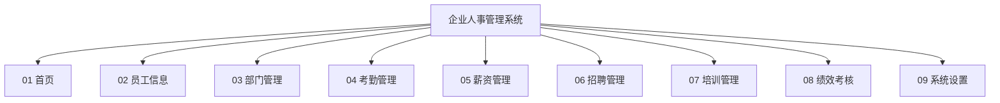

# 企业人事管理系统 需求规格说明书

> **Software Requirements Specification (SRS)**

---

## 文档信息

| 项目 | 内容 |
| --- | --- |
| 文档名称 | 企业人事管理系统 需求规格说明书 |
| 文档版本 | V1.0 |
| 文档状态 | 评审稿 |
| 编制日期 | 2026-09-14 |
| 适用系统 | Enterprise HR Management System |
| 关联资料 | `docs/functional-structure.html`（功能结构图）、`docs/functional-structure.mmd`、`docs/API.md`（接口文档）、`sql/enterprise_hr.sql`（数据库脚本） |

## 修订记录

| 版本 | 日期 | 修订说明 | 修订人 |
| --- | --- | --- | --- |
| V1.0 | 2026-09-14 | 首次编制，覆盖 9 个一级模块 / 52 项功能点 | — |

---

## 1. 引言

### 1.1 编写目的

本文档描述企业人事管理系统（以下简称"本系统"）的功能需求、用户角色、权限范围及优先级划分，作为以下工作的统一依据：

- 产品与业务方确认需求范围与验收标准；
- 研发团队进行架构设计、数据库设计与接口设计；
- 测试团队编写测试用例；
- 项目经理进行工作量评估与分期排期。

### 1.2 项目背景

企业人事管理长期依赖 Excel 台账与线下审批，存在数据分散、口径不一、流程难追溯、统计靠人工汇总等问题。随着组织规模扩大，人事数据需要与考勤、薪资、绩效、招聘等业务打通，形成"一处录入、多处复用"的统一数据源。本系统旨在建立覆盖员工全生命周期的一体化人事管理平台。

### 1.3 适用范围

本文档覆盖本系统 V1.0 至 V2.0 规划范围内的全部功能模块，包括：首页、员工信息、部门管理、考勤管理、薪资管理、招聘管理、培训管理、绩效考核、系统设置。

### 1.4 术语与缩略语

| 术语 | 说明 |
| --- | --- |
| 员工全生命周期 | 从招聘录用、入职、在职（调动/培训/考核）到离职的完整过程 |
| 逻辑删除 | 数据不物理删除，仅置删除标记位，保证历史可追溯 |
| 编制 | 部门可容纳的人员数量上限 |
| 排班 | 按班组/班次安排员工出勤时间的规则 |
| 薪资条 | 员工个人当期薪酬明细凭证 |
| 绩效面谈 | 考核人与被考核人就考核结果进行的沟通记录 |
| RBAC | 基于角色的访问控制（Role-Based Access Control） |
| MoSCoW | 需求优先级排序方法：Must / Should / Could / Won't |

### 1.5 优先级说明

本文档采用 MoSCoW 方法定义四级优先级：

| 优先级 | 名称 | 含义 | 处理策略 |
| --- | --- | --- | --- |
| **P0** | 必须实现 Must have | 系统上线的必要条件，缺失将导致核心业务无法运转 | 第一期交付，不可裁剪 |
| **P1** | 重要 Should have | 显著提升业务效率与数据完整性，重要性次于 P0 | 第一期收尾或第二期交付 |
| **P2** | 期望 Could have | 体验优化与效率增强，业务可在无此功能时正常运转 | 第二期及以后按资源排期 |
| **P3** | 暂缓 Won't have now | 本期明确不做，列入后续版本规划 | 暂不排期 |

---

## 2. 系统概述

### 2.1 系统定位

面向企业人力资源部门与全体员工的内部管理平台，以**员工主数据**为核心，向下支撑部门组织架构，向上驱动考勤、薪资、绩效、招聘、培训六大业务域，最终通过首页看板为管理层提供决策视图。

### 2.2 系统目标

| 序号 | 目标 | 衡量指标 |
| --- | --- | --- |
| G1 | 员工数据统一管理，消除多套台账 | 员工信息一份数据源，重复录入率降为 0 |
| G2 | 人事业务流程线上化、可追溯 | 入职/离职/调动/请假等流程线上化率 ≥ 90% |
| G3 | 薪资核算自动化 | 薪资核算由人工 1 天缩短至 1 小时内 |
| G4 | 考勤数据与薪资、绩效打通 | 考勤结果自动参与薪资核算与绩效扣分 |
| G5 | 分级授权，数据安全可控 | 员工仅可见本人数据，主管仅可见本部门数据 |

### 2.3 总体功能结构

系统采用三层功能结构：**系统层（1）→ 模块层（9）→ 功能项层（52）**。



> 完整结构图（含全部 52 项子功能）见 `docs/functional-structure.html`。

### 2.4 用户角色定义

系统共定义 **5 个核心角色**，另设 **1 个可选管理角色**（面向决策层，可在第二期启用）。

| 角色编号 | 角色名称 | 英文标识 | 职责概述 | 典型用户 |
| --- | --- | --- | --- | --- |
| R1 | 系统管理员 | `ROLE_ADMIN` | 负责系统基础配置：用户账号、角色权限、菜单、数据字典、参数配置及操作日志审计；不参与人事业务审批 | IT 运维 / 系统管理员 |
| R2 | 人事专员 | `ROLE_HR` | 员工全生命周期管理（入转调离）、部门与岗位维护、招聘与培训组织、考勤汇总、薪资核算与发放 | HR 部门员工 |
| R3 | 部门主管 | `ROLE_MANAGER` | 本部门员工信息查看、考勤与请假审批、绩效指标设定与评分、面谈记录、本部门招聘需求提报 | 各部门负责人 |
| R4 | 财务人员 | `ROLE_FINANCE` | 薪资标准维护、薪资核算复核与发放、社保公积金与个税申报数据生成 | 财务部门员工 |
| R5 | 普通员工 | `ROLE_EMPLOYEE` | 查看个人档案与薪资条、考勤打卡、请假/加班/出差申请、培训报名、查看个人绩效结果 | 全体员工 |
| R6 | 决策层（可选） | `ROLE_EXECUTIVE` | 跨部门数据看板与报表分析，查看人力成本、编制占用、绩效分布等汇总指标 | 高管 / 总经理 |

**角色继承与数据范围**：

| 角色 | 数据范围 | 说明 |
| --- | --- | --- |
| R1 系统管理员 | 全系统（不含业务数据明细） | 可管理账号与权限，业务数据默认只读 |
| R2 人事专员 | 全公司 | 全量员工数据 |
| R3 部门主管 | 本部门（含下级部门） | 通过部门树递归获取数据范围 |
| R4 财务人员 | 全公司（薪资相关） | 仅薪资、社保、个税相关字段 |
| R5 普通员工 | 仅本人 | 强制行级数据隔离 |
| R6 决策层 | 全公司（只读汇总） | 仅看聚合指标，不可见个人敏感信息 |

### 2.5 角色—模块权限矩阵

图例：**●** 完全管理（增删改查） · **◐** 部分操作（受数据范围限制） · **△** 审批权 · **○** 仅查看 · **—** 无权限

| 模块 | R1 系统管理员 | R2 人事专员 | R3 部门主管 | R4 财务人员 | R5 普通员工 | R6 决策层 |
| --- | :---: | :---: | :---: | :---: | :---: | :---: |
| 01 首页 | ● | ● | ◐ | ◐ | ◐ | ● |
| 02 员工信息 | ○ | ● | ◐ | ○ | ○ | ○ |
| 03 部门管理 | ○ | ● | ◐ | — | — | ○ |
| 04 考勤管理 | ○ | ● | ◐ △ | ○ | ◐ | ○ |
| 05 薪资管理 | ○ | ◐ | ◐ | ● | ○ | ○ |
| 06 招聘管理 | — | ● | ◐ △ | — | ○ | ○ |
| 07 培训管理 | — | ● | ◐ | — | ◐ | ○ |
| 08 绩效考核 | ○ | ◐ | ● △ | — | ○ | ○ |
| 09 系统设置 | ● | — | — | — | — | ○ |

**矩阵补充说明**：

1. **薪资字段级隔离**：R3 部门主管仅可查看本部门薪资**汇总**，不可见员工个人薪资明细；R5 普通员工仅可查看本人薪资条。
2. **审批链**：请假、加班、出差、录用等申请统一走「直属主管 → 人事专员 → （涉及薪资时）财务」链路，全流程留痕。
3. **权限可配置**：R1 可通过「系统设置 → 角色权限」调整上述矩阵，矩阵为默认初始值。

---

## 3. 功能需求

> 功能编号规则：`F-<模块编号>-<序号>`。每个模块先给出功能清单表，再补充关键业务规则。

### 3.1 首页（F-01）

**模块目标**：作为统一工作台入口，聚合待办、公告与核心指标，使不同角色登录后第一时间看到与自己相关的信息。

| 功能编号 | 功能名称 | 功能描述 | 主要角色 | 优先级 |
| --- | --- | --- | --- | :---: |
| F-01-01 | 数据概览 | 卡片式展示在职人数、本月入职/离职数、部门数、编制占用率、当月考勤异常数等关键指标 | R2 / R6 | P1 |
| F-01-02 | 待办事项 | 聚合待我审批（请假/加班/出差/录用）、待我处理（转正/合同到期/绩效评分）的任务清单，支持一键跳转处理 | R3 / R2 | P1 |
| F-01-03 | 通知公告 | 发布公司制度、放假通知等公告，支持置顶、定向发布（全体/指定部门）与已读回执 | R1 / R2 | P1 |
| F-01-04 | 图表分析 | 以折线/柱状/饼图呈现人员流动趋势、部门人数分布、人力成本趋势、绩效等级分布 | R6 / R2 | P2 |
| F-01-05 | 快捷入口 | 展示高频功能入口（打卡、请假申请、薪资条、员工新增），支持按角色个性化配置 | 全部 | P2 |

**关键业务规则**

- BR-01-01：首页指标卡按角色数据范围过滤，R3 只统计本部门，R5 只统计本人。
- BR-01-02：待办数量需实时刷新（进入页面加载 + 手动刷新），不依赖定时任务。
- BR-01-03：公告支持定时发布与自动下架。

---

### 3.2 员工信息（F-02）

**模块目标**：建立员工主数据，覆盖从入职到离职的全生命周期档案管理，是全系统的基础数据源。

| 功能编号 | 功能名称 | 功能描述 | 主要角色 | 优先级 |
| --- | --- | --- | --- | :---: |
| F-02-01 | 员工档案 | 维护员工基本信息（工号、姓名、性别、年龄、联系方式、学历、部门、岗位、入职日期、薪资、在职状态），支持附件上传（身份证、学历证明） | R2 | P0 |
| F-02-02 | 入职办理 | 新增员工登记，自动生成工号、绑定部门与岗位、设定薪资标准，并触发账号开通与试用期提醒 | R2 | P0 |
| F-02-03 | 调动转岗 | 办理部门调动、岗位调整、职级晋升，保留调动历史轨迹 | R2 / R3 | P1 |
| F-02-04 | 离职办理 | 离职申请与审批、离职面谈记录、工作交接确认、账号停用、离职原因归类 | R2 / R3 | P0 |
| F-02-05 | 合同管理 | 劳动合同签订、续签、变更、到期预警（提前 30/60 天提醒） | R2 | P1 |
| F-02-06 | 员工查询 | 多条件组合查询（工号/姓名/部门/岗位/状态）+ 关键字模糊搜索 + 分页，支持导出 Excel | R2 / R3 | P0 |

**关键业务规则**

- BR-02-01：**工号全局唯一且不可修改**，由系统按规则自动生成（如 `E` + 4 位流水号）。
- BR-02-02：新增员工时**姓名、工号、部门、岗位为必填**；薪资不得为负数。
- BR-02-03：删除员工采用**逻辑删除**，历史考勤、薪资、绩效数据保留可追溯。
- BR-02-04：员工状态变更（在职 ↔ 离职）需留下操作人、操作时间与原因。
- BR-02-05：手机号、邮箱需符合格式校验；身份证号需通过校验位校验（P1）。

---

### 3.3 部门管理（F-03）

**模块目标**：维护组织结构，为数据范围控制、考勤统计、薪资归集提供组织维度依据。

| 功能编号 | 功能名称 | 功能描述 | 主要角色 | 优先级 |
| --- | --- | --- | --- | :---: |
| F-03-01 | 组织架构 | 以树形结构展示公司—事业部—部门—班组的层级关系，支持展开/折叠与拖拽调整 | R2 / R6 | P0 |
| F-03-02 | 部门维护 | 部门的新增、修改、停用、合并、撤销，维护部门编码、名称、上级部门、排序、负责人 | R2 | P0 |
| F-03-03 | 岗位管理 | 维护岗位序列与岗位职责，供员工信息与招聘需求引用 | R2 | P1 |
| F-03-04 | 人员编制 | 设定部门编制上限，实时统计在职人数与编制占用率，超编预警 | R2 / R6 | P2 |
| F-03-05 | 部门负责人 | 指定/变更部门负责人，作为审批链路由依据 | R2 | P1 |

**关键业务规则**

- BR-03-01：部门编码全局唯一；部门名称在同一上级下不可重复。
- BR-03-02：**部门下存在在职员工时禁止删除**，仅允许停用或先转移人员。
- BR-03-03：部门树深度建议不超过 5 层，超出时给出提示。
- BR-03-04：部门负责人变更后，审批路由即时生效，在途流程按发起时的负责人继续（可配置）。

---

### 3.4 考勤管理（F-04）

**模块目标**：采集出勤数据，支撑薪资核算中的考勤扣款与加班费计算，并为绩效提供出勤依据。

| 功能编号 | 功能名称 | 功能描述 | 主要角色 | 优先级 |
| --- | --- | --- | --- | :---: |
| F-04-01 | 打卡记录 | 记录上下班打卡时间与地点，支持补卡申请与审批；自动判定迟到、早退、缺卡 | R5 / R2 | P0 |
| F-04-02 | 请假申请 | 支持年假、事假、病假、婚假、产假等假别的申请与多级审批，自动扣减假期余额并联动考勤 | R5 / R3 | P0 |
| F-04-03 | 加班申请 | 加班申请与审批，区分工作日/休息日/法定节假日，按规则自动折算加班时长 | R5 / R3 | P1 |
| F-04-04 | 出差管理 | 出差申请与审批、出差行程登记，出差期间视为出勤 | R5 / R3 | P1 |
| F-04-05 | 排班管理 | 按部门/班组配置班次（如标准班、早晚班），生成排班表并据此判定考勤 | R2 / R3 | P2 |
| F-04-06 | 考勤统计 | 按人/部门/时间区间汇总出勤天数、异常次数、假期使用情况，输出月报并推送至薪资模块 | R2 / R3 | P0 |

**关键业务规则**

- BR-04-01：请假申请**禁止时间区间重叠**，且起止时间不得跨越已归档的考勤月份。
- BR-04-02：假期余额不足时禁止提交申请（可配置为允许超请并标记）。
- BR-04-03：考勤统计结果按月封账，封账后不可修改，如需调整需走"考勤调整"审批并记录原因。
- BR-04-04：加班时长折算规则（是否计薪、是否可调休）由「系统设置 → 参数配置」维护。

---

### 3.5 薪资管理（F-05）

**模块目标**：实现薪资标准化、自动化核算与合规发放，是本系统数据敏感度最高的模块。

| 功能编号 | 功能名称 | 功能描述 | 主要角色 | 优先级 |
| --- | --- | --- | --- | :---: |
| F-05-01 | 薪资标准 | 维护薪资结构（基本工资、岗位工资、绩效工资、补贴项）与员工薪资标准，支持按职级模板套用与调薪记录 | R4 / R2 | P0 |
| F-05-02 | 薪资核算 | 按月自动计算应发工资：基本薪资 + 加班费 + 补贴 − 考勤扣款 − 社保个人部分 − 个税；支持人工调整项与复核 | R4 | P0 |
| F-05-03 | 薪资发放 | 生成发放批次、对接银行代发文件、标记发放状态、支持失败重发与回执回写 | R4 | P0 |
| F-05-04 | 社保公积金 | 维护参保基数与比例，自动计算企业/个人缴纳额，生成增减员报表 | R4 | P1 |
| F-05-05 | 个税申报 | 按累计预扣法计算个人所得税，生成专项附加扣除台账与申报明细表 | R4 | P1 |
| F-05-06 | 薪资条查询 | 员工在线查看历史各月薪资条明细，支持下载与密码验证 | R5 | P0 |

**关键业务规则**

- BR-05-01：**薪资数据字段级加密存储**，传输采用 HTTPS，仅授权角色可见明文。
- BR-05-02：薪资核算必须以已封账的考勤月报为输入，考勤未封账时禁止启动核算。
- BR-05-03：核算完成后需经**复核**（R4 复核或 R2 审批）方可发放，复核人与核算人不得为同一账号。
- BR-05-04：薪资一经发放，仅允许通过"薪资调整单"在下期补发/扣回，禁止直接修改历史记录。
- BR-05-05：所有薪资数据的查看、导出操作均写入审计日志。

---

### 3.6 招聘管理（F-06）

**模块目标**：管理从需求提报到录用的招聘全流程，并与员工信息模块打通（录用后一键转入职）。

| 功能编号 | 功能名称 | 功能描述 | 主要角色 | 优先级 |
| --- | --- | --- | --- | :---: |
| F-06-01 | 招聘需求 | 部门提报招聘需求（岗位、人数、任职要求、期望到岗时间），经审批后形成招聘计划 | R3 / R2 | P1 |
| F-06-02 | 职位发布 | 生成并管理招聘渠道发布内容，记录各渠道投递量 | R2 | P1 |
| F-06-03 | 简历筛选 | 简历录入/导入、结构化解析、按条件筛选与打标，推动候选人至下一环节 | R2 | P1 |
| F-06-04 | 面试安排 | 安排面试轮次、时间、面试官，记录面试评价与评分 | R2 / R3 | P1 |
| F-06-05 | 录用审批 | 提交录用申请（岗位、薪资、到岗日期），走审批流并生成 Offer | R2 / R3 | P1 |
| F-06-06 | 人才库 | 沉淀未录用但合适的候选人，支持按技能/岗位标签检索与二次激活 | R2 | P2 |

**关键业务规则**

- BR-06-01：候选人状态流转为：待筛选 → 待面试 → 面试中 → 待录用 → 已录用 / 已淘汰，状态变更需留痕。
- BR-06-02：**候选中不占用编制**，仅在「已录用」后计入招聘需求完成数并对接编制模块。
- BR-06-03：录用审批通过后可一键推送至「员工信息 → 入职办理」，自动带入候选人基础信息。

---

### 3.7 培训管理（F-07）

**模块目标**：沉淀培训资源、组织培训活动、记录培训成果，为员工能力发展提供支撑。

| 功能编号 | 功能名称 | 功能描述 | 主要角色 | 优先级 |
| --- | --- | --- | --- | :---: |
| F-07-01 | 培训计划 | 制定年度/季度培训计划（主题、对象、预算、时间），支持按部门下发 | R2 | P2 |
| F-07-02 | 课程管理 | 维护线上/线下课程资料（课件、视频、文档），设置课程分类与学时 | R2 | P2 |
| F-07-03 | 讲师管理 | 维护内部讲师库与外部讲师信息，记录授课经历与评价 | R2 | P2 |
| F-07-04 | 报名签到 | 员工在线报名、名额控制、扫码/手动签到、请假与取消 | R2 / R5 | P2 |
| F-07-05 | 培训考核 | 培训后测验或满意度评价，记录成绩与合格判定 | R2 / R5 | P3 |
| F-07-06 | 培训档案 | 归档员工参训记录、学时统计、证书信息，作为晋升参考 | R2 / R3 | P2 |

**关键业务规则**

- BR-07-01：报名人数达上限后自动关闭报名，可开启候补队列。
- BR-07-02：培训档案写入员工个人档案，员工可自助查看。
- BR-07-03：培训考核结果（P3）不影响薪资，仅作为能力档案记录。

---

### 3.8 绩效考核（F-08）

**模块目标**：建立目标设定—过程跟踪—结果评估—面谈反馈的闭环绩效管理机制。

| 功能编号 | 功能名称 | 功能描述 | 主要角色 | 优先级 |
| --- | --- | --- | --- | :---: |
| F-08-01 | 考核方案 | 配置考核周期（月度/季度/年度）、考核对象范围、评分规则与等级分布比例 | R2 | P1 |
| F-08-02 | 指标设置 | 支持 KPI / OKR 指标录入，设定权重、目标值与评分标准，支持部门主管下达与员工确认 | R3 / R5 | P1 |
| F-08-03 | 绩效评分 | 员工自评 → 主管评分 → （可选）隔级复核，系统按权重自动计算总分与等级 | R3 / R5 | P1 |
| F-08-04 | 绩效面谈 | 记录面谈时间、改进建议、下期目标，形成面谈纪要 | R3 | P1 |
| F-08-05 | 结果归档 | 考核结果确认、申诉处理、归档锁定，作为调薪与晋升依据 | R2 | P1 |
| F-08-06 | 绩效分析 | 统计各部门绩效等级分布、平均分、评级趋势，输出分析报表 | R2 / R6 | P2 |

**关键业务规则**

- BR-08-01：评分完成后须经**结果确认**环节，员工可在规定期限内提出申诉，申诉由指定角色处理。
- BR-08-02：绩效结果归档后锁定，如需修改必须走调整流程并保留历史版本。
- BR-08-03：绩效等级分布可按方案强制比例（如 20%/70%/10%）校验，超比例时提示或阻断（可配置）。
- BR-08-04：绩效结果可用于薪资模块绩效工资计算（联动关系可配置）。

---

### 3.9 系统设置（F-09）

**模块目标**：提供账号、权限、字典、参数与日志等基础能力，保障系统安全稳定运行。

| 功能编号 | 功能名称 | 功能描述 | 主要角色 | 优先级 |
| --- | --- | --- | --- | :---: |
| F-09-01 | 用户管理 | 账号新增/停用/重置密码、绑定员工与部门、锁定与解锁 | R1 | P0 |
| F-09-02 | 角色权限 | 角色定义与菜单/按钮/数据级权限分配，支持角色复制与互斥校验 | R1 | P0 |
| F-09-03 | 菜单管理 | 维护菜单树、路由、图标与排序，控制菜单可见性 | R1 | P1 |
| F-09-04 | 数据字典 | 维护下拉选项类基础数据（性别、学历、假别、岗位序列等） | R1 | P1 |
| F-09-05 | 参数配置 | 维护业务参数：加班折算规则、考勤封账日、合同到期预警天数、个税起征点等 | R1 | P1 |
| F-09-06 | 日志审计 | 记录登录日志与操作日志（操作人、时间、IP、模块、行为、结果），支持检索与导出 | R1 | P1 |

**关键业务规则**

- BR-09-01：密码需满足复杂度要求（长度 ≥ 8，含大小写字母与数字），连续登录失败 5 次锁定 30 分钟。
- BR-09-02：**管理员不可删除自身账号**，也不可取消自身的管理员角色（防止权限丢失）。
- BR-09-03：日志保留不少于 12 个月，薪资与权限相关的敏感操作日志保留不少于 3 年。
- BR-09-04：数据字典被业务数据引用时禁止删除该字典项，仅可停用。

---

## 4. 功能优先级与实施计划

### 4.1 功能点统计

| 模块 | 功能项数 | P0 | P1 | P2 | P3 |
| --- | :---: | :---: | :---: | :---: | :---: |
| 01 首页 | 5 | 0 | 3 | 2 | 0 |
| 02 员工信息 | 6 | 4 | 2 | 0 | 0 |
| 03 部门管理 | 5 | 2 | 2 | 1 | 0 |
| 04 考勤管理 | 6 | 3 | 2 | 1 | 0 |
| 05 薪资管理 | 6 | 4 | 2 | 0 | 0 |
| 06 招聘管理 | 6 | 0 | 5 | 1 | 0 |
| 07 培训管理 | 6 | 0 | 0 | 5 | 1 |
| 08 绩效考核 | 6 | 0 | 5 | 1 | 0 |
| 09 系统设置 | 6 | 2 | 4 | 0 | 0 |
| **合计** | **52** | **15** | **25** | **11** | **1** |

**优先级占比**：P0 占 28.8%，P1 占 48.1%，P2 占 21.2%，P3 占 1.9%。符合"先打通核心主数据与考勤薪资链路，再做过程管理与体验优化"的建设节奏。

### 4.2 分期实施建议

| 阶段 | 版本 | 交付范围 | 交付判定标准 |
| --- | --- | --- | --- |
| 第一期 | V1.0 | **系统设置（用户/角色）+ 部门管理 + 员工信息 + 考勤管理（打卡/请假/统计）+ 薪资管理（标准/核算/发放/薪资条）** 全部 P0 功能 | 可实现"入职→打卡请假→考勤汇总→薪资核算发放→员工查薪资条"完整闭环 |
| 第二期 | V1.1 | 全部 P1 功能：首页看板与待办、合同管理、调动转岗、加班/出差、社保公积金、个税申报、招聘全流程、绩效全流程、菜单与字典与日志 | 人事业务流程线上化率 ≥ 90%，管理驾驶舱可用 |
| 第三期 | V2.0 | P2 功能：图表分析、快捷入口、人员编制、排班管理、人才库、培训管理、绩效分析 | 体验优化与数据洞察能力完善 |
| 后续规划 | V2.x | P3 功能：培训考核 及后续新增需求 | 按业务反馈排期 |

### 4.3 优先级汇总清单（P0 关键路径）

系统上线的**关键路径**为下列 15 项 P0 功能，任一项缺失均导致闭环无法跑通：

| 序号 | 功能编号 | 功能名称 | 所属模块 |
| :---: | --- | --- | --- |
| 1 | F-09-01 | 用户管理 | 系统设置 |
| 2 | F-09-02 | 角色权限 | 系统设置 |
| 3 | F-03-01 | 组织架构 | 部门管理 |
| 4 | F-03-02 | 部门维护 | 部门管理 |
| 5 | F-02-01 | 员工档案 | 员工信息 |
| 6 | F-02-02 | 入职办理 | 员工信息 |
| 7 | F-02-04 | 离职办理 | 员工信息 |
| 8 | F-02-06 | 员工查询 | 员工信息 |
| 9 | F-04-01 | 打卡记录 | 考勤管理 |
| 10 | F-04-02 | 请假申请 | 考勤管理 |
| 11 | F-04-06 | 考勤统计 | 考勤管理 |
| 12 | F-05-01 | 薪资标准 | 薪资管理 |
| 13 | F-05-02 | 薪资核算 | 薪资管理 |
| 14 | F-05-03 | 薪资发放 | 薪资管理 |
| 15 | F-05-06 | 薪资条查询 | 薪资管理 |

---

## 5. 非功能需求

### 5.1 性能需求

| 编号 | 需求项 | 指标 |
| --- | --- | --- |
| NF-01 | 页面响应时间 | 常规列表页 ≤ 2s（1000 条数据内），复杂统计报表 ≤ 5s |
| NF-02 | 接口响应时间 | 单表 CRUD 接口 P95 ≤ 300ms；批量核算接口按异步任务处理 |
| NF-03 | 并发能力 | 支持 500 人同时在线，考勤打卡高峰（如 9:00）并发 ≥ 200 TPS |
| NF-04 | 数据容量 | 支持 10 万级员工、千万级考勤记录，分页查询不劣化 |
| NF-05 | 批量处理 | 薪资核算支持 5000 人规模在 5 分钟内完成 |

### 5.2 安全需求

| 编号 | 需求项 | 说明 |
| --- | --- | --- |
| NF-06 | 身份认证 | 账号密码登录，密码加盐哈希存储；连续失败锁定 |
| NF-07 | 访问控制 | RBAC 三层控制：菜单权限、按钮权限、数据权限（行级） |
| NF-08 | 数据加密 | 薪资、身份证号、银行卡号等敏感字段加密存储；传输启用 HTTPS |
| NF-09 | 审计追溯 | 登录日志与关键操作日志全量留痕，不可篡改，可导出 |
| NF-10 | 数据隔离 | 普通员工强制仅可见本人数据，越权访问返回 403 并记录日志 |

### 5.3 可用性与易用性需求

| 编号 | 需求项 | 说明 |
| --- | --- | --- |
| NF-11 | 界面一致性 | 统一组件库与交互规范，表单校验即时反馈错误原因 |
| NF-12 | 操作可撤销 | 删除类操作二次确认，采用逻辑删除以支持数据恢复 |
| NF-13 | 错误提示 | 错误信息需业务语义化（如"工号已存在"），不得直接暴露堆栈 |
| NF-14 | 兼容性 | 支持 Chrome / Edge 最近两个大版本；管理端最低分辨率 1366×768 |

### 5.4 可维护性与可扩展性

| 编号 | 需求项 | 说明 |
| --- | --- | --- |
| NF-15 | 编码规范 | 分层清晰：Controller / Service / Mapper / Entity / DTO / VO 分离 |
| NF-16 | 统一响应 | 接口统一返回 `{code, message, data}` 三段式结构 |
| NF-17 | 统一异常 | 全局异常处理器统一转换为标准错误码与业务提示 |
| NF-18 | 可配置性 | 业务规则（加班折算、封账日、预警天数）通过参数配置，避免硬编码 |
| NF-19 | 日志规范 | 系统日志分级输出，支持按 traceId 串联单次请求全链路 |

---

## 6. 数据需求概述

### 6.1 核心实体

| 实体 | 说明 | 关键字段 | 关联实体 |
| --- | --- | --- | --- |
| 员工 Employee | 员工主数据 | 工号（唯一）、姓名、部门、岗位、入职日期、状态 | 部门、岗位、考勤、薪资、绩效 |
| 部门 Dept | 组织结构 | 部门编码、名称、上级部门、负责人 | 员工、编制、招聘需求 |
| 岗位 Position | 岗位序列 | 岗位编码、名称、序列、职责 | 员工、招聘需求 |
| 考勤记录 Attendance | 出勤明细 | 员工、日期、上下班时间、异常类型 | 员工、请假单 |
| 请假单 LeaveRequest | 请假申请 | 员工、假别、起止时间、审批状态 | 员工、假期余额 |
| 薪资记录 SalaryRecord | 月度薪资 | 员工、薪资月份、应发、实发、各扣款项 | 员工、考勤月报 |
| 招聘需求 RecruitRequest | 招聘申请 | 部门、岗位、人数、状态 | 部门、岗位、候选人 |
| 候选人 Candidate | 应聘者 | 姓名、联系方式、简历、阶段状态 | 招聘需求 |
| 培训记录 TrainingRecord | 参训记录 | 员工、课程、学时、成绩 | 员工、课程 |
| 考核记录 PerformanceRecord | 绩效结果 | 员工、周期、指标得分、总分、等级 | 员工、考核方案 |
| 系统用户 SysUser | 账号 | 登录名、密码哈希、状态、绑定员工 | 角色 |
| 角色 Role | 角色与权限 | 角色编码、名称、权限集合 | 用户、菜单 |

### 6.2 数据量与增长预估

| 数据对象 | 初始量 | 年增长 | 保留策略 |
| --- | --- | --- | --- |
| 员工档案 | 1,000 | +200/年 | 永久保留（含离职） |
| 考勤记录 | 250,000/年（1000 人） | 同上 | 在线保留 3 年，之后归档 |
| 薪资记录 | 12,000/年 | 同上 | 永久保留 |
| 操作日志 | 1,000,000/年 | 同上 | 在线 12 个月，之后归档 |

### 6.3 数据完整性要求

- 工号、部门编码、岗位编码、登录名均为**唯一约束**；
- 所有业务表保留 `created_at` / `updated_at` 字段，写入时自动填充；
- 删除一律采用**逻辑删除**（`deleted` 标记位），保证历史可追溯；
- 员工与薪资记录为**一对多**关系，薪资记录必须关联有效员工。

---

## 7. 接口需求概述

### 7.1 系统对外接口

| 接口类型 | 用途 | 说明 |
| --- | --- | --- |
| RESTful API | 前后端数据交互 | 统一前缀 `/api`，统一响应结构 `{code, message, data}`，支持分页查询 |
| 文件上传/下载 | 附件、简历、薪资条、报表导出 | 限制文件类型与大小，导出文件加时效水印 |

**典型接口清单（已实现部分）**

| 方法 | 路径 | 说明 |
| --- | --- | --- |
| GET | `/api/employees` | 员工列表 |
| GET | `/api/employees/{id}` | 员工详情 |
| GET | `/api/employees/by-emp-no/{empNo}` | 按工号查询 |
| GET | `/api/employees/page?current=1&size=10&keyword=` | 分页 + 关键字查询 |
| POST | `/api/employees` | 新增员工 |
| PUT | `/api/employees/{id}` | 修改员工 |
| DELETE | `/api/employees/{id}` | 删除员工（逻辑删除） |
| DELETE | `/api/employees/batch` | 批量删除 |
| GET | `/api/depts` | 部门列表 |

> 详细定义见 `docs/API.md`。

### 7.2 外部集成接口

| 集成对象 | 用途 | 优先级 |
| --- | --- | --- |
| 考勤机 / 门禁设备 | 同步打卡原始记录 | P1 |
| 银行代发系统 | 生成并对接薪资代发文件 | P1 |
| 电子签平台 | 劳动合同在线签署 | P2 |
| 短信/邮件网关 | 通知公告、审批提醒、预警推送 | P1 |
| 招聘渠道（招聘网站 API） | 职位发布与简历回收 | P2 |
| 税务申报系统 | 个税申报数据导出 | P2 |

---

## 8. 约束与假设

| 编号 | 类型 | 内容 |
| --- | --- | --- |
| C-01 | 约束 | 系统面向企业内部网络，不对外开放注册 |
| C-02 | 约束 | 薪资模块须满足国家个税与社会保险相关法规要求 |
| C-03 | 约束 | 员工敏感信息（薪资、身份证号）须加密存储 |
| C-04 | 约束 | 需兼容主流浏览器，不强制要求 IE |
| A-01 | 假设 | 企业已有统一的组织架构与职级体系定义 |
| A-02 | 假设 | 考勤机等硬件设备支持标准数据导出或接口对接 |
| A-03 | 假设 | 各部门指定专人负责本部门数据的及时维护 |
| A-04 | 假设 | 员工账号由系统管理员统一开通，不开放自助注册 |

---

## 附录 A：功能编号索引

| 模块 | 编号区间 | 功能数 |
| --- | --- | :---: |
| 首页 | F-01-01 ~ F-01-05 | 5 |
| 员工信息 | F-02-01 ~ F-02-06 | 6 |
| 部门管理 | F-03-01 ~ F-03-05 | 5 |
| 考勤管理 | F-04-01 ~ F-04-06 | 6 |
| 薪资管理 | F-05-01 ~ F-05-06 | 6 |
| 招聘管理 | F-06-01 ~ F-06-06 | 6 |
| 培训管理 | F-07-01 ~ F-07-06 | 6 |
| 绩效考核 | F-08-01 ~ F-08-06 | 6 |
| 系统设置 | F-09-01 ~ F-09-06 | 6 |
| **合计** | — | **52** |

## 附录 B：功能结构图

```
企业人事管理系统
├── 01 首页 ────────── 数据概览 / 待办事项 / 通知公告 / 图表分析 / 快捷入口
├── 02 员工信息 ────── 员工档案 / 入职办理 / 调动转岗 / 离职办理 / 合同管理 / 员工查询
├── 03 部门管理 ────── 组织架构 / 部门维护 / 岗位管理 / 人员编制 / 部门负责人
├── 04 考勤管理 ────── 打卡记录 / 请假申请 / 加班申请 / 出差管理 / 排班管理 / 考勤统计
├── 05 薪资管理 ────── 薪资标准 / 薪资核算 / 薪资发放 / 社保公积金 / 个税申报 / 薪资条查询
├── 06 招聘管理 ────── 招聘需求 / 职位发布 / 简历筛选 / 面试安排 / 录用审批 / 人才库
├── 07 培训管理 ────── 培训计划 / 课程管理 / 讲师管理 / 报名签到 / 培训考核 / 培训档案
├── 08 绩效考核 ────── 考核方案 / 指标设置 / 绩效评分 / 绩效面谈 / 结果归档 / 绩效分析
└── 09 系统设置 ────── 用户管理 / 角色权限 / 菜单管理 / 数据字典 / 参数配置 / 日志审计
```

> 图形化版本见 `docs/functional-structure.html` / `docs/functional-structure.png`；
> 可编辑源码见 `docs/functional-structure.mmd`。

---

**文档结束**
