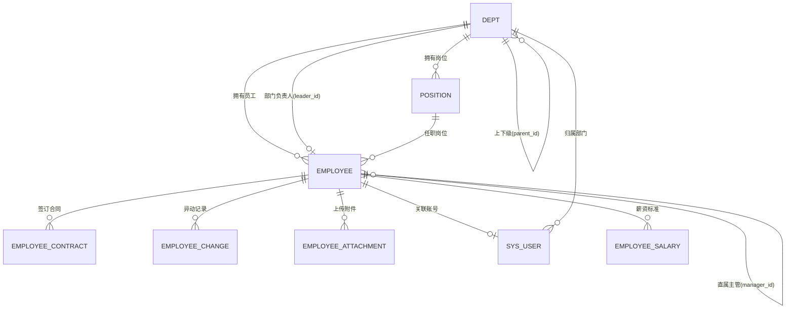

# 企业人事管理系统 数据库设计说明书

> **Database Design Specification**

---

## 文档信息

| 项目 | 内容 |
| --- | --- |
| 文档名称 | 企业人事管理系统 数据库设计说明书 |
| 文档版本 | V1.0 |
| 编制日期 | 2026-09-14 |
| 数据库名称 | `enterprise_hr` |
| 数据库版本 | MySQL 8.0.29 |
| 建表脚本 | `enterprise_hr_schema.sql`（49 张表 / 80 个外键 / 35 个唯一键） |
| 初始化数据 | `data.sql`（完整业务数据）/ `enterprise_hr_init_data.sql`（轻量基线） |
| 设计依据 | 《企业人事管理系统需求规格说明书》（9 模块 / 52 功能点）、`docs/functional-structure.html` |

## 修订记录

| 版本 | 日期 | 修订说明 |
| --- | --- | --- |
| V1.0 | 2026-09-14 | 首次编制：完成 49 张表设计，覆盖 9 大功能模块；含 E-R 关系说明、逐表字段级结构、索引与外键汇总、初始化数据说明，已在本机 MySQL 8.0.29 实测通过 |

---

## 目录

- [文档信息](#文档信息)
- [1. 概述](#1-概述)
  - [1.1 设计目标](#11-设计目标) · [1.2 设计依据](#12-设计依据) · [1.3 数据库环境](#13-数据库环境) · [1.4 设计原则](#14-设计原则)
- [2. 设计规范](#2-设计规范)
  - [2.1 命名规范](#21-命名规范) · [2.2 公共字段规范](#22-公共字段规范) · [2.3 数据类型规范](#23-数据类型规范) · [2.4 索引设计原则](#24-索引设计原则)
- [3. E-R 关系说明](#3-e-r-关系说明)
  - [3.1 实体清单](#31-实体清单49-张表按模块分组) · [3.2 核心 E-R 图](#32-核心-e-r-图) · [3.3 实体关系对照表](#33-实体关系对照表) · [3.4 关键关系说明](#34-关键关系说明) · [3.5 数据流转主链路](#35-数据流转主链路)
- [4. 表结构详细说明](#4-表结构详细说明)
  - [4.1 全部表清单总览](#41-全部表清单总览)
  - [4.2 模块 01 · 首页](#42-模块-01--首页3-张表) · [4.3 模块 02 · 员工信息](#43-模块-02--员工信息4-张表) · [4.4 模块 03 · 部门管理](#44-模块-03--部门管理2-张表)
  - [4.5 模块 04 · 考勤管理](#45-模块-04--考勤管理9-张表) · [4.6 模块 05 · 薪资管理](#46-模块-05--薪资管理6-张表) · [4.7 模块 06 · 招聘管理](#47-模块-06--招聘管理5-张表)
  - [4.8 模块 07 · 培训管理](#48-模块-07--培训管理5-张表) · [4.9 模块 08 · 绩效考核](#49-模块-08--绩效考核4-张表) · [4.10 模块 09 · 系统设置](#410-模块-09--系统设置10-张表) · [4.11 模块 00 · 公共组件](#411-模块-00--公共组件1-张表)
- [5. 索引与外键汇总](#5-索引与外键汇总)
  - [5.1 外键清单](#51-外键清单) · [5.2 唯一键清单](#52-唯一键清单) · [5.3 普通索引清单](#53-普通索引清单)
- [6. 初始化数据说明](#6-初始化数据说明)
  - [6.1 数据内容](#61-数据内容) · [6.2 演示账号](#62-演示账号) · [6.3 可重复执行](#63-可重复执行)
- [7. 部署与验证](#7-部署与验证)
  - [7.1 执行步骤](#71-执行步骤) · [7.2 校验结果（实测）](#72-校验结果实测) · [7.3 外键完整性抽样校验](#73-外键完整性抽样校验) · [7.4 与后端工程的对应关系](#74-与后端工程的对应关系)

---

## 1. 概述

### 1.1 设计目标

| 序号 | 目标 | 落地方式 |
| --- | --- | --- |
| G1 | 完整覆盖 9 大功能模块 52 项功能点 | 49 张表按模块划分，每表标注对应功能编号（如 `F-02-01`） |
| G2 | 数据关系显式化、可追溯 | 80 个外键约束 + 35 个唯一键，禁止孤儿数据 |
| G3 | 支撑员工全生命周期管理 | 员工主数据 + 异动/合同/考勤/薪资/绩效全链路关联 |
| G4 | 满足薪资数据合规要求 | 敏感字段加密列设计 + 字段级权限 + 审计日志表 |
| G5 | 兼顾查询性能 | 高频查询字段建索引，冗余快照字段减少联表 |
| G6 | 支持逻辑删除与历史追溯 | 统一 `deleted` 标记位，业务编号独立于主键 |

### 1.2 设计依据

- 《企业人事管理系统需求规格说明书》第 3 章功能需求（F-01 ~ F-09）
- 需求规格说明书第 6 章数据需求（核心实体 12 类）
- 现有系统实现：Spring Boot 3.3.4 + MyBatis-Plus 3.5.7（雪花 ID、逻辑删除、自动填充）

### 1.3 数据库环境

| 项 | 值 | 说明 |
| --- | --- | --- |
| DBMS | MySQL 8.0+ | 使用 8.0 特性：`utf8mb4_0900_ai_ci`、CHECK 约束支持 |
| 存储引擎 | InnoDB | 支持事务、行级锁、外键 |
| 字符集 | `utf8mb4` | 完整支持中文与 Emoji（4 字节） |
| 排序规则 | `utf8mb4_0900_ai_ci` | 8.0 默认，大小写不敏感、重音不敏感，性能优于 `utf8mb4_unicode_ci` |
| 时区 | Asia/Shanghai | JDBC 需带 `serverTimezone=Asia/Shanghai` |
| 连接串示例 | `jdbc:mysql://localhost:3306/enterprise_hr?useUnicode=true&characterEncoding=utf-8&useSSL=false&serverTimezone=Asia/Shanghai&allowPublicKeyRetrieval=true` | |

### 1.4 设计原则

1. **以员工主数据为中心**：`employee` 是全系统的锚点表，员工一手数据只维护一份，其余模块通过外键引用。
2. **规范化与适度反范式结合**：
   - 规范化：`position` 从 `employee` 中独立成表；`sys_dict_type/item` 统一字典；`salary_item` 拆分明细项。
   - 反范式：`employee.position` 保留职位名称快照、`salary_record.dept_id` 冗余部门 ID、`performance_record.dept_id` 冗余部门 ID —— 目的是避免列表页与统计报表的深度联表。
3. **一表一职责**：审批流用一张 `approval_record` 承载 8 类业务，避免为每种申请单建一套审批表。
4. **状态即可读性**：所有状态字段用 `TINYINT` 状态码，取值含义写入字段注释，业务含义不依赖猜。
5. **删除策略分级**：主数据一律 `RESTRICT`（禁止误删），从属明细 `CASCADE`（随主体消亡），业务数据统一逻辑删除。

---

## 2. 设计规范

### 2.1 命名规范

| 对象 | 规范 | 示例 |
| --- | --- | --- |
| 表名 | 小写下划线，业务表用单数名词；系统表前缀 `sys_` | `employee`、`salary_record`、`sys_user` |
| 字段名 | 小写下划线 | `emp_no`、`hire_date`、`created_at` |
| 主键 | 统一 `id` | `id` |
| 外键字段 | `<被引用表名>_id` | `dept_id`、`employee_id`、`plan_id` |
| 外键约束名 | `fk_<表名>_<语义>` | `fk_emp_dept` |
| 普通索引名 | `idx_<表名>_<字段>` | `idx_emp_dept` |
| 唯一键名 | `uk_<表名>_<字段>` | `uk_emp_no` |
| 布尔/状态 | `is_xxx` / `xxx_status` | `is_paid`、`pay_status` |

### 2.2 公共字段规范

除纯追加型日志表外，所有表都包含以下公共字段：

| 字段 | 类型 | 说明 |
| --- | --- | --- |
| `id` | `BIGINT AUTO_INCREMENT` | 主键。MyBatis-Plus 配置 `ASSIGN_ID` 时会写入雪花 ID，覆盖自增 |
| `deleted` | `TINYINT NOT NULL DEFAULT 0` | 逻辑删除标记，0 未删除 / 1 已删除，配合 `@TableLogic` |
| `created_at` | `DATETIME NOT NULL DEFAULT CURRENT_TIMESTAMP` | 创建时间，由数据库自动维护 |
| `updated_at` | `DATETIME NOT NULL DEFAULT CURRENT_TIMESTAMP ON UPDATE CURRENT_TIMESTAMP` | 更新时间，任何字段变更自动刷新 |
| `created_by` / `updated_by` | `BIGINT` | 操作人（仅核心业务表，如 `employee`、`employee_salary`） |

> **特例**：`sys_login_log`、`sys_oper_log`、`salary_item`、`sys_user_role` 等追加型表不含 `deleted` —— 日志与关联关系不做逻辑删除，避免"已删除的授权仍在生效"这类歧义。

### 2.3 数据类型规范

| 业务含义 | 数据类型 | 说明 |
| --- | --- | --- |
| 主键 / 外键 | `BIGINT` | 兼容雪花 ID（19 位） |
| 金额 | `DECIMAL(12,2)` | 最大约 99 亿，精确到分；禁止用 `FLOAT/DOUBLE` |
| 比例 / 费率 | `DECIMAL(6,4)` | 如 `0.1600` 表示 16% |
| 权重 / 评分 | `DECIMAL(5,2)` | 如 `70.00` 表示 70 分或 70% |
| 天数 / 学时 | `DECIMAL(6,1)` | 支持 0.5 天（半天假） |
| 状态码 | `TINYINT` | 取值含义写入注释 |
| 姓名 / 编码 | `VARCHAR(32)` | 兼顾中英文 |
| 名称 / 标题 | `VARCHAR(64 ~ 200)` | 按业务长度分级 |
| 长文本 | `TEXT` | 公告正文、岗位职责、面试评价等 |
| 日期 / 时间 | `DATE` / `DATETIME` / `TIME` | 生日用 `DATE`，时刻用 `DATETIME`，班次用 `TIME` |

### 2.4 索引设计原则

1. **唯一键优先**：业务唯一标识（工号、单号、编码、账号）一律建唯一键，既是约束也是索引。
2. **外键必建索引**：MySQL 自动为外键列创建索引，脚本中显式声明以便阅读。
3. **高频查询建组合索引**：如 `uk_salary_emp_ym (employee_id, salary_year, salary_month)`，既保证唯一又命中查询。
4. **低频枚举不建索引**：如 `gender`、`marital_status` 等低基数列不单独建索引。
5. **报表维度建索引**：`idx_salary_period (salary_year, salary_month)`、`idx_perf_record_dept (dept_id, grade)` 支撑统计报表。

---

## 3. E-R 关系说明

### 3.1 实体清单（49 张表，按模块分组）

| 模块 | 表数量 | 数据表 |
| --- | :---: | --- |
| 09 系统设置 | 10 | `sys_user`、`sys_role`、`sys_user_role`、`sys_menu`、`sys_role_menu`、`sys_dict_type`、`sys_dict_item`、`sys_config`、`sys_login_log`、`sys_oper_log` |
| 03 部门管理 | 2 | `dept`、`position` |
| 02 员工信息 | 4 | `employee`、`employee_contract`、`employee_change`、`employee_attachment` |
| 04 考勤管理 | 9 | `shift`、`leave_type`、`employee_schedule`、`attendance_record`、`attendance_month`、`leave_balance`、`leave_request`、`overtime_request`、`business_trip` |
| 05 薪资管理 | 6 | `salary_standard`、`employee_salary`、`salary_record`、`salary_item`、`insurance_config`、`insurance_record` |
| 06 招聘管理 | 5 | `recruit_request`、`job_posting`、`candidate`、`interview_record`、`offer_record` |
| 07 培训管理 | 5 | `training_plan`、`course`、`trainer`、`training_enroll`、`training_record` |
| 08 绩效考核 | 4 | `performance_plan`、`performance_indicator`、`performance_record`、`performance_interview` |
| 01 首页 / 公共 | 4 | `notice`、`notice_read`、`approval_record`、`todo_task` |
| **合计** | **49** | — |

### 3.2 核心 E-R 图

#### 3.2.1 组织与员工主数据



**读图要点**

1. `DEPT` 自关联形成组织树，`parent_id IS NULL` 表示顶级部门；同时用 `dept_path` 冗余层级路径，避免递归查询。
2. `DEPT.leader_id ↔ EMPLOYEE.dept_id` 构成**双向引用**，建表时存在循环依赖，因此 `fk_dept_leader` 在脚本末尾通过 `ALTER TABLE` 补充。
3. `EMPLOYEE.manager_id` 自关联表示汇报关系，用于审批链路由。
4. `EMPLOYEE_SALARY` 与 `EMPLOYEE` 是 1:N —— 每次调薪新增一条记录并置 `is_current = 1`，历史记录保留，实现调薪可追溯。

#### 3.2.2 业务域关系

```mermaid
erDiagram
    EMPLOYEE ||--o{ ATTENDANCE_RECORD : "每日打卡"
    EMPLOYEE ||--o{ ATTENDANCE_MONTH : "月度考勤汇总"
    EMPLOYEE ||--o{ LEAVE_REQUEST : "请假申请"
    LEAVE_TYPE ||--o{ LEAVE_REQUEST : "假别"
    EMPLOYEE ||--o{ LEAVE_BALANCE : "假期余额"
    LEAVE_TYPE ||--o{ LEAVE_BALANCE : "额度规则"
    SHIFT ||--o{ ATTENDANCE_RECORD : "班次"
    EMPLOYEE ||--o{ OVERTIME_REQUEST : "加班申请"
    EMPLOYEE ||--o{ BUSINESS_TRIP : "出差申请"

    EMPLOYEE ||--o{ SALARY_RECORD : "月度薪资"
    SALARY_RECORD ||--o{ SALARY_ITEM : "薪资明细"
    EMPLOYEE ||--o{ INSURANCE_RECORD : "社保缴纳"
    INSURANCE_CONFIG ||--o{ INSURANCE_RECORD : "缴费规则"
    SALARY_STANDARD ||--o{ EMPLOYEE_SALARY : "套用标准"

    RECRUIT_REQUEST ||--o{ JOB_POSTING : "职位发布"
    RECRUIT_REQUEST ||--o{ CANDIDATE : "候选人"
    CANDIDATE ||--o{ INTERVIEW_RECORD : "面试记录"
    CANDIDATE ||--o| OFFER_RECORD : "录用通知"
    RECRUIT_REQUEST ||--o{ OFFER_RECORD : "录用归属"

    TRAINING_PLAN ||--o{ TRAINING_ENROLL : "报名"
    COURSE ||--o{ TRAINING_ENROLL : "课程"
    TRAINER ||--o{ COURSE : "授课"
    EMPLOYEE ||--o{ TRAINING_RECORD : "培训档案"

    PERFORMANCE_PLAN ||--o{ PERFORMANCE_RECORD : "考核记录"
    PERFORMANCE_PLAN ||--o{ PERFORMANCE_INDICATOR : "考核指标"
    PERFORMANCE_RECORD ||--o{ PERFORMANCE_INTERVIEW : "绩效面谈"

    NOTICE ||--o{ NOTICE_READ : "已读回执"
```



### 3.3 实体关系对照表

| 序号 | 关系（A → B） | 基数 | 外键 | 业务含义 |
| :---: | --- | :---: | --- | --- |
| 1 | `dept` → `dept` | 1 : N | `parent_id` | 组织树上下级 |
| 2 | `dept` → `employee` | 1 : N | `dept_id` | 部门拥有员工 |
| 3 | `employee` → `dept` | N : 1 | `leader_id` | 部门负责人（反向引用） |
| 4 | `dept` → `position` | 1 : N | `dept_id` | 部门下设岗位 |
| 5 | `position` → `employee` | 1 : N | `position_id` | 员工任职岗位 |
| 6 | `employee` → `employee` | 1 : N | `manager_id` | 直属主管（自关联） |
| 7 | `employee` → `employee_contract` | 1 : N | `employee_id` | 一人多份合同（含续签） |
| 8 | `employee` → `employee_change` | 1 : N | `employee_id` | 一人多次异动 |
| 9 | `employee` → `employee_salary` | 1 : N | `employee_id` | 一人多条薪资标准（调薪历史） |
| 10 | `employee` → `sys_user` | 1 : 0..1 | `employee_id` | 员工与登录账号一一对应（可无） |
| 11 | `sys_user` ↔ `sys_role` | N : M | 中间表 `sys_user_role` | 用户可多角色 |
| 12 | `sys_role` ↔ `sys_menu` | N : M | 中间表 `sys_role_menu` | 角色可多菜单权限 |
| 13 | `sys_dict_type` → `sys_dict_item` | 1 : N | `dict_type_id` | 字典类型下的字典项 |
| 14 | `employee` → `leave_request` | 1 : N | `employee_id` | 一人多次请假 |
| 15 | `leave_type` → `leave_balance` | 1 : N | `leave_type_id` | 各假别的年度额度 |
| 16 | `shift` → `attendance_record` | 1 : N | `shift_id` | 班次决定考勤判定标准 |
| 17 | `employee` → `attendance_record` | 1 : N | `employee_id` | 一人一天一条（唯一键约束） |
| 18 | `employee` → `salary_record` | 1 : N | `employee_id` | 一人一月一条（唯一键约束） |
| 19 | `salary_record` → `salary_item` | 1 : N | `salary_record_id` | 薪资条明细项 |
| 20 | `insurance_config` → `insurance_record` | 1 : N | `config_id` | 缴费比例规则实例化 |
| 21 | `recruit_request` → `candidate` | 1 : N | `recruit_request_id` | 一个需求多个候选人 |
| 22 | `candidate` → `interview_record` | 1 : N | `candidate_id` | 多轮面试 |
| 23 | `candidate` → `offer_record` | 1 : 0..1 | `candidate_id` | 录用才产生 Offer |
| 24 | `trainer` → `course` | 1 : N | `trainer_id` | 讲师授课 |
| 25 | `training_plan` → `training_enroll` | 1 : N | `plan_id` | 计划下报名记录 |
| 26 | `performance_plan` → `performance_record` | 1 : N | `plan_id` | 方案下考核记录（+ 员工唯一） |
| 27 | `performance_record` → `performance_interview` | 1 : N | `record_id` | 考核后面谈 |
| 28 | `notice` → `notice_read` | 1 : N | `notice_id` | 公告已读回执 |
| 29 | `approval_record` → 各业务单据 | N : 1 | `biz_type` + `biz_id`（**多态，不设外键**） | 通用审批流水 |

### 3.4 关键关系说明

**① 员工与部门：双向引用的处理**

`employee.dept_id → dept.id` 与 `dept.leader_id → employee.id` 互为外键，直接建表会形成循环依赖。解决方案：

```sql
-- 建表阶段：dept.leader_id 仅建列与索引，不加外键
-- 脚本末尾：两张表都存在后再补加
ALTER TABLE `dept`
    ADD CONSTRAINT `fk_dept_leader` FOREIGN KEY (`leader_id`) REFERENCES `employee` (`id`)
        ON DELETE RESTRICT ON UPDATE CASCADE;
```

**② 薪资与考勤：通过"月份"逻辑关联，不做物理外键**

`salary_record` 的应发/扣款依赖 `attendance_month`，但两者并非行级一一对应（一个薪资记录汇总整月考勤）。因此**不建外键**，由业务规则保证：
- 薪资核算前必须校验该月考勤已封账（`attendance_month.lock_status = 1`）；
- 核算结果通过 `salary_item` 记录考勤扣款明细，可反查。

**③ 通用审批表的多态设计**

`approval_record` 通过 `(biz_type, biz_id)` 指向 8 类业务单据（请假/加班/出差/异动/离职/招聘需求/录用/调薪）。这是典型的**多态关联**，无法建立外键 —— 若强行建外键需要 8 个可空外键列，得不偿失。该表只建 `idx_approval_biz (biz_type, biz_id)` 组合索引保证查询性能。

**④ 一人一天 / 一人一月 / 一人一周期 的唯一性保障**

| 表 | 唯一键 | 业务含义 |
| --- | --- | --- |
| `attendance_record` | `(employee_id, attendance_date)` | 一天只允许一条考勤记录 |
| `salary_record` | `(employee_id, salary_year, salary_month)` | 一月只允许一条薪资记录 |
| `attendance_month` | `(employee_id, record_year, record_month)` | 一月只允许一条考勤汇总 |
| `insurance_record` | `(employee_id, record_year, record_month)` | 一月只允许一条社保记录 |
| `performance_record` | `(plan_id, employee_id)` | 一个方案下每人只有一条考核记录 |

**⑤ 招聘到入职的数据流转**

```
recruit_request（需求）
      ↓ 发布
job_posting（渠道）→ candidate（简历）
      ↓ 面试
interview_record（评价）
      ↓ 通过
offer_record（录用，含 dept_id / position_id）
      ↓ 一键推送
employee（入职办理，工号自动生成）
```

`offer_record` 已持有 `dept_id`、`position_id`、`offer_salary`，入职时直接带入 `employee` 与 `employee_salary`，实现招聘→人事的数据贯通。

**⑥ 逻辑删除与外键约束的配合**

系统统一使用逻辑删除（`deleted = 1`），实际发出的是 `UPDATE` 语句，**不会触发外键的 `ON DELETE RESTRICT`**。这带来两个好处：
1. 被引用的历史数据不会因"删除"而破坏完整性；
2. 但**物理删除（`DELETE`）仍受外键保护** —— 例如部门下有员工时无法物理删除，符合 `BR-03-02` 的业务规则。

**⑦ 人才库不单独建表**

`candidate` 表通过 `is_talent` + `talent_tags` 两个字段承载人才库能力。理由：同一候选人可能在人才库与在招需求中同时存在，独立建表会产生重复数据与同步成本。标签用逗号分隔存储，配合 `idx_candidate_talent` 索引支撑检索。

### 3.5 数据流转主链路

```
部门 dept ──→ 岗位 position ──→ 员工 employee ──┬─→ 考勤 attendance_record / attendance_month
                                              ├─→ 请假 leave_request ──→ 假期余额 leave_balance
                                              ├─→ 加班/出差 overtime_request / business_trip
                                              ├─→ 薪资 salary_record ──→ 明细 salary_item
                                              ├─→ 社保 insurance_record
                                              ├─→ 绩效 performance_record ──→ 面谈 performance_interview
                                              ├─→ 培训 training_record
                                              └─→ 账号 sys_user ──→ 角色 sys_role ──→ 菜单 sys_menu
招聘 recruit_request ──→ 候选人 candidate ──→ Offer ──→ （入职）员工 employee
```

## 4. 表结构详细说明

> 本章逐表给出字段级结构。所有字段名、类型、默认值、注释、索引与外键均**直接取自** `enterprise_hr_schema.sql`（由工具脚本解析生成），与 DDL 严格一致。

阅读约定：

- 「空」列 ✗ 表示 `NOT NULL`，✓ 表示允许 `NULL`；
- 「说明」列即 DDL 中的 `COMMENT`，也是数据库里存储的字段注释；
- 全部表主键统一为 `id BIGINT AUTO_INCREMENT`；
- `deleted` 为逻辑删除标记（0 未删除 / 1 已删除），**日志类表无此列**；
- `created_at` / `updated_at` 由数据库默认值 `CURRENT_TIMESTAMP` 与 `ON UPDATE` 自动维护，
  业务代码通常无需显式赋值（MyBatis-Plus 侧另有 `MetaObjectHandler` 双保险）。

### 4.1 全部表清单总览

共 **49 张表**、**776 个字段**、**80 个外键**、**35 个唯一键**。

| # | 模块 | 表名 | 中文名 | 字段数 | 外键 | 逻辑删除 |
| ---: | --- | --- | --- | ---: | ---: | :-: |
| 1 | 09 系统设置 | `sys_dict_type` | 字典类型表 | 8 | 0 | ✓ |
| 2 | 09 系统设置 | `sys_dict_item` | 字典项表 | 12 | 1 | ✓ |
| 3 | 09 系统设置 | `sys_menu` | 菜单权限表 | 14 | 1 | ✓ |
| 4 | 09 系统设置 | `sys_role` | 角色表 | 13 | 0 | ✓ |
| 5 | 09 系统设置 | `sys_config` | 系统参数表 | 11 | 0 | ✓ |
| 6 | 09 系统设置 | `sys_login_log` | 登录日志表 | 10 | 0 | — |
| 7 | 09 系统设置 | `sys_oper_log` | 操作日志表 | 15 | 0 | — |
| 8 | 04 考勤管理 | `shift` | 班次定义表 | 16 | 0 | ✓ |
| 9 | 04 考勤管理 | `leave_type` | 假别表 | 16 | 0 | ✓ |
| 10 | 05 薪资管理 | `salary_standard` | 薪资标准模板表 | 15 | 0 | ✓ |
| 11 | 03 部门管理 | `dept` | 部门表 | 16 | 2 | ✓ |
| 12 | 03 部门管理 | `position` | 岗位表 | 15 | 1 | ✓ |
| 13 | 02 员工信息 | `employee` | 员工表 | 42 | 3 | ✓ |
| 14 | 02 员工信息 | `employee_contract` | 劳动合同表 | 19 | 2 | ✓ |
| 15 | 02 员工信息 | `employee_change` | 员工异动记录表 | 19 | 3 | ✓ |
| 16 | 02 员工信息 | `employee_attachment` | 员工附件表 | 11 | 1 | ✓ |
| 17 | 09 系统设置 | `sys_user` | 系统用户表 | 18 | 2 | ✓ |
| 18 | 09 系统设置 | `sys_user_role` | 用户角色关联表 | 4 | 2 | — |
| 19 | 09 系统设置 | `sys_role_menu` | 角色菜单关联表 | 4 | 2 | — |
| 20 | 05 薪资管理 | `insurance_config` | 社保公积金配置表 | 14 | 0 | ✓ |
| 21 | 05 薪资管理 | `employee_salary` | 员工薪资标准表 | 19 | 2 | ✓ |
| 22 | 05 薪资管理 | `salary_record` | 月度薪资记录表 | 29 | 2 | ✓ |
| 23 | 05 薪资管理 | `salary_item` | 薪资明细项表 | 10 | 1 | ✓ |
| 24 | 05 薪资管理 | `insurance_record` | 社保缴纳记录表 | 24 | 2 | ✓ |
| 25 | 04 考勤管理 | `leave_balance` | 假期余额表 | 12 | 2 | ✓ |
| 26 | 04 考勤管理 | `attendance_record` | 考勤打卡记录表 | 17 | 2 | ✓ |
| 27 | 04 考勤管理 | `employee_schedule` | 员工排班表 | 8 | 2 | ✓ |
| 28 | 04 考勤管理 | `leave_request` | 请假申请表 | 15 | 3 | ✓ |
| 29 | 04 考勤管理 | `overtime_request` | 加班申请表 | 16 | 2 | ✓ |
| 30 | 04 考勤管理 | `business_trip` | 出差申请表 | 16 | 2 | ✓ |
| 31 | 04 考勤管理 | `attendance_month` | 考勤月报表 | 21 | 2 | ✓ |
| 32 | 07 培训管理 | `trainer` | 讲师表 | 18 | 1 | ✓ |
| 33 | 06 招聘管理 | `recruit_request` | 招聘需求表 | 24 | 4 | ✓ |
| 34 | 06 招聘管理 | `job_posting` | 职位发布表 | 13 | 1 | ✓ |
| 35 | 06 招聘管理 | `candidate` | 候选人表 | 24 | 2 | ✓ |
| 36 | 06 招聘管理 | `interview_record` | 面试记录表 | 14 | 3 | ✓ |
| 37 | 06 招聘管理 | `offer_record` | 录用通知表 | 20 | 4 | ✓ |
| 38 | 07 培训管理 | `training_plan` | 培训计划表 | 18 | 1 | ✓ |
| 39 | 07 培训管理 | `course` | 课程表 | 16 | 1 | ✓ |
| 40 | 07 培训管理 | `training_enroll` | 培训报名表 | 14 | 3 | ✓ |
| 41 | 07 培训管理 | `training_record` | 培训档案表 | 15 | 3 | ✓ |
| 42 | 08 绩效考核 | `performance_plan` | 考核方案表 | 23 | 1 | ✓ |
| 43 | 08 绩效考核 | `performance_indicator` | 考核指标表 | 18 | 2 | ✓ |
| 44 | 08 绩效考核 | `performance_record` | 绩效考核记录表 | 21 | 4 | ✓ |
| 45 | 08 绩效考核 | `performance_interview` | 绩效面谈记录表 | 13 | 3 | ✓ |
| 46 | 01 首页 | `notice` | 通知公告表 | 15 | 1 | ✓ |
| 47 | 01 首页 | `notice_read` | 公告已读记录表 | 4 | 2 | — |
| 48 | 01 首页 | `todo_task` | 待办任务表 | 15 | 1 | ✓ |
| 49 | 00 公共组件 | `approval_record` | 通用审批记录表 | 12 | 1 | ✓ |

### 4.2 模块 01 · 首页（3 张表）

#### 4.2.1 `notice` — 通知公告表

- **对应功能点**：F-01-03 通知公告
- **模块归属**：模块 01 · 首页
- **字段数**：15　|　**外键数**：1
- **上级依赖**：`employee`

| 字段名 | 类型 | 空 | 默认值 | 说明 |
| --- | --- | :-: | --- | --- |
| `id` | BIGINT | ✗ | AUTO_INCREMENT | 主键ID |
| `title` | VARCHAR(200) | ✗ | — | 公告标题 |
| `content` | TEXT | ✓ | — | 公告正文 |
| `notice_type` | TINYINT | ✗ | 3 | 公告类型:1公司制度 2放假通知 3人事公告 4活动通知 5其他 |
| `publisher_id` | BIGINT | ✓ | — | 发布人员工ID |
| `publish_time` | DATETIME | ✓ | — | 发布时间(支持定时发布) |
| `expire_time` | DATETIME | ✓ | — | 失效时间(到期自动下架) |
| `target_scope` | TINYINT | ✗ | 1 | 发布范围:1全体 2指定部门 |
| `target_dept_ids` | VARCHAR(500) | ✓ | — | 指定部门ID列表,逗号分隔 |
| `is_top` | TINYINT | ✗ | 0 | 是否置顶:1是 0否 |
| `read_count` | INT | ✗ | 0 | 已读人数 |
| `status` | TINYINT | ✗ | 1 | 状态:1草稿 2已发布 3已下架 |
| `deleted` | TINYINT | ✗ | 0 | 逻辑删除:0未删除 1已删除 |
| `created_at` | DATETIME | ✗ | CURRENT_TIMESTAMP | 创建时间 |
| `updated_at` | DATETIME | ✗ | CURRENT_TIMESTAMP | 更新时间 |

**主键**：`id`

**普通索引**：
- `idx_notice_status`（status, publish_time）
- `idx_notice_publisher`（publisher_id）

**外键**：
- `fk_notice_publisher`：`publisher_id` → `employee`.`id`（ON DELETE RESTRICT）

#### 4.2.2 `notice_read` — 公告已读记录表

- **对应功能点**：F-01-03 通知公告
- **模块归属**：模块 01 · 首页
- **字段数**：4　|　**外键数**：2
- **上级依赖**：`notice`、`employee`

| 字段名 | 类型 | 空 | 默认值 | 说明 |
| --- | --- | :-: | --- | --- |
| `id` | BIGINT | ✗ | AUTO_INCREMENT | 主键ID |
| `notice_id` | BIGINT | ✗ | — | 公告ID |
| `employee_id` | BIGINT | ✗ | — | 阅读人员工ID |
| `read_time` | DATETIME | ✗ | CURRENT_TIMESTAMP | 阅读时间 |

**主键**：`id`

**唯一键**：
- `uk_notice_read`（notice_id, employee_id）

**普通索引**：
- `idx_notice_read_emp`（employee_id）

**外键**：
- `fk_notice_read_notice`：`notice_id` → `notice`.`id`（ON DELETE CASCADE）
- `fk_notice_read_emp`：`employee_id` → `employee`.`id`（ON DELETE CASCADE）

#### 4.2.3 `todo_task` — 待办任务表

- **对应功能点**：F-01-02 待办事项
- **模块归属**：模块 01 · 首页
- **字段数**：15　|　**外键数**：1
- **上级依赖**：`employee`

| 字段名 | 类型 | 空 | 默认值 | 说明 |
| --- | --- | :-: | --- | --- |
| `id` | BIGINT | ✗ | AUTO_INCREMENT | 主键ID |
| `receiver_id` | BIGINT | ✗ | — | 待办接收人员工ID |
| `task_type` | TINYINT | ✗ | 1 | 待办类型:1待审批 2合同到期 3转正提醒 4绩效评分 5培训报名 6其他 |
| `task_title` | VARCHAR(200) | ✗ | — | 待办标题 |
| `task_content` | VARCHAR(500) | ✓ | — | 待办详情 |
| `biz_type` | TINYINT | ✓ | — | 业务类型(同approval_record.biz_type) |
| `biz_id` | BIGINT | ✓ | — | 业务单据ID(多态,不设外键) |
| `biz_no` | VARCHAR(64) | ✓ | — | 业务单号 |
| `priority` | TINYINT | ✗ | 2 | 优先级:1低 2中 3高 |
| `deadline` | DATETIME | ✓ | — | 处理截止时间 |
| `handle_status` | TINYINT | ✗ | 0 | 处理状态:0未处理 1已处理 2已忽略 |
| `handle_time` | DATETIME | ✓ | — | 处理时间 |
| `deleted` | TINYINT | ✗ | 0 | 逻辑删除:0未删除 1已删除 |
| `created_at` | DATETIME | ✗ | CURRENT_TIMESTAMP | 创建时间 |
| `updated_at` | DATETIME | ✗ | CURRENT_TIMESTAMP | 更新时间 |

**主键**：`id`

**普通索引**：
- `idx_todo_receiver`（receiver_id, handle_status）
- `idx_todo_type`（task_type）

**外键**：
- `fk_todo_receiver`：`receiver_id` → `employee`.`id`（ON DELETE CASCADE）

### 4.3 模块 02 · 员工信息（4 张表）

#### 4.3.1 `employee` — 员工表

- **对应功能点**：F-02-01 员工档案
- **模块归属**：模块 02 · 员工信息
- **字段数**：42　|　**外键数**：3
- **上级依赖**：`dept`、`position`、`employee`

| 字段名 | 类型 | 空 | 默认值 | 说明 |
| --- | --- | :-: | --- | --- |
| `id` | BIGINT | ✗ | AUTO_INCREMENT | 主键ID |
| `emp_no` | VARCHAR(32) | ✗ | — | 员工工号(唯一,不可修改),如 E0001 |
| `name` | VARCHAR(32) | ✗ | — | 姓名 |
| `gender` | VARCHAR(8) | ✓ | — | 性别:M男 F女 U未知 |
| `age` | INT | ✓ | — | 年龄(冗余快照,可由birth_date推算) |
| `birth_date` | DATE | ✓ | — | 出生日期 |
| `id_card` | VARCHAR(32) | ✓ | — | 身份证号(加密存储) |
| `nation` | VARCHAR(20) | ✓ | — | 民族,如 汉族 |
| `native_place` | VARCHAR(64) | ✓ | — | 籍贯 |
| `marital_status` | TINYINT | ✓ | — | 婚姻状况:1未婚 2已婚 3离异 4丧偶 |
| `political_status` | TINYINT | ✓ | — | 政治面貌:1群众 2共青团员 3中共党员 4民主党派 |
| `phone` | VARCHAR(20) | ✓ | — | 手机号 |
| `email` | VARCHAR(64) | ✓ | — | 电子邮箱 |
| `emergency_contact` | VARCHAR(32) | ✓ | — | 紧急联系人姓名 |
| `emergency_phone` | VARCHAR(20) | ✓ | — | 紧急联系人电话 |
| `address` | VARCHAR(255) | ✓ | — | 现居住地址 |
| `education` | TINYINT | ✓ | — | 最高学历:1博士 2硕士 3本科 4大专 5中专 6高中 7其他 |
| `graduate_school` | VARCHAR(64) | ✓ | — | 毕业院校 |
| `major` | VARCHAR(64) | ✓ | — | 所学专业 |
| `graduate_date` | DATE | ✓ | — | 毕业日期 |
| `dept_id` | BIGINT | ✓ | — | 所属部门ID |
| `position_id` | BIGINT | ✓ | — | 所属岗位ID |
| `position` | VARCHAR(64) | ✓ | — | 职位名称(冗余快照,避免列表频繁联表) |
| `job_level` | VARCHAR(16) | ✓ | — | 职级,如 P5/M2 |
| `employee_type` | TINYINT | ✗ | 1 | 用工性质:1正式 2试用 3实习 4兼职 5劳务 |
| `hire_date` | DATE | ✓ | — | 入职日期 |
| `regular_date` | DATE | ✓ | — | 转正日期 |
| `work_start_date` | DATE | ✓ | — | 参加工作时间 |
| `leave_date` | DATE | ✓ | — | 离职日期 |
| `leave_reason` | VARCHAR(255) | ✓ | — | 离职原因 |
| `status` | TINYINT | ✗ | 1 | 在职状态:0离职 1在职 2试用 3待入职 |
| `manager_id` | BIGINT | ✓ | — | 直属主管(员工ID) |
| `salary` | DECIMAL(12,2) | ✓ | — | 当前基本薪资(冗余快照,明细见employee_salary) |
| `bank_name` | VARCHAR(64) | ✓ | — | 开户银行 |
| `bank_account` | VARCHAR(32) | ✓ | — | 银行卡号(加密存储) |
| `avatar` | VARCHAR(255) | ✓ | — | 头像地址 |
| `remark` | VARCHAR(255) | ✓ | — | 备注 |
| `created_by` | BIGINT | ✓ | — | 创建人用户ID |
| `updated_by` | BIGINT | ✓ | — | 最后修改人用户ID |
| `deleted` | TINYINT | ✗ | 0 | 逻辑删除:0未删除 1已删除 |
| `created_at` | DATETIME | ✗ | CURRENT_TIMESTAMP | 创建时间 |
| `updated_at` | DATETIME | ✗ | CURRENT_TIMESTAMP | 更新时间 |

**主键**：`id`

**唯一键**：
- `uk_emp_no`（emp_no）
- `uk_emp_id_card`（id_card）

**普通索引**：
- `idx_emp_name`（name）
- `idx_emp_dept`（dept_id）
- `idx_emp_position`（position_id）
- `idx_emp_manager`（manager_id）
- `idx_emp_status`（status）
- `idx_emp_hire_date`（hire_date）

**外键**：
- `fk_emp_dept`：`dept_id` → `dept`.`id`（ON DELETE RESTRICT）
- `fk_emp_position`：`position_id` → `position`.`id`（ON DELETE RESTRICT）
- `fk_emp_manager`：`manager_id` → `employee`.`id`（ON DELETE RESTRICT）

#### 4.3.2 `employee_contract` — 劳动合同表

- **对应功能点**：F-02-05 合同管理
- **模块归属**：模块 02 · 员工信息
- **字段数**：19　|　**外键数**：2
- **上级依赖**：`employee`、`employee_contract`

| 字段名 | 类型 | 空 | 默认值 | 说明 |
| --- | --- | :-: | --- | --- |
| `id` | BIGINT | ✗ | AUTO_INCREMENT | 主键ID |
| `contract_no` | VARCHAR(64) | ✗ | — | 合同编号(唯一) |
| `employee_id` | BIGINT | ✗ | — | 员工ID |
| `contract_type` | TINYINT | ✗ | 1 | 合同类型:1固定期限 2无固定期限 3以完成任务为期限 4实习协议 5劳务协议 |
| `first_party` | VARCHAR(128) | ✓ | — | 甲方(公司名称) |
| `second_party` | VARCHAR(32) | ✓ | — | 乙方(员工姓名) |
| `sign_date` | DATE | ✓ | — | 签订日期 |
| `start_date` | DATE | ✗ | — | 合同生效日期 |
| `end_date` | DATE | ✓ | — | 合同到期日期(NULL=无固定期限) |
| `term_years` | DECIMAL(4,1) | ✓ | — | 合同期限(年) |
| `salary_agreed` | DECIMAL(12,2) | ✓ | — | 合同约定薪资 |
| `probation_months` | INT | ✗ | 0 | 试用期月数 |
| `renew_from_id` | BIGINT | ✓ | — | 续签来源合同ID(上一份合同) |
| `status` | TINYINT | ✗ | 1 | 合同状态:1生效中 2已到期 3已续签 4已解除 5已终止 |
| `attachment_url` | VARCHAR(255) | ✓ | — | 合同扫描件地址 |
| `remark` | VARCHAR(255) | ✓ | — | 备注 |
| `deleted` | TINYINT | ✗ | 0 | 逻辑删除:0未删除 1已删除 |
| `created_at` | DATETIME | ✗ | CURRENT_TIMESTAMP | 创建时间 |
| `updated_at` | DATETIME | ✗ | CURRENT_TIMESTAMP | 更新时间 |

**主键**：`id`

**唯一键**：
- `uk_contract_no`（contract_no）

**普通索引**：
- `idx_contract_emp`（employee_id）
- `idx_contract_end`（end_date, status）

**外键**：
- `fk_contract_emp`：`employee_id` → `employee`.`id`（ON DELETE RESTRICT）
- `fk_contract_renew`：`renew_from_id` → `employee_contract`.`id`（ON DELETE RESTRICT）

#### 4.3.3 `employee_change` — 员工异动记录表

- **对应功能点**：F-02-03 调动转岗
- **模块归属**：模块 02 · 员工信息
- **字段数**：19　|　**外键数**：3
- **上级依赖**：`employee`、`dept`、`dept`

| 字段名 | 类型 | 空 | 默认值 | 说明 |
| --- | --- | :-: | --- | --- |
| `id` | BIGINT | ✗ | AUTO_INCREMENT | 主键ID |
| `employee_id` | BIGINT | ✗ | — | 员工ID |
| `change_type` | TINYINT | ✗ | — | 异动类型:1入职 2转正 3调岗 4调部门 5晋升 6降级 7离职 8返聘 |
| `before_dept_id` | BIGINT | ✓ | — | 异动前部门ID |
| `after_dept_id` | BIGINT | ✓ | — | 异动后部门ID |
| `before_position` | VARCHAR(64) | ✓ | — | 异动前职位 |
| `after_position` | VARCHAR(64) | ✓ | — | 异动后职位 |
| `before_salary` | DECIMAL(12,2) | ✓ | — | 异动前薪资 |
| `after_salary` | DECIMAL(12,2) | ✓ | — | 异动后薪资 |
| `effect_date` | DATE | ✗ | — | 生效日期 |
| `reason` | VARCHAR(500) | ✓ | — | 异动原因 |
| `apply_no` | VARCHAR(64) | ✓ | — | 关联申请单号 |
| `approval_status` | TINYINT | ✗ | 1 | 审批状态:0待提交 1审批中 2已通过 3已驳回 |
| `operator_id` | BIGINT | ✓ | — | 经办人(员工ID) |
| `attachment_url` | VARCHAR(255) | ✓ | — | 异动附件(调令等) |
| `remark` | VARCHAR(255) | ✓ | — | 备注 |
| `deleted` | TINYINT | ✗ | 0 | 逻辑删除:0未删除 1已删除 |
| `created_at` | DATETIME | ✗ | CURRENT_TIMESTAMP | 创建时间 |
| `updated_at` | DATETIME | ✗ | CURRENT_TIMESTAMP | 更新时间 |

**主键**：`id`

**普通索引**：
- `idx_change_emp`（employee_id, effect_date）
- `idx_change_type`（change_type）

**外键**：
- `fk_change_emp`：`employee_id` → `employee`.`id`（ON DELETE RESTRICT）
- `fk_change_before_dept`：`before_dept_id` → `dept`.`id`（ON DELETE RESTRICT）
- `fk_change_after_dept`：`after_dept_id` → `dept`.`id`（ON DELETE RESTRICT）

#### 4.3.4 `employee_attachment` — 员工附件表

- **对应功能点**：F-02-01 员工档案
- **模块归属**：模块 02 · 员工信息
- **字段数**：11　|　**外键数**：1
- **上级依赖**：`employee`

| 字段名 | 类型 | 空 | 默认值 | 说明 |
| --- | --- | :-: | --- | --- |
| `id` | BIGINT | ✗ | AUTO_INCREMENT | 主键ID |
| `employee_id` | BIGINT | ✗ | — | 员工ID |
| `attach_type` | TINYINT | ✗ | 7 | 附件类型:1身份证 2学历证书 3学位证书 4离职证明 5体检报告 6合同扫描件 7其他 |
| `file_name` | VARCHAR(255) | ✗ | — | 文件名 |
| `file_url` | VARCHAR(500) | ✗ | — | 文件访问地址 |
| `file_ext` | VARCHAR(16) | ✓ | — | 扩展名,如 pdf/jpg |
| `file_size` | BIGINT | ✓ | — | 文件大小(字节) |
| `uploader_id` | BIGINT | ✓ | — | 上传人用户ID |
| `deleted` | TINYINT | ✗ | 0 | 逻辑删除:0未删除 1已删除 |
| `created_at` | DATETIME | ✗ | CURRENT_TIMESTAMP | 上传时间 |
| `updated_at` | DATETIME | ✗ | CURRENT_TIMESTAMP | 更新时间 |

**主键**：`id`

**普通索引**：
- `idx_attach_emp`（employee_id）

**外键**：
- `fk_attach_emp`：`employee_id` → `employee`.`id`（ON DELETE CASCADE）

### 4.4 模块 03 · 部门管理（2 张表）

#### 4.4.1 `dept` — 部门表

- **对应功能点**：F-03-01/02 组织架构/部门维护
- **模块归属**：模块 03 · 部门管理
- **字段数**：16　|　**外键数**：2
- **上级依赖**：`dept`、`employee`

| 字段名 | 类型 | 空 | 默认值 | 说明 |
| --- | --- | :-: | --- | --- |
| `id` | BIGINT | ✗ | AUTO_INCREMENT | 主键ID |
| `dept_code` | VARCHAR(32) | ✗ | — | 部门编码(全局唯一),如 D1001 |
| `name` | VARCHAR(64) | ✗ | — | 部门名称 |
| `parent_id` | BIGINT | ✓ | — | 上级部门ID(NULL=顶级部门) |
| `leader` | VARCHAR(32) | ✓ | — | 部门负责人姓名(快照,便于快速展示) |
| `leader_id` | BIGINT | ✓ | — | 部门负责人(员工ID,外键后置添加) |
| `dept_type` | TINYINT | ✗ | 3 | 组织类型:1公司 2中心/事业部 3部门 4班组 |
| `dept_level` | TINYINT | ✗ | 1 | 层级深度,顶级=1 |
| `dept_path` | VARCHAR(255) | ✗ | '' | 层级路径,如 /1/5/9/,便于递归查询 |
| `headcount_limit` | INT | ✗ | 0 | 编制上限(0=不限) |
| `phone` | VARCHAR(20) | ✓ | — | 部门联系电话 |
| `sort_no` | INT | ✗ | 0 | 显示排序,升序 |
| `status` | TINYINT | ✗ | 1 | 状态:1正常 0停用 |
| `deleted` | TINYINT | ✗ | 0 | 逻辑删除:0未删除 1已删除 |
| `created_at` | DATETIME | ✗ | CURRENT_TIMESTAMP | 创建时间 |
| `updated_at` | DATETIME | ✗ | CURRENT_TIMESTAMP | 更新时间 |

**主键**：`id`

**唯一键**：
- `uk_dept_code`（dept_code）
- `uk_dept_name`（name）

**普通索引**：
- `idx_dept_parent`（parent_id）
- `idx_dept_leader`（leader_id）
- `idx_dept_status`（status）

**外键**：
- `fk_dept_parent`：`parent_id` → `dept`.`id`（ON DELETE RESTRICT）
- `fk_dept_leader`：`leader_id` → `employee`.`id`（ON DELETE RESTRICT）

#### 4.4.2 `position` — 岗位表

- **对应功能点**：F-03-03 岗位管理
- **模块归属**：模块 03 · 部门管理
- **字段数**：15　|　**外键数**：1
- **上级依赖**：`dept`

| 字段名 | 类型 | 空 | 默认值 | 说明 |
| --- | --- | :-: | --- | --- |
| `id` | BIGINT | ✗ | AUTO_INCREMENT | 主键ID |
| `position_code` | VARCHAR(32) | ✗ | — | 岗位编码(全局唯一),如 P-TECH-001 |
| `position_name` | VARCHAR(64) | ✗ | — | 岗位名称,如 Java开发工程师 |
| `position_seq` | TINYINT | ✗ | 2 | 岗位序列:1管理 2技术 3职能 4操作 |
| `job_level` | VARCHAR(16) | ✓ | — | 职级范围,如 P4-P7 |
| `dept_id` | BIGINT | ✓ | — | 所属部门ID(NULL=公司通用岗位) |
| `duty` | VARCHAR(500) | ✓ | — | 岗位职责 |
| `requirement` | VARCHAR(500) | ✓ | — | 任职要求 |
| `headcount_limit` | INT | ✗ | 0 | 岗位编制上限(0=不限) |
| `sort_no` | INT | ✗ | 0 | 显示排序,升序 |
| `status` | TINYINT | ✗ | 1 | 状态:1启用 0停用 |
| `remark` | VARCHAR(255) | ✓ | — | 备注 |
| `deleted` | TINYINT | ✗ | 0 | 逻辑删除:0未删除 1已删除 |
| `created_at` | DATETIME | ✗ | CURRENT_TIMESTAMP | 创建时间 |
| `updated_at` | DATETIME | ✗ | CURRENT_TIMESTAMP | 更新时间 |

**主键**：`id`

**唯一键**：
- `uk_position_code`（position_code）

**普通索引**：
- `idx_position_dept`（dept_id）
- `idx_position_seq`（position_seq）

**外键**：
- `fk_position_dept`：`dept_id` → `dept`.`id`（ON DELETE RESTRICT）

### 4.5 模块 04 · 考勤管理（9 张表）

#### 4.5.1 `shift` — 班次定义表

- **对应功能点**：F-04-05 排班管理
- **模块归属**：模块 04 · 考勤管理
- **字段数**：16　|　**外键数**：0

| 字段名 | 类型 | 空 | 默认值 | 说明 |
| --- | --- | :-: | --- | --- |
| `id` | BIGINT | ✗ | AUTO_INCREMENT | 主键ID |
| `shift_code` | VARCHAR(32) | ✗ | — | 班次编码(唯一),如 STD/DAY/NIGHT |
| `shift_name` | VARCHAR(64) | ✗ | — | 班次名称,如 标准班 |
| `work_start` | TIME | ✗ | '09:00:00' | 上班时间 |
| `work_end` | TIME | ✗ | '18:00:00' | 下班时间 |
| `rest_minutes` | INT | ✗ | 60 | 休息时长(分钟) |
| `standard_hours` | DECIMAL(4,1) | ✗ | 8 | 标准工时(小时) |
| `late_tolerance` | INT | ✗ | 5 | 迟到容忍(分钟),超出计迟到 |
| `early_tolerance` | INT | ✗ | 5 | 早退容忍(分钟) |
| `flex_start` | INT | ✗ | 0 | 弹性上班提前分钟数 |
| `status` | TINYINT | ✗ | 1 | 状态:1启用 0停用 |
| `sort_no` | INT | ✗ | 0 | 显示排序,升序 |
| `remark` | VARCHAR(255) | ✓ | — | 备注 |
| `deleted` | TINYINT | ✗ | 0 | 逻辑删除:0未删除 1已删除 |
| `created_at` | DATETIME | ✗ | CURRENT_TIMESTAMP | 创建时间 |
| `updated_at` | DATETIME | ✗ | CURRENT_TIMESTAMP | 更新时间 |

**主键**：`id`

**唯一键**：
- `uk_shift_code`（shift_code）

**外键**：无

#### 4.5.2 `leave_type` — 假别表

- **对应功能点**：F-04-02 请假申请
- **模块归属**：模块 04 · 考勤管理
- **字段数**：16　|　**外键数**：0

| 字段名 | 类型 | 空 | 默认值 | 说明 |
| --- | --- | :-: | --- | --- |
| `id` | BIGINT | ✗ | AUTO_INCREMENT | 主键ID |
| `type_code` | VARCHAR(32) | ✗ | — | 假别编码(唯一),如 ANNUAL/SICK |
| `type_name` | VARCHAR(32) | ✗ | — | 假别名称,如 年假 |
| `is_paid` | TINYINT | ✗ | 1 | 是否带薪:1带薪 0不带薪 |
| `unit` | TINYINT | ✗ | 1 | 计量单位:1天 2小时 |
| `min_unit` | DECIMAL(4,1) | ✗ | 0 | 最小请假单位(天),如 0.5 表示半天 |
| `max_days_per_year` | DECIMAL(6,1) | ✗ | 0 | 每年额度上限(0=不限) |
| `valid_months` | INT | ✗ | 12 | 额度有效月数 |
| `can_carry_over` | TINYINT | ✗ | 0 | 是否可结转下年:1是 0否 |
| `need_proof` | TINYINT | ✗ | 0 | 是否需上传证明:1是 0否 |
| `status` | TINYINT | ✗ | 1 | 状态:1启用 0停用 |
| `sort_no` | INT | ✗ | 0 | 显示排序,升序 |
| `remark` | VARCHAR(255) | ✓ | — | 备注 |
| `deleted` | TINYINT | ✗ | 0 | 逻辑删除:0未删除 1已删除 |
| `created_at` | DATETIME | ✗ | CURRENT_TIMESTAMP | 创建时间 |
| `updated_at` | DATETIME | ✗ | CURRENT_TIMESTAMP | 更新时间 |

**主键**：`id`

**唯一键**：
- `uk_leave_type_code`（type_code）

**外键**：无

#### 4.5.3 `leave_balance` — 假期余额表

- **对应功能点**：F-04-02 请假申请
- **模块归属**：模块 04 · 考勤管理
- **字段数**：12　|　**外键数**：2
- **上级依赖**：`employee`、`leave_type`

| 字段名 | 类型 | 空 | 默认值 | 说明 |
| --- | --- | :-: | --- | --- |
| `id` | BIGINT | ✗ | AUTO_INCREMENT | 主键ID |
| `employee_id` | BIGINT | ✗ | — | 员工ID |
| `leave_type_id` | BIGINT | ✗ | — | 假别ID |
| `balance_year` | SMALLINT | ✗ | — | 所属年度,如 2026 |
| `total_days` | DECIMAL(6,1) | ✗ | 0 | 年度总额度(天) |
| `carry_over_days` | DECIMAL(6,1) | ✗ | 0 | 上年结转天数 |
| `used_days` | DECIMAL(6,1) | ✗ | 0 | 已使用天数 |
| `remain_days` | DECIMAL(6,1) | ✗ | 0 | 剩余可用天数 |
| `expire_date` | DATE | ✓ | — | 额度失效日期 |
| `deleted` | TINYINT | ✗ | 0 | 逻辑删除:0未删除 1已删除 |
| `created_at` | DATETIME | ✗ | CURRENT_TIMESTAMP | 创建时间 |
| `updated_at` | DATETIME | ✗ | CURRENT_TIMESTAMP | 更新时间 |

**主键**：`id`

**唯一键**：
- `uk_leave_balance_emp_type_year`（employee_id, leave_type_id, balance_year）

**普通索引**：
- `idx_leave_balance_type`（leave_type_id）

**外键**：
- `fk_leave_balance_emp`：`employee_id` → `employee`.`id`（ON DELETE RESTRICT）
- `fk_leave_balance_type`：`leave_type_id` → `leave_type`.`id`（ON DELETE RESTRICT）

#### 4.5.4 `attendance_record` — 考勤打卡记录表

- **对应功能点**：F-04-01 打卡记录
- **模块归属**：模块 04 · 考勤管理
- **字段数**：17　|　**外键数**：2
- **上级依赖**：`employee`、`shift`

| 字段名 | 类型 | 空 | 默认值 | 说明 |
| --- | --- | :-: | --- | --- |
| `id` | BIGINT | ✗ | AUTO_INCREMENT | 主键ID |
| `employee_id` | BIGINT | ✗ | — | 员工ID |
| `attendance_date` | DATE | ✗ | — | 考勤日期 |
| `shift_id` | BIGINT | ✓ | — | 排班班次ID(NULL=使用默认班次) |
| `first_check_in` | DATETIME | ✓ | — | 首次上班打卡时间 |
| `last_check_out` | DATETIME | ✓ | — | 末次下班打卡时间 |
| `work_hours` | DECIMAL(5,1) | ✗ | 0 | 实际出勤工时(小时) |
| `late_minutes` | INT | ✗ | 0 | 迟到分钟数 |
| `early_minutes` | INT | ✗ | 0 | 早退分钟数 |
| `check_in_status` | TINYINT | ✗ | 1 | 上班打卡状态:1正常 2迟到 3严重迟到 |
| `check_out_status` | TINYINT | ✗ | 1 | 下班打卡状态:1正常 2早退 3缺卡 |
| `attendance_status` | TINYINT | ✗ | 1 | 考勤结果:1正常 2迟到 3早退 4缺卡 5旷工 6休假 7出差 8调休 |
| `source` | TINYINT | ✗ | 1 | 数据来源:1考勤设备 2移动端打卡 3补卡审批 |
| `remark` | VARCHAR(255) | ✓ | — | 备注(补卡原因/异常说明) |
| `deleted` | TINYINT | ✗ | 0 | 逻辑删除:0未删除 1已删除 |
| `created_at` | DATETIME | ✗ | CURRENT_TIMESTAMP | 创建时间 |
| `updated_at` | DATETIME | ✗ | CURRENT_TIMESTAMP | 更新时间 |

**主键**：`id`

**唯一键**：
- `uk_attendance_emp_date`（employee_id, attendance_date）

**普通索引**：
- `idx_attendance_date`（attendance_date）
- `idx_attendance_status`（attendance_status）
- `idx_attendance_shift`（shift_id）

**外键**：
- `fk_attendance_emp`：`employee_id` → `employee`.`id`（ON DELETE RESTRICT）
- `fk_attendance_shift`：`shift_id` → `shift`.`id`（ON DELETE RESTRICT）

#### 4.5.5 `employee_schedule` — 员工排班表

- **对应功能点**：F-04-05 排班管理
- **模块归属**：模块 04 · 考勤管理
- **字段数**：8　|　**外键数**：2
- **上级依赖**：`employee`、`shift`

| 字段名 | 类型 | 空 | 默认值 | 说明 |
| --- | --- | :-: | --- | --- |
| `id` | BIGINT | ✗ | AUTO_INCREMENT | 主键ID |
| `employee_id` | BIGINT | ✗ | — | 员工ID |
| `shift_id` | BIGINT | ✗ | — | 班次ID |
| `schedule_date` | DATE | ✗ | — | 排班日期 |
| `remark` | VARCHAR(255) | ✓ | — | 备注 |
| `deleted` | TINYINT | ✗ | 0 | 逻辑删除:0未删除 1已删除 |
| `created_at` | DATETIME | ✗ | CURRENT_TIMESTAMP | 创建时间 |
| `updated_at` | DATETIME | ✗ | CURRENT_TIMESTAMP | 更新时间 |

**主键**：`id`

**唯一键**：
- `uk_schedule_emp_date`（employee_id, schedule_date）

**普通索引**：
- `idx_schedule_shift`（shift_id）
- `idx_schedule_date`（schedule_date）

**外键**：
- `fk_schedule_emp`：`employee_id` → `employee`.`id`（ON DELETE CASCADE）
- `fk_schedule_shift`：`shift_id` → `shift`.`id`（ON DELETE RESTRICT）

#### 4.5.6 `leave_request` — 请假申请表

- **对应功能点**：F-04-02 请假申请
- **模块归属**：模块 04 · 考勤管理
- **字段数**：15　|　**外键数**：3
- **上级依赖**：`employee`、`leave_type`、`employee`

| 字段名 | 类型 | 空 | 默认值 | 说明 |
| --- | --- | :-: | --- | --- |
| `id` | BIGINT | ✗ | AUTO_INCREMENT | 主键ID |
| `request_no` | VARCHAR(64) | ✗ | — | 申请单号(唯一),如 LV20260901001 |
| `employee_id` | BIGINT | ✗ | — | 申请人员工ID |
| `leave_type_id` | BIGINT | ✗ | — | 假别ID |
| `start_time` | DATETIME | ✗ | — | 请假开始时间 |
| `end_time` | DATETIME | ✗ | — | 请假结束时间 |
| `days` | DECIMAL(6,1) | ✗ | — | 请假天数(支持0.5天) |
| `reason` | VARCHAR(500) | ✓ | — | 请假事由 |
| `attachment_url` | VARCHAR(500) | ✓ | — | 证明材料地址(病假条等) |
| `approval_status` | TINYINT | ✗ | 1 | 审批状态:0草稿 1审批中 2已通过 3已驳回 4已撤销 |
| `current_approver_id` | BIGINT | ✓ | — | 当前审批人员工ID |
| `apply_time` | DATETIME | ✗ | CURRENT_TIMESTAMP | 申请时间 |
| `deleted` | TINYINT | ✗ | 0 | 逻辑删除:0未删除 1已删除 |
| `created_at` | DATETIME | ✗ | CURRENT_TIMESTAMP | 创建时间 |
| `updated_at` | DATETIME | ✗ | CURRENT_TIMESTAMP | 更新时间 |

**主键**：`id`

**唯一键**：
- `uk_leave_request_no`（request_no）

**普通索引**：
- `idx_leave_req_emp`（employee_id, start_time）
- `idx_leave_req_type`（leave_type_id）
- `idx_leave_req_status`（approval_status）
- `idx_leave_req_approver`（current_approver_id）

**外键**：
- `fk_leave_req_emp`：`employee_id` → `employee`.`id`（ON DELETE RESTRICT）
- `fk_leave_req_type`：`leave_type_id` → `leave_type`.`id`（ON DELETE RESTRICT）
- `fk_leave_req_approver`：`current_approver_id` → `employee`.`id`（ON DELETE RESTRICT）

#### 4.5.7 `overtime_request` — 加班申请表

- **对应功能点**：F-04-03 加班申请
- **模块归属**：模块 04 · 考勤管理
- **字段数**：16　|　**外键数**：2
- **上级依赖**：`employee`、`employee`

| 字段名 | 类型 | 空 | 默认值 | 说明 |
| --- | --- | :-: | --- | --- |
| `id` | BIGINT | ✗ | AUTO_INCREMENT | 主键ID |
| `request_no` | VARCHAR(64) | ✗ | — | 申请单号(唯一),如 OT20260901001 |
| `employee_id` | BIGINT | ✗ | — | 申请人员工ID |
| `overtime_date` | DATE | ✗ | — | 加班日期 |
| `start_time` | TIME | ✗ | — | 加班开始时间 |
| `end_time` | TIME | ✗ | — | 加班结束时间 |
| `hours` | DECIMAL(5,1) | ✗ | — | 加班时长(小时) |
| `overtime_type` | TINYINT | ✗ | 1 | 加班类型:1工作日 2休息日 3法定节假日 |
| `compensate_type` | TINYINT | ✗ | 1 | 补偿方式:1调休 2计薪 |
| `reason` | VARCHAR(500) | ✓ | — | 加班事由 |
| `approval_status` | TINYINT | ✗ | 1 | 审批状态:0草稿 1审批中 2已通过 3已驳回 4已撤销 |
| `current_approver_id` | BIGINT | ✓ | — | 当前审批人员工ID |
| `apply_time` | DATETIME | ✗ | CURRENT_TIMESTAMP | 申请时间 |
| `deleted` | TINYINT | ✗ | 0 | 逻辑删除:0未删除 1已删除 |
| `created_at` | DATETIME | ✗ | CURRENT_TIMESTAMP | 创建时间 |
| `updated_at` | DATETIME | ✗ | CURRENT_TIMESTAMP | 更新时间 |

**主键**：`id`

**唯一键**：
- `uk_overtime_request_no`（request_no）

**普通索引**：
- `idx_overtime_emp`（employee_id, overtime_date）
- `idx_overtime_status`（approval_status）

**外键**：
- `fk_overtime_emp`：`employee_id` → `employee`.`id`（ON DELETE RESTRICT）
- `fk_overtime_approver`：`current_approver_id` → `employee`.`id`（ON DELETE RESTRICT）

#### 4.5.8 `business_trip` — 出差申请表

- **对应功能点**：F-04-04 出差管理
- **模块归属**：模块 04 · 考勤管理
- **字段数**：16　|　**外键数**：2
- **上级依赖**：`employee`、`employee`

| 字段名 | 类型 | 空 | 默认值 | 说明 |
| --- | --- | :-: | --- | --- |
| `id` | BIGINT | ✗ | AUTO_INCREMENT | 主键ID |
| `request_no` | VARCHAR(64) | ✗ | — | 申请单号(唯一),如 BT20260901001 |
| `employee_id` | BIGINT | ✗ | — | 申请人员工ID |
| `destination` | VARCHAR(128) | ✗ | — | 出差目的地 |
| `purpose` | VARCHAR(500) | ✓ | — | 出差事由 |
| `start_time` | DATETIME | ✗ | — | 出差开始时间 |
| `end_time` | DATETIME | ✗ | — | 出差结束时间 |
| `days` | DECIMAL(6,1) | ✗ | — | 出差天数 |
| `transport` | TINYINT | ✓ | — | 交通方式:1飞机 2高铁 3汽车 4自驾 5其他 |
| `budget_amount` | DECIMAL(12,2) | ✗ | 0 | 预算金额 |
| `approval_status` | TINYINT | ✗ | 1 | 审批状态:0草稿 1审批中 2已通过 3已驳回 4已撤销 |
| `current_approver_id` | BIGINT | ✓ | — | 当前审批人员工ID |
| `apply_time` | DATETIME | ✗ | CURRENT_TIMESTAMP | 申请时间 |
| `deleted` | TINYINT | ✗ | 0 | 逻辑删除:0未删除 1已删除 |
| `created_at` | DATETIME | ✗ | CURRENT_TIMESTAMP | 创建时间 |
| `updated_at` | DATETIME | ✗ | CURRENT_TIMESTAMP | 更新时间 |

**主键**：`id`

**唯一键**：
- `uk_business_trip_no`（request_no）

**普通索引**：
- `idx_trip_emp`（employee_id, start_time）
- `idx_trip_status`（approval_status）

**外键**：
- `fk_trip_emp`：`employee_id` → `employee`.`id`（ON DELETE RESTRICT）
- `fk_trip_approver`：`current_approver_id` → `employee`.`id`（ON DELETE RESTRICT）

#### 4.5.9 `attendance_month` — 考勤月报表

- **对应功能点**：F-04-06 考勤统计
- **模块归属**：模块 04 · 考勤管理
- **字段数**：21　|　**外键数**：2
- **上级依赖**：`employee`、`dept`

| 字段名 | 类型 | 空 | 默认值 | 说明 |
| --- | --- | :-: | --- | --- |
| `id` | BIGINT | ✗ | AUTO_INCREMENT | 主键ID |
| `employee_id` | BIGINT | ✗ | — | 员工ID |
| `dept_id` | BIGINT | ✓ | — | 所属部门ID(冗余,便于部门维度统计) |
| `record_year` | SMALLINT | ✗ | — | 统计年份 |
| `record_month` | TINYINT | ✗ | — | 统计月份:1-12 |
| `should_days` | DECIMAL(6,1) | ✗ | 0 | 应出勤天数 |
| `actual_days` | DECIMAL(6,1) | ✗ | 0 | 实际出勤天数 |
| `late_count` | INT | ✗ | 0 | 迟到次数 |
| `early_count` | INT | ✗ | 0 | 早退次数 |
| `absent_count` | INT | ✗ | 0 | 旷工次数 |
| `missing_count` | INT | ✗ | 0 | 缺卡次数 |
| `leave_days` | DECIMAL(6,1) | ✗ | 0 | 请假天数合计 |
| `overtime_hours` | DECIMAL(6,1) | ✗ | 0 | 加班时长合计(小时) |
| `trip_days` | DECIMAL(6,1) | ✗ | 0 | 出差天数合计 |
| `lock_status` | TINYINT | ✗ | 0 | 封账状态:0未封账 1已封账(禁改) |
| `lock_time` | DATETIME | ✓ | — | 封账时间 |
| `lock_by` | BIGINT | ✓ | — | 封账操作人用户ID |
| `remark` | VARCHAR(255) | ✓ | — | 备注 |
| `deleted` | TINYINT | ✗ | 0 | 逻辑删除:0未删除 1已删除 |
| `created_at` | DATETIME | ✗ | CURRENT_TIMESTAMP | 创建时间 |
| `updated_at` | DATETIME | ✗ | CURRENT_TIMESTAMP | 更新时间 |

**主键**：`id`

**唯一键**：
- `uk_attendance_month_emp_ym`（employee_id, record_year, record_month）

**普通索引**：
- `idx_att_month_period`（record_year, record_month）
- `idx_att_month_dept`（dept_id）

**外键**：
- `fk_att_month_emp`：`employee_id` → `employee`.`id`（ON DELETE RESTRICT）
- `fk_att_month_dept`：`dept_id` → `dept`.`id`（ON DELETE RESTRICT）

### 4.6 模块 05 · 薪资管理（6 张表）

#### 4.6.1 `salary_standard` — 薪资标准模板表

- **对应功能点**：F-05-01 薪资标准
- **模块归属**：模块 05 · 薪资管理
- **字段数**：15　|　**外键数**：0

| 字段名 | 类型 | 空 | 默认值 | 说明 |
| --- | --- | :-: | --- | --- |
| `id` | BIGINT | ✗ | AUTO_INCREMENT | 主键ID |
| `standard_code` | VARCHAR(32) | ✗ | — | 标准编码(唯一),如 STD-TECH-P5 |
| `standard_name` | VARCHAR(64) | ✗ | — | 标准名称,如 P5技术岗标准 |
| `position_seq` | TINYINT | ✓ | — | 适用岗位序列:1管理 2技术 3职能 4操作 |
| `job_level` | VARCHAR(16) | ✓ | — | 适用职级,如 P5/M2 |
| `base_salary` | DECIMAL(12,2) | ✗ | 0 | 基本工资 |
| `post_salary` | DECIMAL(12,2) | ✗ | 0 | 岗位工资 |
| `performance_salary` | DECIMAL(12,2) | ✗ | 0 | 绩效工资(基数) |
| `allowance` | DECIMAL(12,2) | ✗ | 0 | 固定补贴合计 |
| `effective_date` | DATE | ✓ | — | 生效日期 |
| `status` | TINYINT | ✗ | 1 | 状态:1启用 0停用 |
| `remark` | VARCHAR(255) | ✓ | — | 备注 |
| `deleted` | TINYINT | ✗ | 0 | 逻辑删除:0未删除 1已删除 |
| `created_at` | DATETIME | ✗ | CURRENT_TIMESTAMP | 创建时间 |
| `updated_at` | DATETIME | ✗ | CURRENT_TIMESTAMP | 更新时间 |

**主键**：`id`

**唯一键**：
- `uk_salary_standard_code`（standard_code）

**普通索引**：
- `idx_salary_standard_level`（position_seq, job_level）

**外键**：无

#### 4.6.2 `insurance_config` — 社保公积金配置表

- **对应功能点**：F-05-04 社保公积金
- **模块归属**：模块 05 · 薪资管理
- **字段数**：14　|　**外键数**：0

| 字段名 | 类型 | 空 | 默认值 | 说明 |
| --- | --- | :-: | --- | --- |
| `id` | BIGINT | ✗ | AUTO_INCREMENT | 主键ID |
| `config_name` | VARCHAR(64) | ✗ | — | 配置名称,如 2026年北京社保-养老 |
| `city` | VARCHAR(32) | ✗ | '北京' | 参保城市 |
| `social_type` | TINYINT | ✗ | — | 险种类型:1养老 2医疗 3失业 4工伤 5生育 6住房公积金 |
| `company_rate` | DECIMAL(6,4) | ✗ | 0 | 企业缴纳比例(如0.1600=16%) |
| `personal_rate` | DECIMAL(6,4) | ✗ | 0 | 个人缴纳比例(如0.0800=8%) |
| `base_min` | DECIMAL(12,2) | ✗ | 0 | 缴费基数下限 |
| `base_max` | DECIMAL(12,2) | ✗ | 0 | 缴费基数上限 |
| `effective_date` | DATE | ✓ | — | 生效日期 |
| `status` | TINYINT | ✗ | 1 | 状态:1启用 0停用 |
| `remark` | VARCHAR(255) | ✓ | — | 备注 |
| `deleted` | TINYINT | ✗ | 0 | 逻辑删除:0未删除 1已删除 |
| `created_at` | DATETIME | ✗ | CURRENT_TIMESTAMP | 创建时间 |
| `updated_at` | DATETIME | ✗ | CURRENT_TIMESTAMP | 更新时间 |

**主键**：`id`

**普通索引**：
- `idx_ins_cfg_city_type`（city, social_type, status）

**外键**：无

#### 4.6.3 `employee_salary` — 员工薪资标准表

- **对应功能点**：F-05-01 薪资标准
- **模块归属**：模块 05 · 薪资管理
- **字段数**：19　|　**外键数**：2
- **上级依赖**：`employee`、`salary_standard`

| 字段名 | 类型 | 空 | 默认值 | 说明 |
| --- | --- | :-: | --- | --- |
| `id` | BIGINT | ✗ | AUTO_INCREMENT | 主键ID |
| `employee_id` | BIGINT | ✗ | — | 员工ID |
| `standard_id` | BIGINT | ✓ | — | 套用的薪资标准模板ID |
| `base_salary` | DECIMAL(12,2) | ✗ | 0 | 基本工资 |
| `post_salary` | DECIMAL(12,2) | ✗ | 0 | 岗位工资 |
| `performance_salary` | DECIMAL(12,2) | ✗ | 0 | 绩效工资基数 |
| `allowance` | DECIMAL(12,2) | ✗ | 0 | 固定补贴合计 |
| `social_base` | DECIMAL(12,2) | ✓ | — | 社保缴费基数 |
| `fund_base` | DECIMAL(12,2) | ✓ | — | 公积金缴费基数 |
| `fund_rate` | DECIMAL(5,2) | ✓ | — | 公积金缴存比例(%) |
| `adjust_reason` | VARCHAR(255) | ✓ | — | 调薪原因 |
| `effective_date` | DATE | ✗ | — | 生效日期 |
| `is_current` | TINYINT | ✗ | 1 | 是否当前生效:1是 0否(历史记录) |
| `approval_status` | TINYINT | ✗ | 1 | 审批状态:0待审 1已生效 2已驳回 |
| `remark` | VARCHAR(255) | ✓ | — | 备注 |
| `created_by` | BIGINT | ✓ | — | 操作人用户ID |
| `deleted` | TINYINT | ✗ | 0 | 逻辑删除:0未删除 1已删除 |
| `created_at` | DATETIME | ✗ | CURRENT_TIMESTAMP | 创建时间 |
| `updated_at` | DATETIME | ✗ | CURRENT_TIMESTAMP | 更新时间 |

**主键**：`id`

**普通索引**：
- `idx_emp_salary_emp`（employee_id, is_current）
- `idx_emp_salary_date`（effective_date）

**外键**：
- `fk_emp_salary_emp`：`employee_id` → `employee`.`id`（ON DELETE RESTRICT）
- `fk_emp_salary_standard`：`standard_id` → `salary_standard`.`id`（ON DELETE RESTRICT）

#### 4.6.4 `salary_record` — 月度薪资记录表

- **对应功能点**：F-05-02 薪资核算
- **模块归属**：模块 05 · 薪资管理
- **字段数**：29　|　**外键数**：2
- **上级依赖**：`employee`、`dept`

| 字段名 | 类型 | 空 | 默认值 | 说明 |
| --- | --- | :-: | --- | --- |
| `id` | BIGINT | ✗ | AUTO_INCREMENT | 主键ID |
| `employee_id` | BIGINT | ✗ | — | 员工ID |
| `dept_id` | BIGINT | ✓ | — | 所属部门ID(冗余,便于按部门统计人力成本) |
| `salary_year` | SMALLINT | ✗ | — | 薪资年份,如 2026 |
| `salary_month` | TINYINT | ✗ | — | 薪资月份:1-12 |
| `base_salary` | DECIMAL(12,2) | ✗ | 0 | 基本工资 |
| `post_salary` | DECIMAL(12,2) | ✗ | 0 | 岗位工资 |
| `performance_salary` | DECIMAL(12,2) | ✗ | 0 | 绩效工资(按考核结果浮动) |
| `allowance` | DECIMAL(12,2) | ✗ | 0 | 补贴合计 |
| `overtime_pay` | DECIMAL(12,2) | ✗ | 0 | 加班费 |
| `other_add` | DECIMAL(12,2) | ✗ | 0 | 其他加项(补发等) |
| `attendance_deduct` | DECIMAL(12,2) | ✗ | 0 | 考勤扣款(迟到/早退/旷工) |
| `other_deduct` | DECIMAL(12,2) | ✗ | 0 | 其他扣项 |
| `gross_pay` | DECIMAL(12,2) | ✗ | 0 | 应发合计 |
| `social_personal` | DECIMAL(12,2) | ✗ | 0 | 社保个人缴纳 |
| `social_company` | DECIMAL(12,2) | ✗ | 0 | 社保企业缴纳 |
| `fund_personal` | DECIMAL(12,2) | ✗ | 0 | 公积金个人缴纳 |
| `fund_company` | DECIMAL(12,2) | ✗ | 0 | 公积金企业缴纳 |
| `tax_amount` | DECIMAL(12,2) | ✗ | 0 | 个人所得税 |
| `net_pay` | DECIMAL(12,2) | ✗ | 0 | 实发合计 |
| `pay_status` | TINYINT | ✗ | 0 | 发放状态:0待核算 1已核算 2已复核 3已发放 4发放失败 |
| `pay_date` | DATE | ✓ | — | 实际发放日期 |
| `pay_batch_no` | VARCHAR(64) | ✓ | — | 发放批次号 |
| `lock_status` | TINYINT | ✗ | 0 | 锁定状态:0未锁定 1已锁定(禁改) |
| `audit_by` | BIGINT | ✓ | — | 复核人用户ID(不得与核算人相同) |
| `remark` | VARCHAR(255) | ✓ | — | 备注 |
| `deleted` | TINYINT | ✗ | 0 | 逻辑删除:0未删除 1已删除 |
| `created_at` | DATETIME | ✗ | CURRENT_TIMESTAMP | 创建时间 |
| `updated_at` | DATETIME | ✗ | CURRENT_TIMESTAMP | 更新时间 |

**主键**：`id`

**唯一键**：
- `uk_salary_emp_ym`（employee_id, salary_year, salary_month）

**普通索引**：
- `idx_salary_period`（salary_year, salary_month）
- `idx_salary_dept`（dept_id）
- `idx_salary_status`（pay_status）

**外键**：
- `fk_salary_emp`：`employee_id` → `employee`.`id`（ON DELETE RESTRICT）
- `fk_salary_dept`：`dept_id` → `dept`.`id`（ON DELETE RESTRICT）

#### 4.6.5 `salary_item` — 薪资明细项表

- **对应功能点**：F-05-06 薪资条查询
- **模块归属**：模块 05 · 薪资管理
- **字段数**：10　|　**外键数**：1
- **上级依赖**：`salary_record`

| 字段名 | 类型 | 空 | 默认值 | 说明 |
| --- | --- | :-: | --- | --- |
| `id` | BIGINT | ✗ | AUTO_INCREMENT | 主键ID |
| `salary_record_id` | BIGINT | ✗ | — | 月度薪资记录ID |
| `item_type` | TINYINT | ✗ | 1 | 项目类型:1应发项 2扣款项 3企业承担项 |
| `item_code` | VARCHAR(32) | ✗ | — | 项目编码,如 BASE/POST/OT/SOCIAL |
| `item_name` | VARCHAR(64) | ✗ | — | 项目名称,如 基本工资 |
| `item_amount` | DECIMAL(12,2) | ✗ | 0 | 项目金额 |
| `sort_no` | INT | ✗ | 0 | 展示排序,升序 |
| `remark` | VARCHAR(255) | ✓ | — | 备注(计算口径说明) |
| `deleted` | TINYINT | ✗ | 0 | 逻辑删除:0未删除 1已删除 |
| `created_at` | DATETIME | ✗ | CURRENT_TIMESTAMP | 创建时间 |

**主键**：`id`

**普通索引**：
- `idx_salary_item_record`（salary_record_id, item_type）

**外键**：
- `fk_salary_item_record`：`salary_record_id` → `salary_record`.`id`（ON DELETE CASCADE）

#### 4.6.6 `insurance_record` — 社保缴纳记录表

- **对应功能点**：F-05-04 社保公积金
- **模块归属**：模块 05 · 薪资管理
- **字段数**：24　|　**外键数**：2
- **上级依赖**：`employee`、`insurance_config`

| 字段名 | 类型 | 空 | 默认值 | 说明 |
| --- | --- | :-: | --- | --- |
| `id` | BIGINT | ✗ | AUTO_INCREMENT | 主键ID |
| `employee_id` | BIGINT | ✗ | — | 员工ID |
| `config_id` | BIGINT | ✓ | — | 关联社保配置ID |
| `record_year` | SMALLINT | ✗ | — | 缴纳年份 |
| `record_month` | TINYINT | ✗ | — | 缴纳月份:1-12 |
| `social_base` | DECIMAL(12,2) | ✗ | 0 | 社保缴费基数 |
| `fund_base` | DECIMAL(12,2) | ✗ | 0 | 公积金缴费基数 |
| `pension_personal` | DECIMAL(12,2) | ✗ | 0 | 养老保险-个人 |
| `pension_company` | DECIMAL(12,2) | ✗ | 0 | 养老保险-企业 |
| `medical_personal` | DECIMAL(12,2) | ✗ | 0 | 医疗保险-个人 |
| `medical_company` | DECIMAL(12,2) | ✗ | 0 | 医疗保险-企业 |
| `unemploy_personal` | DECIMAL(12,2) | ✗ | 0 | 失业保险-个人 |
| `unemploy_company` | DECIMAL(12,2) | ✗ | 0 | 失业保险-企业 |
| `injury_company` | DECIMAL(12,2) | ✗ | 0 | 工伤保险-企业(个人不缴) |
| `maternity_company` | DECIMAL(12,2) | ✗ | 0 | 生育保险-企业(个人不缴) |
| `fund_personal` | DECIMAL(12,2) | ✗ | 0 | 住房公积金-个人 |
| `fund_company` | DECIMAL(12,2) | ✗ | 0 | 住房公积金-企业 |
| `total_personal` | DECIMAL(12,2) | ✗ | 0 | 个人缴纳合计(含公积金) |
| `total_company` | DECIMAL(12,2) | ✗ | 0 | 企业缴纳合计(含公积金) |
| `pay_status` | TINYINT | ✗ | 0 | 缴纳状态:0未缴 1已缴 2已减员 |
| `remark` | VARCHAR(255) | ✓ | — | 备注 |
| `deleted` | TINYINT | ✗ | 0 | 逻辑删除:0未删除 1已删除 |
| `created_at` | DATETIME | ✗ | CURRENT_TIMESTAMP | 创建时间 |
| `updated_at` | DATETIME | ✗ | CURRENT_TIMESTAMP | 更新时间 |

**主键**：`id`

**唯一键**：
- `uk_insurance_emp_ym`（employee_id, record_year, record_month）

**普通索引**：
- `idx_insurance_period`（record_year, record_month）

**外键**：
- `fk_insurance_emp`：`employee_id` → `employee`.`id`（ON DELETE RESTRICT）
- `fk_insurance_config`：`config_id` → `insurance_config`.`id`（ON DELETE RESTRICT）

### 4.7 模块 06 · 招聘管理（5 张表）

#### 4.7.1 `recruit_request` — 招聘需求表

- **对应功能点**：F-06-01 招聘需求
- **模块归属**：模块 06 · 招聘管理
- **字段数**：24　|　**外键数**：4
- **上级依赖**：`dept`、`position`、`employee`、`employee`

| 字段名 | 类型 | 空 | 默认值 | 说明 |
| --- | --- | :-: | --- | --- |
| `id` | BIGINT | ✗ | AUTO_INCREMENT | 主键ID |
| `request_no` | VARCHAR(64) | ✗ | — | 需求单号(唯一),如 RC20260901001 |
| `request_dept_id` | BIGINT | ✗ | — | 需求部门ID |
| `position_id` | BIGINT | ✓ | — | 招聘岗位ID |
| `position_name` | VARCHAR(64) | ✓ | — | 岗位名称(快照) |
| `recruit_count` | INT | ✗ | 1 | 招聘人数 |
| `hired_count` | INT | ✗ | 0 | 已录用人数 |
| `job_level` | VARCHAR(16) | ✓ | — | 职级 |
| `salary_min` | DECIMAL(12,2) | ✓ | — | 薪资区间下限 |
| `salary_max` | DECIMAL(12,2) | ✓ | — | 薪资区间上限 |
| `education_req` | TINYINT | ✓ | — | 学历要求:1博士 2硕士 3本科 4大专 5中专 6高中 7不限 |
| `experience_years` | INT | ✓ | — | 经验要求(年) |
| `job_description` | TEXT | ✓ | — | 岗位职责 |
| `job_requirement` | TEXT | ✓ | — | 任职要求 |
| `hope_arrive_date` | DATE | ✓ | — | 期望到岗日期 |
| `urgency` | TINYINT | ✗ | 1 | 紧急程度:1普通 2紧急 3非常紧急 |
| `applicant_id` | BIGINT | ✓ | — | 提报人员工ID |
| `apply_time` | DATETIME | ✗ | CURRENT_TIMESTAMP | 提报时间 |
| `approval_status` | TINYINT | ✗ | 1 | 审批状态:0草稿 1审批中 2已通过 3已驳回 |
| `current_approver_id` | BIGINT | ✓ | — | 当前审批人员工ID |
| `status` | TINYINT | ✗ | 1 | 需求状态:1进行中 2已完成 3已取消 |
| `deleted` | TINYINT | ✗ | 0 | 逻辑删除:0未删除 1已删除 |
| `created_at` | DATETIME | ✗ | CURRENT_TIMESTAMP | 创建时间 |
| `updated_at` | DATETIME | ✗ | CURRENT_TIMESTAMP | 更新时间 |

**主键**：`id`

**唯一键**：
- `uk_recruit_request_no`（request_no）

**普通索引**：
- `idx_recruit_dept`（request_dept_id）
- `idx_recruit_position`（position_id）
- `idx_recruit_status`（status, approval_status）

**外键**：
- `fk_recruit_dept`：`request_dept_id` → `dept`.`id`（ON DELETE RESTRICT）
- `fk_recruit_position`：`position_id` → `position`.`id`（ON DELETE RESTRICT）
- `fk_recruit_applicant`：`applicant_id` → `employee`.`id`（ON DELETE RESTRICT）
- `fk_recruit_approver`：`current_approver_id` → `employee`.`id`（ON DELETE RESTRICT）

#### 4.7.2 `job_posting` — 职位发布表

- **对应功能点**：F-06-02 职位发布
- **模块归属**：模块 06 · 招聘管理
- **字段数**：13　|　**外键数**：1
- **上级依赖**：`recruit_request`

| 字段名 | 类型 | 空 | 默认值 | 说明 |
| --- | --- | :-: | --- | --- |
| `id` | BIGINT | ✗ | AUTO_INCREMENT | 主键ID |
| `recruit_request_id` | BIGINT | ✗ | — | 关联招聘需求ID |
| `channel` | TINYINT | ✗ | 1 | 发布渠道:1官网 2智联招聘 3前程无忧 4BOSS直聘 5猎聘 6内部推荐 7其他 |
| `posting_title` | VARCHAR(128) | ✗ | — | 发布职位名称 |
| `posting_url` | VARCHAR(500) | ✓ | — | 发布链接 |
| `publish_time` | DATETIME | ✓ | — | 发布时间 |
| `close_time` | DATETIME | ✓ | — | 关闭时间 |
| `view_count` | INT | ✗ | 0 | 浏览量 |
| `apply_count` | INT | ✗ | 0 | 投递量 |
| `status` | TINYINT | ✗ | 1 | 状态:1发布中 2已关闭 |
| `deleted` | TINYINT | ✗ | 0 | 逻辑删除:0未删除 1已删除 |
| `created_at` | DATETIME | ✗ | CURRENT_TIMESTAMP | 创建时间 |
| `updated_at` | DATETIME | ✗ | CURRENT_TIMESTAMP | 更新时间 |

**主键**：`id`

**普通索引**：
- `idx_posting_request`（recruit_request_id）
- `idx_posting_channel`（channel, status）

**外键**：
- `fk_posting_request`：`recruit_request_id` → `recruit_request`.`id`（ON DELETE CASCADE）

#### 4.7.3 `candidate` — 候选人表

- **对应功能点**：F-06-03 简历筛选 / F-06-06 人才库
- **模块归属**：模块 06 · 招聘管理
- **字段数**：24　|　**外键数**：2
- **上级依赖**：`recruit_request`、`employee`

| 字段名 | 类型 | 空 | 默认值 | 说明 |
| --- | --- | :-: | --- | --- |
| `id` | BIGINT | ✗ | AUTO_INCREMENT | 主键ID |
| `recruit_request_id` | BIGINT | ✗ | — | 关联招聘需求ID |
| `name` | VARCHAR(32) | ✗ | — | 候选人姓名 |
| `gender` | VARCHAR(8) | ✓ | — | 性别:M男 F女 U未知 |
| `birth_date` | DATE | ✓ | — | 出生日期 |
| `phone` | VARCHAR(20) | ✓ | — | 联系电话 |
| `email` | VARCHAR(64) | ✓ | — | 电子邮箱 |
| `education` | TINYINT | ✓ | — | 最高学历:1博士 2硕士 3本科 4大专 5中专 6高中 7其他 |
| `graduate_school` | VARCHAR(64) | ✓ | — | 毕业院校 |
| `major` | VARCHAR(64) | ✓ | — | 所学专业 |
| `work_years` | INT | ✓ | — | 工作年限 |
| `current_company` | VARCHAR(128) | ✓ | — | 当前就职公司 |
| `current_position` | VARCHAR(64) | ✓ | — | 当前职位 |
| `expect_salary` | DECIMAL(12,2) | ✓ | — | 期望薪资 |
| `resume_url` | VARCHAR(500) | ✓ | — | 简历文件地址 |
| `source` | TINYINT | ✗ | 2 | 简历来源:1官网 2招聘网站 3内部推荐 4猎头 5校园招聘 6其他 |
| `referrer_id` | BIGINT | ✓ | — | 内推人员工ID |
| `stage` | TINYINT | ✗ | 1 | 所处阶段:1待筛选 2待面试 3面试中 4待录用 5已录用 6已淘汰 |
| `is_talent` | TINYINT | ✗ | 0 | 是否纳入人才库:1是 0否 |
| `talent_tags` | VARCHAR(255) | ✓ | — | 人才库标签,逗号分隔,如 Java,后端,3年经验 |
| `remark` | VARCHAR(500) | ✓ | — | 备注(淘汰原因等) |
| `deleted` | TINYINT | ✗ | 0 | 逻辑删除:0未删除 1已删除 |
| `created_at` | DATETIME | ✗ | CURRENT_TIMESTAMP | 创建时间 |
| `updated_at` | DATETIME | ✗ | CURRENT_TIMESTAMP | 更新时间 |

**主键**：`id`

**普通索引**：
- `idx_candidate_request`（recruit_request_id）
- `idx_candidate_stage`（stage）
- `idx_candidate_talent`（is_talent）
- `idx_candidate_phone`（phone）

**外键**：
- `fk_candidate_request`：`recruit_request_id` → `recruit_request`.`id`（ON DELETE CASCADE）
- `fk_candidate_referrer`：`referrer_id` → `employee`.`id`（ON DELETE RESTRICT）

#### 4.7.4 `interview_record` — 面试记录表

- **对应功能点**：F-06-04 面试安排
- **模块归属**：模块 06 · 招聘管理
- **字段数**：14　|　**外键数**：3
- **上级依赖**：`candidate`、`recruit_request`、`employee`

| 字段名 | 类型 | 空 | 默认值 | 说明 |
| --- | --- | :-: | --- | --- |
| `id` | BIGINT | ✗ | AUTO_INCREMENT | 主键ID |
| `candidate_id` | BIGINT | ✗ | — | 候选人ID |
| `recruit_request_id` | BIGINT | ✗ | — | 关联招聘需求ID |
| `round_no` | INT | ✗ | 1 | 面试轮次,从1开始 |
| `interview_type` | TINYINT | ✗ | 1 | 面试类型:1初试 2复试 3终试 4HR面谈 |
| `interview_time` | DATETIME | ✓ | — | 面试时间 |
| `interview_place` | VARCHAR(128) | ✓ | — | 面试地点/会议链接 |
| `interviewer_id` | BIGINT | ✓ | — | 面试官员工ID |
| `score` | INT | ✓ | — | 面试评分(0-100) |
| `evaluation` | VARCHAR(1000) | ✓ | — | 面试评价 |
| `conclusion` | TINYINT | ✓ | — | 面试结论:1通过 2待定 3淘汰 |
| `deleted` | TINYINT | ✗ | 0 | 逻辑删除:0未删除 1已删除 |
| `created_at` | DATETIME | ✗ | CURRENT_TIMESTAMP | 创建时间 |
| `updated_at` | DATETIME | ✗ | CURRENT_TIMESTAMP | 更新时间 |

**主键**：`id`

**普通索引**：
- `idx_interview_candidate`（candidate_id, round_no）
- `idx_interview_request`（recruit_request_id）
- `idx_interview_interviewer`（interviewer_id）

**外键**：
- `fk_interview_candidate`：`candidate_id` → `candidate`.`id`（ON DELETE CASCADE）
- `fk_interview_request`：`recruit_request_id` → `recruit_request`.`id`（ON DELETE CASCADE）
- `fk_interview_interviewer`：`interviewer_id` → `employee`.`id`（ON DELETE RESTRICT）

#### 4.7.5 `offer_record` — 录用通知表

- **对应功能点**：F-06-05 录用审批
- **模块归属**：模块 06 · 招聘管理
- **字段数**：20　|　**外键数**：4
- **上级依赖**：`candidate`、`recruit_request`、`dept`、`position`

| 字段名 | 类型 | 空 | 默认值 | 说明 |
| --- | --- | :-: | --- | --- |
| `id` | BIGINT | ✗ | AUTO_INCREMENT | 主键ID |
| `offer_no` | VARCHAR(64) | ✗ | — | Offer编号(唯一) |
| `candidate_id` | BIGINT | ✗ | — | 候选人ID |
| `recruit_request_id` | BIGINT | ✗ | — | 关联招聘需求ID |
| `dept_id` | BIGINT | ✗ | — | 录用部门ID |
| `position_id` | BIGINT | ✓ | — | 录用岗位ID |
| `job_level` | VARCHAR(16) | ✓ | — | 定级 |
| `offer_salary` | DECIMAL(12,2) | ✗ | 0 | 转正后月薪 |
| `probation_months` | INT | ✗ | 3 | 试用期月数 |
| `probation_salary` | DECIMAL(12,2) | ✓ | — | 试用期月薪(通常为转正的80%) |
| `entry_date` | DATE | ✓ | — | 预计入职日期 |
| `approval_status` | TINYINT | ✗ | 1 | 审批状态:0草稿 1审批中 2已通过 3已驳回 |
| `current_approver_id` | BIGINT | ✓ | — | 当前审批人员工ID |
| `send_time` | DATETIME | ✓ | — | Offer发送时间 |
| `confirm_time` | DATETIME | ✓ | — | 候选人确认时间 |
| `offer_url` | VARCHAR(500) | ✓ | — | Offer文件地址 |
| `status` | TINYINT | ✗ | 1 | 状态:1待发送 2已发送 3已接受 4已拒绝 5已过期 6已入职 |
| `deleted` | TINYINT | ✗ | 0 | 逻辑删除:0未删除 1已删除 |
| `created_at` | DATETIME | ✗ | CURRENT_TIMESTAMP | 创建时间 |
| `updated_at` | DATETIME | ✗ | CURRENT_TIMESTAMP | 更新时间 |

**主键**：`id`

**唯一键**：
- `uk_offer_no`（offer_no）

**普通索引**：
- `idx_offer_candidate`（candidate_id）
- `idx_offer_request`（recruit_request_id）
- `idx_offer_dept`（dept_id）

**外键**：
- `fk_offer_candidate`：`candidate_id` → `candidate`.`id`（ON DELETE RESTRICT）
- `fk_offer_request`：`recruit_request_id` → `recruit_request`.`id`（ON DELETE RESTRICT）
- `fk_offer_dept`：`dept_id` → `dept`.`id`（ON DELETE RESTRICT）
- `fk_offer_position`：`position_id` → `position`.`id`（ON DELETE RESTRICT）

### 4.8 模块 07 · 培训管理（5 张表）

#### 4.8.1 `trainer` — 讲师表

- **对应功能点**：F-07-03 讲师管理
- **模块归属**：模块 07 · 培训管理
- **字段数**：18　|　**外键数**：1
- **上级依赖**：`employee`

| 字段名 | 类型 | 空 | 默认值 | 说明 |
| --- | --- | :-: | --- | --- |
| `id` | BIGINT | ✗ | AUTO_INCREMENT | 主键ID |
| `trainer_code` | VARCHAR(32) | ✗ | — | 讲师编号(唯一) |
| `trainer_name` | VARCHAR(32) | ✗ | — | 讲师姓名 |
| `trainer_type` | TINYINT | ✗ | 1 | 讲师类型:1内部讲师 2外部讲师 |
| `employee_id` | BIGINT | ✓ | — | 内部讲师关联员工ID(外部讲师为空) |
| `expertise` | VARCHAR(255) | ✓ | — | 擅长领域,如 Java架构/项目管理 |
| `trainer_level` | TINYINT | ✗ | 1 | 讲师等级:1初级 2中级 3高级 4资深 |
| `phone` | VARCHAR(20) | ✓ | — | 联系电话 |
| `email` | VARCHAR(64) | ✓ | — | 邮箱 |
| `org_name` | VARCHAR(128) | ✓ | — | 所属机构(外部讲师) |
| `hour_rate` | DECIMAL(10,2) | ✗ | 0 | 课时费(元/小时) |
| `teach_count` | INT | ✗ | 0 | 累计授课次数 |
| `avg_score` | DECIMAL(4,1) | ✓ | — | 平均评分(5分制) |
| `status` | TINYINT | ✗ | 1 | 状态:1启用 0停用 |
| `remark` | VARCHAR(255) | ✓ | — | 备注 |
| `deleted` | TINYINT | ✗ | 0 | 逻辑删除:0未删除 1已删除 |
| `created_at` | DATETIME | ✗ | CURRENT_TIMESTAMP | 创建时间 |
| `updated_at` | DATETIME | ✗ | CURRENT_TIMESTAMP | 更新时间 |

**主键**：`id`

**唯一键**：
- `uk_trainer_code`（trainer_code）

**普通索引**：
- `idx_trainer_employee`（employee_id）
- `idx_trainer_type`（trainer_type）

**外键**：
- `fk_trainer_employee`：`employee_id` → `employee`.`id`（ON DELETE RESTRICT）

#### 4.8.2 `training_plan` — 培训计划表

- **对应功能点**：F-07-01 培训计划
- **模块归属**：模块 07 · 培训管理
- **字段数**：18　|　**外键数**：1
- **上级依赖**：`employee`

| 字段名 | 类型 | 空 | 默认值 | 说明 |
| --- | --- | :-: | --- | --- |
| `id` | BIGINT | ✗ | AUTO_INCREMENT | 主键ID |
| `plan_code` | VARCHAR(32) | ✗ | — | 计划编号(唯一) |
| `plan_name` | VARCHAR(128) | ✗ | — | 计划名称,如 2026年Q1新员工培训 |
| `plan_year` | SMALLINT | ✗ | — | 所属年度 |
| `plan_quarter` | TINYINT | ✗ | 0 | 所属季度:0全年 1-4对应Q1-Q4 |
| `train_type` | TINYINT | ✗ | 2 | 培训类型:1新员工 2专业技能 3管理能力 4通用素质 5合规培训 |
| `target_scope` | TINYINT | ✗ | 1 | 培训对象范围:1全体 2指定部门 3指定岗位 4指定人员 |
| `target_dept_ids` | VARCHAR(500) | ✓ | — | 指定部门ID列表,逗号分隔 |
| `budget_amount` | DECIMAL(12,2) | ✗ | 0 | 预算金额 |
| `actual_amount` | DECIMAL(12,2) | ✗ | 0 | 实际支出 |
| `start_date` | DATE | ✓ | — | 开始日期 |
| `end_date` | DATE | ✓ | — | 结束日期 |
| `organizer_id` | BIGINT | ✓ | — | 组织人员工ID |
| `description` | VARCHAR(1000) | ✓ | — | 计划说明 |
| `status` | TINYINT | ✗ | 1 | 状态:1草稿 2已发布 3进行中 4已完成 5已取消 |
| `deleted` | TINYINT | ✗ | 0 | 逻辑删除:0未删除 1已删除 |
| `created_at` | DATETIME | ✗ | CURRENT_TIMESTAMP | 创建时间 |
| `updated_at` | DATETIME | ✗ | CURRENT_TIMESTAMP | 更新时间 |

**主键**：`id`

**唯一键**：
- `uk_training_plan_code`（plan_code）

**普通索引**：
- `idx_plan_year_quarter`（plan_year, plan_quarter）
- `idx_plan_organizer`（organizer_id）

**外键**：
- `fk_plan_organizer`：`organizer_id` → `employee`.`id`（ON DELETE RESTRICT）

#### 4.8.3 `course` — 课程表

- **对应功能点**：F-07-02 课程管理
- **模块归属**：模块 07 · 培训管理
- **字段数**：16　|　**外键数**：1
- **上级依赖**：`trainer`

| 字段名 | 类型 | 空 | 默认值 | 说明 |
| --- | --- | :-: | --- | --- |
| `id` | BIGINT | ✗ | AUTO_INCREMENT | 主键ID |
| `course_code` | VARCHAR(32) | ✗ | — | 课程编码(唯一) |
| `course_name` | VARCHAR(128) | ✗ | — | 课程名称 |
| `course_type` | TINYINT | ✗ | 2 | 授课形式:1线上 2线下 |
| `category` | VARCHAR(64) | ✓ | — | 课程分类,如 技术类/管理类 |
| `hours` | DECIMAL(5,1) | ✗ | 0 | 课程学时 |
| `trainer_id` | BIGINT | ✓ | — | 主讲讲师ID |
| `courseware_url` | VARCHAR(500) | ✓ | — | 课件下载地址 |
| `video_url` | VARCHAR(500) | ✓ | — | 录播视频地址 |
| `outline` | TEXT | ✓ | — | 课程大纲 |
| `max_students` | INT | ✗ | 0 | 人数上限(0=不限) |
| `status` | TINYINT | ✗ | 1 | 状态:1启用 0停用 |
| `remark` | VARCHAR(255) | ✓ | — | 备注 |
| `deleted` | TINYINT | ✗ | 0 | 逻辑删除:0未删除 1已删除 |
| `created_at` | DATETIME | ✗ | CURRENT_TIMESTAMP | 创建时间 |
| `updated_at` | DATETIME | ✗ | CURRENT_TIMESTAMP | 更新时间 |

**主键**：`id`

**唯一键**：
- `uk_course_code`（course_code）

**普通索引**：
- `idx_course_trainer`（trainer_id）
- `idx_course_category`（category）

**外键**：
- `fk_course_trainer`：`trainer_id` → `trainer`.`id`（ON DELETE RESTRICT）

#### 4.8.4 `training_enroll` — 培训报名表

- **对应功能点**：F-07-04 报名签到
- **模块归属**：模块 07 · 培训管理
- **字段数**：14　|　**外键数**：3
- **上级依赖**：`training_plan`、`course`、`employee`

| 字段名 | 类型 | 空 | 默认值 | 说明 |
| --- | --- | :-: | --- | --- |
| `id` | BIGINT | ✗ | AUTO_INCREMENT | 主键ID |
| `plan_id` | BIGINT | ✗ | — | 培训计划ID |
| `course_id` | BIGINT | ✗ | — | 课程ID |
| `employee_id` | BIGINT | ✗ | — | 报名员工ID |
| `enroll_time` | DATETIME | ✗ | CURRENT_TIMESTAMP | 报名时间 |
| `sign_in_status` | TINYINT | ✗ | 0 | 签到状态:0未签到 1已签到 2缺席 |
| `sign_in_time` | DATETIME | ✓ | — | 签到时间 |
| `exam_score` | DECIMAL(5,1) | ✓ | — | 考核成绩(0-100) |
| `pass_status` | TINYINT | ✗ | 0 | 考核结果:0未考核 1合格 2不合格 |
| `satisfaction_score` | TINYINT | ✓ | — | 满意度评分(1-5星) |
| `remark` | VARCHAR(255) | ✓ | — | 备注 |
| `deleted` | TINYINT | ✗ | 0 | 逻辑删除:0未删除 1已删除 |
| `created_at` | DATETIME | ✗ | CURRENT_TIMESTAMP | 创建时间 |
| `updated_at` | DATETIME | ✗ | CURRENT_TIMESTAMP | 更新时间 |

**主键**：`id`

**唯一键**：
- `uk_enroll_plan_emp`（plan_id, employee_id）

**普通索引**：
- `idx_enroll_course`（course_id）
- `idx_enroll_emp`（employee_id）

**外键**：
- `fk_enroll_plan`：`plan_id` → `training_plan`.`id`（ON DELETE CASCADE）
- `fk_enroll_course`：`course_id` → `course`.`id`（ON DELETE RESTRICT）
- `fk_enroll_emp`：`employee_id` → `employee`.`id`（ON DELETE RESTRICT）

#### 4.8.5 `training_record` — 培训档案表

- **对应功能点**：F-07-06 培训档案
- **模块归属**：模块 07 · 培训管理
- **字段数**：15　|　**外键数**：3
- **上级依赖**：`employee`、`training_plan`、`course`

| 字段名 | 类型 | 空 | 默认值 | 说明 |
| --- | --- | :-: | --- | --- |
| `id` | BIGINT | ✗ | AUTO_INCREMENT | 主键ID |
| `employee_id` | BIGINT | ✗ | — | 员工ID |
| `plan_id` | BIGINT | ✓ | — | 关联培训计划ID |
| `course_id` | BIGINT | ✓ | — | 关联课程ID |
| `course_name` | VARCHAR(128) | ✗ | — | 课程名称(快照,防课程改名影响历史) |
| `train_type` | TINYINT | ✓ | — | 培训类型:1新员工 2专业技能 3管理能力 4通用素质 5合规培训 |
| `hours` | DECIMAL(5,1) | ✗ | 0 | 获得学时 |
| `train_date` | DATE | ✓ | — | 培训日期 |
| `exam_score` | DECIMAL(5,1) | ✓ | — | 考核成绩 |
| `pass_status` | TINYINT | ✗ | 0 | 考核结果:0未考核 1合格 2不合格 |
| `certificate_no` | VARCHAR(64) | ✓ | — | 证书编号 |
| `archive_year` | SMALLINT | ✓ | — | 归档年度 |
| `deleted` | TINYINT | ✗ | 0 | 逻辑删除:0未删除 1已删除 |
| `created_at` | DATETIME | ✗ | CURRENT_TIMESTAMP | 创建时间 |
| `updated_at` | DATETIME | ✗ | CURRENT_TIMESTAMP | 更新时间 |

**主键**：`id`

**普通索引**：
- `idx_train_rec_emp`（employee_id, train_date）
- `idx_train_rec_course`（course_id）

**外键**：
- `fk_train_rec_emp`：`employee_id` → `employee`.`id`（ON DELETE RESTRICT）
- `fk_train_rec_plan`：`plan_id` → `training_plan`.`id`（ON DELETE RESTRICT）
- `fk_train_rec_course`：`course_id` → `course`.`id`（ON DELETE RESTRICT）

### 4.9 模块 08 · 绩效考核（4 张表）

#### 4.9.1 `performance_plan` — 考核方案表

- **对应功能点**：F-08-01 考核方案
- **模块归属**：模块 08 · 绩效考核
- **字段数**：23　|　**外键数**：1
- **上级依赖**：`employee`

| 字段名 | 类型 | 空 | 默认值 | 说明 |
| --- | --- | :-: | --- | --- |
| `id` | BIGINT | ✗ | AUTO_INCREMENT | 主键ID |
| `plan_code` | VARCHAR(32) | ✗ | — | 方案编号(唯一) |
| `plan_name` | VARCHAR(128) | ✗ | — | 方案名称,如 2026年Q1绩效考核 |
| `period_type` | TINYINT | ✗ | 2 | 考核周期:1月度 2季度 3半年度 4年度 |
| `plan_year` | SMALLINT | ✗ | — | 考核年度 |
| `plan_quarter` | TINYINT | ✓ | — | 考核季度:1-4(周期为季度时有效) |
| `plan_month` | TINYINT | ✓ | — | 考核月份:1-12(周期为月度时有效) |
| `start_date` | DATE | ✓ | — | 考核开始日期 |
| `end_date` | DATE | ✓ | — | 考核截止日期 |
| `scope_type` | TINYINT | ✗ | 1 | 考核范围:1全体 2指定部门 3指定岗位 4指定人员 |
| `scope_dept_ids` | VARCHAR(500) | ✓ | — | 指定部门ID列表,逗号分隔 |
| `grade_rule` | VARCHAR(255) | ✓ | — | 等级规则,如 S:90+,A:80-89,B:70-79,C:60-69,D:<60 |
| `force_distribution` | TINYINT | ✗ | 0 | 是否强制分布:1是 0否 |
| `distribution_rule` | VARCHAR(255) | ✓ | — | 等级分布比例,如 S:10,A:20,B:50,C:15,D:5 |
| `self_weight` | DECIMAL(5,2) | ✗ | 20 | 员工自评权重(%) |
| `leader_weight` | DECIMAL(5,2) | ✗ | 70 | 主管评分权重(%) |
| `review_weight` | DECIMAL(5,2) | ✗ | 10 | 隔级复核权重(%) |
| `creator_id` | BIGINT | ✓ | — | 创建人员工ID |
| `description` | VARCHAR(1000) | ✓ | — | 方案说明 |
| `status` | TINYINT | ✗ | 1 | 状态:1草稿 2已发布 3评分中 4已结束 |
| `deleted` | TINYINT | ✗ | 0 | 逻辑删除:0未删除 1已删除 |
| `created_at` | DATETIME | ✗ | CURRENT_TIMESTAMP | 创建时间 |
| `updated_at` | DATETIME | ✗ | CURRENT_TIMESTAMP | 更新时间 |

**主键**：`id`

**唯一键**：
- `uk_performance_plan_code`（plan_code）

**普通索引**：
- `idx_perf_plan_period`（plan_year, period_type）

**外键**：
- `fk_perf_plan_creator`：`creator_id` → `employee`.`id`（ON DELETE RESTRICT）

#### 4.9.2 `performance_indicator` — 考核指标表

- **对应功能点**：F-08-02 指标设置
- **模块归属**：模块 08 · 绩效考核
- **字段数**：18　|　**外键数**：2
- **上级依赖**：`performance_plan`、`employee`

| 字段名 | 类型 | 空 | 默认值 | 说明 |
| --- | --- | :-: | --- | --- |
| `id` | BIGINT | ✗ | AUTO_INCREMENT | 主键ID |
| `plan_id` | BIGINT | ✗ | — | 考核方案ID |
| `employee_id` | BIGINT | ✗ | — | 被考核员工ID |
| `indicator_name` | VARCHAR(128) | ✗ | — | 指标名称,如 需求交付及时率 |
| `indicator_type` | TINYINT | ✗ | 1 | 指标类型:1KPI 2OKR 3能力 4态度 |
| `weight` | DECIMAL(5,2) | ✗ | 0 | 指标权重(%),同一员工合计应为100 |
| `target_value` | VARCHAR(255) | ✓ | — | 目标值,如 95% |
| `actual_value` | VARCHAR(255) | ✓ | — | 实际完成值 |
| `score_standard` | VARCHAR(500) | ✓ | — | 评分标准说明 |
| `self_score` | DECIMAL(5,2) | ✓ | — | 自评得分(0-100) |
| `leader_score` | DECIMAL(5,2) | ✓ | — | 主管评分(0-100) |
| `final_score` | DECIMAL(5,2) | ✓ | — | 最终得分(按权重汇总) |
| `source` | TINYINT | ✗ | 1 | 指标来源:1主管下达 2员工自拟 3系统模板 |
| `confirm_status` | TINYINT | ✗ | 0 | 员工确认状态:0待确认 1已确认 |
| `sort_no` | INT | ✗ | 0 | 显示排序,升序 |
| `deleted` | TINYINT | ✗ | 0 | 逻辑删除:0未删除 1已删除 |
| `created_at` | DATETIME | ✗ | CURRENT_TIMESTAMP | 创建时间 |
| `updated_at` | DATETIME | ✗ | CURRENT_TIMESTAMP | 更新时间 |

**主键**：`id`

**普通索引**：
- `idx_indicator_plan_emp`（plan_id, employee_id）

**外键**：
- `fk_indicator_plan`：`plan_id` → `performance_plan`.`id`（ON DELETE CASCADE）
- `fk_indicator_emp`：`employee_id` → `employee`.`id`（ON DELETE CASCADE）

#### 4.9.3 `performance_record` — 绩效考核记录表

- **对应功能点**：F-08-03/05 绩效评分/结果归档
- **模块归属**：模块 08 · 绩效考核
- **字段数**：21　|　**外键数**：4
- **上级依赖**：`performance_plan`、`employee`、`dept`、`employee`

| 字段名 | 类型 | 空 | 默认值 | 说明 |
| --- | --- | :-: | --- | --- |
| `id` | BIGINT | ✗ | AUTO_INCREMENT | 主键ID |
| `plan_id` | BIGINT | ✗ | — | 考核方案ID |
| `employee_id` | BIGINT | ✗ | — | 被考核员工ID |
| `dept_id` | BIGINT | ✓ | — | 所属部门ID(冗余,便于部门统计) |
| `leader_id` | BIGINT | ✓ | — | 考核主管员工ID |
| `self_score` | DECIMAL(5,2) | ✓ | — | 自评加权总分 |
| `leader_score` | DECIMAL(5,2) | ✓ | — | 主管评分加权总分 |
| `review_score` | DECIMAL(5,2) | ✓ | — | 隔级复核分 |
| `final_score` | DECIMAL(5,2) | ✓ | — | 最终得分(按方案权重计算) |
| `grade` | VARCHAR(8) | ✓ | — | 绩效等级:S/A/B/C/D |
| `dept_rank` | INT | ✓ | — | 部门内排名 |
| `employee_confirm_status` | TINYINT | ✗ | 0 | 员工确认状态:0待确认 1已确认 2已申诉 |
| `appeal_reason` | VARCHAR(500) | ✓ | — | 申诉理由 |
| `appeal_result` | VARCHAR(500) | ✓ | — | 申诉处理结果 |
| `archive_status` | TINYINT | ✗ | 0 | 归档状态:0未归档 1已归档(锁定) |
| `archive_time` | DATETIME | ✓ | — | 归档时间 |
| `status` | TINYINT | ✗ | 1 | 流程状态:1待自评 2待主管评 3待复核 4待员工确认 5已完成 |
| `remark` | VARCHAR(500) | ✓ | — | 备注 |
| `deleted` | TINYINT | ✗ | 0 | 逻辑删除:0未删除 1已删除 |
| `created_at` | DATETIME | ✗ | CURRENT_TIMESTAMP | 创建时间 |
| `updated_at` | DATETIME | ✗ | CURRENT_TIMESTAMP | 更新时间 |

**主键**：`id`

**唯一键**：
- `uk_perf_record_plan_emp`（plan_id, employee_id）

**普通索引**：
- `idx_perf_record_emp`（employee_id）
- `idx_perf_record_dept`（dept_id, grade）
- `idx_perf_record_status`（status）

**外键**：
- `fk_perf_record_plan`：`plan_id` → `performance_plan`.`id`（ON DELETE RESTRICT）
- `fk_perf_record_emp`：`employee_id` → `employee`.`id`（ON DELETE RESTRICT）
- `fk_perf_record_dept`：`dept_id` → `dept`.`id`（ON DELETE RESTRICT）
- `fk_perf_record_leader`：`leader_id` → `employee`.`id`（ON DELETE RESTRICT）

#### 4.9.4 `performance_interview` — 绩效面谈记录表

- **对应功能点**：F-08-04 绩效面谈
- **模块归属**：模块 08 · 绩效考核
- **字段数**：13　|　**外键数**：3
- **上级依赖**：`performance_record`、`employee`、`employee`

| 字段名 | 类型 | 空 | 默认值 | 说明 |
| --- | --- | :-: | --- | --- |
| `id` | BIGINT | ✗ | AUTO_INCREMENT | 主键ID |
| `record_id` | BIGINT | ✗ | — | 绩效考核记录ID |
| `employee_id` | BIGINT | ✗ | — | 被面谈员工ID |
| `interviewer_id` | BIGINT | ✗ | — | 面谈人(主管)员工ID |
| `interview_time` | DATETIME | ✓ | — | 面谈时间 |
| `interview_place` | VARCHAR(128) | ✓ | — | 面谈地点 |
| `achievement` | VARCHAR(1000) | ✓ | — | 本期成绩与亮点 |
| `shortcoming` | VARCHAR(1000) | ✓ | — | 不足与改进方向 |
| `next_goal` | VARCHAR(1000) | ✓ | — | 下期目标 |
| `employee_feedback` | VARCHAR(1000) | ✓ | — | 员工反馈与诉求 |
| `deleted` | TINYINT | ✗ | 0 | 逻辑删除:0未删除 1已删除 |
| `created_at` | DATETIME | ✗ | CURRENT_TIMESTAMP | 创建时间 |
| `updated_at` | DATETIME | ✗ | CURRENT_TIMESTAMP | 更新时间 |

**主键**：`id`

**普通索引**：
- `idx_perf_interview_record`（record_id）
- `idx_perf_interview_emp`（employee_id）

**外键**：
- `fk_perf_interview_record`：`record_id` → `performance_record`.`id`（ON DELETE CASCADE）
- `fk_perf_interview_emp`：`employee_id` → `employee`.`id`（ON DELETE RESTRICT）
- `fk_perf_interview_interviewer`：`interviewer_id` → `employee`.`id`（ON DELETE RESTRICT）

### 4.10 模块 09 · 系统设置（10 张表）

#### 4.10.1 `sys_dict_type` — 字典类型表

- **对应功能点**：F-09-04 数据字典
- **模块归属**：模块 09 · 系统设置
- **字段数**：8　|　**外键数**：0

| 字段名 | 类型 | 空 | 默认值 | 说明 |
| --- | --- | :-: | --- | --- |
| `id` | BIGINT | ✗ | AUTO_INCREMENT | 主键ID |
| `dict_type` | VARCHAR(64) | ✗ | — | 字典类型编码(唯一),如 education/gender/leave_type |
| `dict_name` | VARCHAR(64) | ✗ | — | 字典类型名称,如 学历 |
| `status` | TINYINT | ✗ | 1 | 状态:1启用 0停用 |
| `remark` | VARCHAR(255) | ✓ | — | 备注 |
| `deleted` | TINYINT | ✗ | 0 | 逻辑删除:0未删除 1已删除 |
| `created_at` | DATETIME | ✗ | CURRENT_TIMESTAMP | 创建时间 |
| `updated_at` | DATETIME | ✗ | CURRENT_TIMESTAMP | 更新时间 |

**主键**：`id`

**唯一键**：
- `uk_dict_type`（dict_type）

**普通索引**：
- `idx_dict_type_status`（status）

**外键**：无

#### 4.10.2 `sys_dict_item` — 字典项表

- **对应功能点**：F-09-04 数据字典
- **模块归属**：模块 09 · 系统设置
- **字段数**：12　|　**外键数**：1
- **上级依赖**：`sys_dict_type`

| 字段名 | 类型 | 空 | 默认值 | 说明 |
| --- | --- | :-: | --- | --- |
| `id` | BIGINT | ✗ | AUTO_INCREMENT | 主键ID |
| `dict_type_id` | BIGINT | ✗ | — | 所属字典类型ID(sys_dict_type.id) |
| `item_value` | VARCHAR(64) | ✗ | — | 字典项值(存库值),如 3 |
| `item_label` | VARCHAR(64) | ✗ | — | 字典项显示文本,如 本科 |
| `sort_no` | INT | ✗ | 0 | 显示排序,升序 |
| `is_default` | TINYINT | ✗ | 0 | 是否默认选中:1是 0否 |
| `css_class` | VARCHAR(64) | ✓ | — | 前端样式类(标签颜色等) |
| `status` | TINYINT | ✗ | 1 | 状态:1启用 0停用 |
| `remark` | VARCHAR(255) | ✓ | — | 备注 |
| `deleted` | TINYINT | ✗ | 0 | 逻辑删除:0未删除 1已删除 |
| `created_at` | DATETIME | ✗ | CURRENT_TIMESTAMP | 创建时间 |
| `updated_at` | DATETIME | ✗ | CURRENT_TIMESTAMP | 更新时间 |

**主键**：`id`

**唯一键**：
- `uk_dict_item_type_value`（dict_type_id, item_value）

**普通索引**：
- `idx_dict_item_type`（dict_type_id）

**外键**：
- `fk_dict_item_type`：`dict_type_id` → `sys_dict_type`.`id`（ON DELETE CASCADE）

#### 4.10.3 `sys_menu` — 菜单权限表

- **对应功能点**：F-09-03 菜单管理
- **模块归属**：模块 09 · 系统设置
- **字段数**：14　|　**外键数**：1
- **上级依赖**：`sys_menu`

| 字段名 | 类型 | 空 | 默认值 | 说明 |
| --- | --- | :-: | --- | --- |
| `id` | BIGINT | ✗ | AUTO_INCREMENT | 主键ID |
| `parent_id` | BIGINT | ✓ | — | 父菜单ID(NULL=顶级菜单) |
| `menu_name` | VARCHAR(64) | ✗ | — | 菜单名称 |
| `menu_type` | TINYINT | ✗ | 2 | 菜单类型:1目录 2菜单 3按钮 |
| `path` | VARCHAR(200) | ✓ | — | 前端路由地址,如 /employee |
| `component` | VARCHAR(200) | ✓ | — | 前端组件路径 |
| `perms` | VARCHAR(100) | ✓ | — | 权限标识,如 employee:list |
| `icon` | VARCHAR(100) | ✓ | — | 菜单图标 |
| `sort_no` | INT | ✗ | 0 | 显示排序,升序 |
| `visible` | TINYINT | ✗ | 1 | 是否显示:1显示 0隐藏 |
| `status` | TINYINT | ✗ | 1 | 状态:1启用 0停用 |
| `deleted` | TINYINT | ✗ | 0 | 逻辑删除:0未删除 1已删除 |
| `created_at` | DATETIME | ✗ | CURRENT_TIMESTAMP | 创建时间 |
| `updated_at` | DATETIME | ✗ | CURRENT_TIMESTAMP | 更新时间 |

**主键**：`id`

**唯一键**：
- `uk_menu_perms`（perms）

**普通索引**：
- `idx_menu_parent`（parent_id）

**外键**：
- `fk_menu_parent`：`parent_id` → `sys_menu`.`id`（ON DELETE RESTRICT）

#### 4.10.4 `sys_role` — 角色表

- **对应功能点**：F-09-02 角色权限
- **模块归属**：模块 09 · 系统设置
- **字段数**：13　|　**外键数**：0

| 字段名 | 类型 | 空 | 默认值 | 说明 |
| --- | --- | :-: | --- | --- |
| `id` | BIGINT | ✗ | AUTO_INCREMENT | 主键ID |
| `role_code` | VARCHAR(64) | ✗ | — | 角色编码(唯一),如 ROLE_HR |
| `role_name` | VARCHAR(64) | ✗ | — | 角色名称,如 人事专员 |
| `description` | VARCHAR(255) | ✓ | — | 角色职责描述 |
| `data_scope` | TINYINT | ✗ | 4 | 数据范围:1全部 2本部门 3本部门及下级 4仅本人 5自定义 |
| `data_scope_depts` | VARCHAR(500) | ✓ | — | 自定义数据范围部门ID列表,逗号分隔 |
| `role_type` | TINYINT | ✗ | 2 | 角色类型:1系统内置(不可删除) 2自定义 |
| `sort_no` | INT | ✗ | 0 | 显示排序,升序 |
| `status` | TINYINT | ✗ | 1 | 状态:1启用 0停用 |
| `remark` | VARCHAR(255) | ✓ | — | 备注 |
| `deleted` | TINYINT | ✗ | 0 | 逻辑删除:0未删除 1已删除 |
| `created_at` | DATETIME | ✗ | CURRENT_TIMESTAMP | 创建时间 |
| `updated_at` | DATETIME | ✗ | CURRENT_TIMESTAMP | 更新时间 |

**主键**：`id`

**唯一键**：
- `uk_role_code`（role_code）

**普通索引**：
- `idx_role_status`（status）

**外键**：无

#### 4.10.5 `sys_config` — 系统参数表

- **对应功能点**：F-09-05 参数配置
- **模块归属**：模块 09 · 系统设置
- **字段数**：11　|　**外键数**：0

| 字段名 | 类型 | 空 | 默认值 | 说明 |
| --- | --- | :-: | --- | --- |
| `id` | BIGINT | ✗ | AUTO_INCREMENT | 主键ID |
| `config_key` | VARCHAR(100) | ✗ | — | 参数键(唯一),如 attendance.lock.day |
| `config_name` | VARCHAR(100) | ✗ | — | 参数名称,如 考勤封账日 |
| `config_value` | VARCHAR(500) | ✗ | — | 参数值 |
| `config_group` | VARCHAR(50) | ✗ | 'system' | 参数分组:attendance考勤/salary薪资/recruit招聘/system系统 |
| `value_type` | TINYINT | ✗ | 1 | 值类型:1字符串 2数字 3布尔 4JSON |
| `is_system` | TINYINT | ✗ | 0 | 是否系统内置:1是(禁止删除) 0否 |
| `remark` | VARCHAR(255) | ✓ | — | 备注说明 |
| `deleted` | TINYINT | ✗ | 0 | 逻辑删除:0未删除 1已删除 |
| `created_at` | DATETIME | ✗ | CURRENT_TIMESTAMP | 创建时间 |
| `updated_at` | DATETIME | ✗ | CURRENT_TIMESTAMP | 更新时间 |

**主键**：`id`

**唯一键**：
- `uk_config_key`（config_key）

**普通索引**：
- `idx_config_group`（config_group）

**外键**：无

#### 4.10.6 `sys_login_log` — 登录日志表

- **对应功能点**：F-09-06 日志审计
- **模块归属**：模块 09 · 系统设置
- **字段数**：10　|　**外键数**：0

| 字段名 | 类型 | 空 | 默认值 | 说明 |
| --- | --- | :-: | --- | --- |
| `id` | BIGINT | ✗ | AUTO_INCREMENT | 主键ID |
| `user_id` | BIGINT | ✓ | — | 用户ID(登录失败时可能为空,故不设外键) |
| `username` | VARCHAR(64) | ✗ | — | 登录账号 |
| `login_ip` | VARCHAR(64) | ✓ | — | 登录IP |
| `login_location` | VARCHAR(100) | ✓ | — | 登录地点 |
| `browser` | VARCHAR(100) | ✓ | — | 浏览器 |
| `os` | VARCHAR(100) | ✓ | — | 操作系统 |
| `login_status` | TINYINT | ✗ | 1 | 登录状态:1成功 0失败 |
| `message` | VARCHAR(255) | ✓ | — | 提示信息 |
| `login_time` | DATETIME | ✗ | CURRENT_TIMESTAMP | 登录时间 |

**主键**：`id`

**普通索引**：
- `idx_login_log_user`（user_id）
- `idx_login_log_time`（login_time）
- `idx_login_log_name`（username）

**外键**：无

#### 4.10.7 `sys_oper_log` — 操作日志表

- **对应功能点**：F-09-06 日志审计
- **模块归属**：模块 09 · 系统设置
- **字段数**：15　|　**外键数**：0

| 字段名 | 类型 | 空 | 默认值 | 说明 |
| --- | --- | :-: | --- | --- |
| `id` | BIGINT | ✗ | AUTO_INCREMENT | 主键ID |
| `user_id` | BIGINT | ✓ | — | 操作人用户ID |
| `username` | VARCHAR(64) | ✓ | — | 操作人账号 |
| `module` | VARCHAR(64) | ✓ | — | 所属模块,如 员工信息 |
| `oper_type` | TINYINT | ✗ | 7 | 操作类型:1新增 2修改 3删除 4查询 5导出 6导入 7其他 |
| `oper_desc` | VARCHAR(255) | ✓ | — | 操作描述 |
| `request_method` | VARCHAR(10) | ✓ | — | HTTP方法:GET/POST/PUT/DELETE |
| `request_url` | VARCHAR(255) | ✓ | — | 请求地址 |
| `request_param` | TEXT | ✓ | — | 请求参数(JSON) |
| `response_result` | TEXT | ✓ | — | 响应结果(截断存储) |
| `oper_ip` | VARCHAR(64) | ✓ | — | 操作IP |
| `oper_status` | TINYINT | ✗ | 1 | 操作状态:1成功 0失败 |
| `error_msg` | VARCHAR(1000) | ✓ | — | 异常信息 |
| `cost_time` | BIGINT | ✓ | — | 耗时(毫秒) |
| `oper_time` | DATETIME | ✗ | CURRENT_TIMESTAMP | 操作时间 |

**主键**：`id`

**普通索引**：
- `idx_oper_log_user`（user_id）
- `idx_oper_log_time`（oper_time）
- `idx_oper_log_module`（module）

**外键**：无

#### 4.10.8 `sys_user` — 系统用户表

- **对应功能点**：F-09-01 用户管理
- **模块归属**：模块 09 · 系统设置
- **字段数**：18　|　**外键数**：2
- **上级依赖**：`employee`、`dept`

| 字段名 | 类型 | 空 | 默认值 | 说明 |
| --- | --- | :-: | --- | --- |
| `id` | BIGINT | ✗ | AUTO_INCREMENT | 主键ID |
| `username` | VARCHAR(64) | ✗ | — | 登录账号(唯一) |
| `password` | VARCHAR(100) | ✗ | — | 密码(BCrypt加盐哈希,禁止明文) |
| `real_name` | VARCHAR(32) | ✓ | — | 姓名 |
| `employee_id` | BIGINT | ✓ | — | 关联员工ID(NULL=非员工账号,如外包运维) |
| `dept_id` | BIGINT | ✓ | — | 所属部门ID(冗余,便于数据范围过滤) |
| `phone` | VARCHAR(20) | ✓ | — | 手机号 |
| `email` | VARCHAR(64) | ✓ | — | 邮箱 |
| `avatar` | VARCHAR(255) | ✓ | — | 头像地址 |
| `status` | TINYINT | ✗ | 1 | 账号状态:1正常 0停用 2锁定 |
| `login_fail_count` | INT | ✗ | 0 | 连续登录失败次数 |
| `lock_until` | DATETIME | ✓ | — | 锁定到期时间 |
| `last_login_time` | DATETIME | ✓ | — | 最后登录时间 |
| `last_login_ip` | VARCHAR(64) | ✓ | — | 最后登录IP |
| `remark` | VARCHAR(255) | ✓ | — | 备注 |
| `deleted` | TINYINT | ✗ | 0 | 逻辑删除:0未删除 1已删除 |
| `created_at` | DATETIME | ✗ | CURRENT_TIMESTAMP | 创建时间 |
| `updated_at` | DATETIME | ✗ | CURRENT_TIMESTAMP | 更新时间 |

**主键**：`id`

**唯一键**：
- `uk_user_username`（username）

**普通索引**：
- `idx_user_employee`（employee_id）
- `idx_user_dept`（dept_id）
- `idx_user_status`（status）

**外键**：
- `fk_user_employee`：`employee_id` → `employee`.`id`（ON DELETE RESTRICT）
- `fk_user_dept`：`dept_id` → `dept`.`id`（ON DELETE RESTRICT）

#### 4.10.9 `sys_user_role` — 用户角色关联表

- **对应功能点**：F-09-02 角色权限
- **模块归属**：模块 09 · 系统设置
- **字段数**：4　|　**外键数**：2
- **上级依赖**：`sys_user`、`sys_role`

| 字段名 | 类型 | 空 | 默认值 | 说明 |
| --- | --- | :-: | --- | --- |
| `id` | BIGINT | ✗ | AUTO_INCREMENT | 主键ID |
| `user_id` | BIGINT | ✗ | — | 用户ID |
| `role_id` | BIGINT | ✗ | — | 角色ID |
| `created_at` | DATETIME | ✗ | CURRENT_TIMESTAMP | 授权时间 |

**主键**：`id`

**唯一键**：
- `uk_user_role`（user_id, role_id）

**普通索引**：
- `idx_user_role_role`（role_id）

**外键**：
- `fk_user_role_user`：`user_id` → `sys_user`.`id`（ON DELETE CASCADE）
- `fk_user_role_role`：`role_id` → `sys_role`.`id`（ON DELETE CASCADE）

#### 4.10.10 `sys_role_menu` — 角色菜单关联表

- **对应功能点**：F-09-03 菜单管理
- **模块归属**：模块 09 · 系统设置
- **字段数**：4　|　**外键数**：2
- **上级依赖**：`sys_role`、`sys_menu`

| 字段名 | 类型 | 空 | 默认值 | 说明 |
| --- | --- | :-: | --- | --- |
| `id` | BIGINT | ✗ | AUTO_INCREMENT | 主键ID |
| `role_id` | BIGINT | ✗ | — | 角色ID |
| `menu_id` | BIGINT | ✗ | — | 菜单ID |
| `created_at` | DATETIME | ✗ | CURRENT_TIMESTAMP | 授权时间 |

**主键**：`id`

**唯一键**：
- `uk_role_menu`（role_id, menu_id）

**普通索引**：
- `idx_role_menu_menu`（menu_id）

**外键**：
- `fk_role_menu_role`：`role_id` → `sys_role`.`id`（ON DELETE CASCADE）
- `fk_role_menu_menu`：`menu_id` → `sys_menu`.`id`（ON DELETE CASCADE）

### 4.11 模块 00 · 公共组件（1 张表）

#### 4.11.1 `approval_record` — 通用审批记录表

- **模块归属**：模块 00 · 公共组件
- **字段数**：12　|　**外键数**：1
- **上级依赖**：`employee`

| 字段名 | 类型 | 空 | 默认值 | 说明 |
| --- | --- | :-: | --- | --- |
| `id` | BIGINT | ✗ | AUTO_INCREMENT | 主键ID |
| `biz_type` | TINYINT | ✗ | — | 业务类型:1请假 2加班 3出差 4员工异动 5离职 6招聘需求 7录用 8调薪 |
| `biz_id` | BIGINT | ✗ | — | 业务单据ID(多态指向不同业务表,故不设外键) |
| `biz_no` | VARCHAR(64) | ✓ | — | 业务单号(冗余,便于检索) |
| `approval_level` | INT | ✗ | 1 | 审批层级,从1开始 |
| `approver_id` | BIGINT | ✓ | — | 审批人员工ID |
| `approver_name` | VARCHAR(32) | ✓ | — | 审批人姓名(快照) |
| `approval_status` | TINYINT | ✗ | 1 | 审批结果:1待审批 2已同意 3已驳回 4已转交 |
| `approval_opinion` | VARCHAR(500) | ✓ | — | 审批意见 |
| `approval_time` | DATETIME | ✓ | — | 审批时间 |
| `deleted` | TINYINT | ✗ | 0 | 逻辑删除:0未删除 1已删除 |
| `created_at` | DATETIME | ✗ | CURRENT_TIMESTAMP | 创建时间 |

**主键**：`id`

**普通索引**：
- `idx_approval_biz`（biz_type, biz_id）
- `idx_approval_approver`（approver_id, approval_status）

**外键**：
- `fk_approval_approver`：`approver_id` → `employee`.`id`（ON DELETE RESTRICT）

## 5. 索引与外键汇总

### 5.1 外键清单

全库共 **80 个外键**。删除行为遵循「主数据 RESTRICT、从属明细 CASCADE」的统一约定。

| # | 外键名 | 所属表 | 字段 | 引用 | 删除行为 |
| ---: | --- | --- | --- | --- | :-: |
| 1 | `fk_dict_item_type` | `sys_dict_item` | `dict_type_id` | `sys_dict_type`.`id` | CASCADE |
| 2 | `fk_menu_parent` | `sys_menu` | `parent_id` | `sys_menu`.`id` | RESTRICT |
| 3 | `fk_dept_parent` | `dept` | `parent_id` | `dept`.`id` | RESTRICT |
| 4 | `fk_dept_leader` | `dept` | `leader_id` | `employee`.`id` | RESTRICT |
| 5 | `fk_position_dept` | `position` | `dept_id` | `dept`.`id` | RESTRICT |
| 6 | `fk_emp_dept` | `employee` | `dept_id` | `dept`.`id` | RESTRICT |
| 7 | `fk_emp_position` | `employee` | `position_id` | `position`.`id` | RESTRICT |
| 8 | `fk_emp_manager` | `employee` | `manager_id` | `employee`.`id` | RESTRICT |
| 9 | `fk_contract_emp` | `employee_contract` | `employee_id` | `employee`.`id` | RESTRICT |
| 10 | `fk_contract_renew` | `employee_contract` | `renew_from_id` | `employee_contract`.`id` | RESTRICT |
| 11 | `fk_change_emp` | `employee_change` | `employee_id` | `employee`.`id` | RESTRICT |
| 12 | `fk_change_before_dept` | `employee_change` | `before_dept_id` | `dept`.`id` | RESTRICT |
| 13 | `fk_change_after_dept` | `employee_change` | `after_dept_id` | `dept`.`id` | RESTRICT |
| 14 | `fk_attach_emp` | `employee_attachment` | `employee_id` | `employee`.`id` | CASCADE |
| 15 | `fk_user_employee` | `sys_user` | `employee_id` | `employee`.`id` | RESTRICT |
| 16 | `fk_user_dept` | `sys_user` | `dept_id` | `dept`.`id` | RESTRICT |
| 17 | `fk_user_role_user` | `sys_user_role` | `user_id` | `sys_user`.`id` | CASCADE |
| 18 | `fk_user_role_role` | `sys_user_role` | `role_id` | `sys_role`.`id` | CASCADE |
| 19 | `fk_role_menu_role` | `sys_role_menu` | `role_id` | `sys_role`.`id` | CASCADE |
| 20 | `fk_role_menu_menu` | `sys_role_menu` | `menu_id` | `sys_menu`.`id` | CASCADE |
| 21 | `fk_emp_salary_emp` | `employee_salary` | `employee_id` | `employee`.`id` | RESTRICT |
| 22 | `fk_emp_salary_standard` | `employee_salary` | `standard_id` | `salary_standard`.`id` | RESTRICT |
| 23 | `fk_salary_emp` | `salary_record` | `employee_id` | `employee`.`id` | RESTRICT |
| 24 | `fk_salary_dept` | `salary_record` | `dept_id` | `dept`.`id` | RESTRICT |
| 25 | `fk_salary_item_record` | `salary_item` | `salary_record_id` | `salary_record`.`id` | CASCADE |
| 26 | `fk_insurance_emp` | `insurance_record` | `employee_id` | `employee`.`id` | RESTRICT |
| 27 | `fk_insurance_config` | `insurance_record` | `config_id` | `insurance_config`.`id` | RESTRICT |
| 28 | `fk_leave_balance_emp` | `leave_balance` | `employee_id` | `employee`.`id` | RESTRICT |
| 29 | `fk_leave_balance_type` | `leave_balance` | `leave_type_id` | `leave_type`.`id` | RESTRICT |
| 30 | `fk_attendance_emp` | `attendance_record` | `employee_id` | `employee`.`id` | RESTRICT |
| 31 | `fk_attendance_shift` | `attendance_record` | `shift_id` | `shift`.`id` | RESTRICT |
| 32 | `fk_schedule_emp` | `employee_schedule` | `employee_id` | `employee`.`id` | CASCADE |
| 33 | `fk_schedule_shift` | `employee_schedule` | `shift_id` | `shift`.`id` | RESTRICT |
| 34 | `fk_leave_req_emp` | `leave_request` | `employee_id` | `employee`.`id` | RESTRICT |
| 35 | `fk_leave_req_type` | `leave_request` | `leave_type_id` | `leave_type`.`id` | RESTRICT |
| 36 | `fk_leave_req_approver` | `leave_request` | `current_approver_id` | `employee`.`id` | RESTRICT |
| 37 | `fk_overtime_emp` | `overtime_request` | `employee_id` | `employee`.`id` | RESTRICT |
| 38 | `fk_overtime_approver` | `overtime_request` | `current_approver_id` | `employee`.`id` | RESTRICT |
| 39 | `fk_trip_emp` | `business_trip` | `employee_id` | `employee`.`id` | RESTRICT |
| 40 | `fk_trip_approver` | `business_trip` | `current_approver_id` | `employee`.`id` | RESTRICT |
| 41 | `fk_att_month_emp` | `attendance_month` | `employee_id` | `employee`.`id` | RESTRICT |
| 42 | `fk_att_month_dept` | `attendance_month` | `dept_id` | `dept`.`id` | RESTRICT |
| 43 | `fk_trainer_employee` | `trainer` | `employee_id` | `employee`.`id` | RESTRICT |
| 44 | `fk_recruit_dept` | `recruit_request` | `request_dept_id` | `dept`.`id` | RESTRICT |
| 45 | `fk_recruit_position` | `recruit_request` | `position_id` | `position`.`id` | RESTRICT |
| 46 | `fk_recruit_applicant` | `recruit_request` | `applicant_id` | `employee`.`id` | RESTRICT |
| 47 | `fk_recruit_approver` | `recruit_request` | `current_approver_id` | `employee`.`id` | RESTRICT |
| 48 | `fk_posting_request` | `job_posting` | `recruit_request_id` | `recruit_request`.`id` | CASCADE |
| 49 | `fk_candidate_request` | `candidate` | `recruit_request_id` | `recruit_request`.`id` | CASCADE |
| 50 | `fk_candidate_referrer` | `candidate` | `referrer_id` | `employee`.`id` | RESTRICT |
| 51 | `fk_interview_candidate` | `interview_record` | `candidate_id` | `candidate`.`id` | CASCADE |
| 52 | `fk_interview_request` | `interview_record` | `recruit_request_id` | `recruit_request`.`id` | CASCADE |
| 53 | `fk_interview_interviewer` | `interview_record` | `interviewer_id` | `employee`.`id` | RESTRICT |
| 54 | `fk_offer_candidate` | `offer_record` | `candidate_id` | `candidate`.`id` | RESTRICT |
| 55 | `fk_offer_request` | `offer_record` | `recruit_request_id` | `recruit_request`.`id` | RESTRICT |
| 56 | `fk_offer_dept` | `offer_record` | `dept_id` | `dept`.`id` | RESTRICT |
| 57 | `fk_offer_position` | `offer_record` | `position_id` | `position`.`id` | RESTRICT |
| 58 | `fk_plan_organizer` | `training_plan` | `organizer_id` | `employee`.`id` | RESTRICT |
| 59 | `fk_course_trainer` | `course` | `trainer_id` | `trainer`.`id` | RESTRICT |
| 60 | `fk_enroll_plan` | `training_enroll` | `plan_id` | `training_plan`.`id` | CASCADE |
| 61 | `fk_enroll_course` | `training_enroll` | `course_id` | `course`.`id` | RESTRICT |
| 62 | `fk_enroll_emp` | `training_enroll` | `employee_id` | `employee`.`id` | RESTRICT |
| 63 | `fk_train_rec_emp` | `training_record` | `employee_id` | `employee`.`id` | RESTRICT |
| 64 | `fk_train_rec_plan` | `training_record` | `plan_id` | `training_plan`.`id` | RESTRICT |
| 65 | `fk_train_rec_course` | `training_record` | `course_id` | `course`.`id` | RESTRICT |
| 66 | `fk_perf_plan_creator` | `performance_plan` | `creator_id` | `employee`.`id` | RESTRICT |
| 67 | `fk_indicator_plan` | `performance_indicator` | `plan_id` | `performance_plan`.`id` | CASCADE |
| 68 | `fk_indicator_emp` | `performance_indicator` | `employee_id` | `employee`.`id` | CASCADE |
| 69 | `fk_perf_record_plan` | `performance_record` | `plan_id` | `performance_plan`.`id` | RESTRICT |
| 70 | `fk_perf_record_emp` | `performance_record` | `employee_id` | `employee`.`id` | RESTRICT |
| 71 | `fk_perf_record_dept` | `performance_record` | `dept_id` | `dept`.`id` | RESTRICT |
| 72 | `fk_perf_record_leader` | `performance_record` | `leader_id` | `employee`.`id` | RESTRICT |
| 73 | `fk_perf_interview_record` | `performance_interview` | `record_id` | `performance_record`.`id` | CASCADE |
| 74 | `fk_perf_interview_emp` | `performance_interview` | `employee_id` | `employee`.`id` | RESTRICT |
| 75 | `fk_perf_interview_interviewer` | `performance_interview` | `interviewer_id` | `employee`.`id` | RESTRICT |
| 76 | `fk_notice_publisher` | `notice` | `publisher_id` | `employee`.`id` | RESTRICT |
| 77 | `fk_notice_read_notice` | `notice_read` | `notice_id` | `notice`.`id` | CASCADE |
| 78 | `fk_notice_read_emp` | `notice_read` | `employee_id` | `employee`.`id` | CASCADE |
| 79 | `fk_todo_receiver` | `todo_task` | `receiver_id` | `employee`.`id` | CASCADE |
| 80 | `fk_approval_approver` | `approval_record` | `approver_id` | `employee`.`id` | RESTRICT |

其中 **19 个为 CASCADE**（均为从属明细表，主记录删除时明细一并清除）：

| 外键名 | 所属表 | 字段 | 引用 | 说明 |
| --- | --- | --- | --- | --- |
| `fk_dict_item_type` | `sys_dict_item` | `dict_type_id` | `sys_dict_type`.`id` | 明细随主记录级联删除 |
| `fk_attach_emp` | `employee_attachment` | `employee_id` | `employee`.`id` | 明细随主记录级联删除 |
| `fk_user_role_user` | `sys_user_role` | `user_id` | `sys_user`.`id` | 明细随主记录级联删除 |
| `fk_user_role_role` | `sys_user_role` | `role_id` | `sys_role`.`id` | 明细随主记录级联删除 |
| `fk_role_menu_role` | `sys_role_menu` | `role_id` | `sys_role`.`id` | 明细随主记录级联删除 |
| `fk_role_menu_menu` | `sys_role_menu` | `menu_id` | `sys_menu`.`id` | 明细随主记录级联删除 |
| `fk_salary_item_record` | `salary_item` | `salary_record_id` | `salary_record`.`id` | 明细随主记录级联删除 |
| `fk_schedule_emp` | `employee_schedule` | `employee_id` | `employee`.`id` | 明细随主记录级联删除 |
| `fk_posting_request` | `job_posting` | `recruit_request_id` | `recruit_request`.`id` | 明细随主记录级联删除 |
| `fk_candidate_request` | `candidate` | `recruit_request_id` | `recruit_request`.`id` | 明细随主记录级联删除 |
| `fk_interview_candidate` | `interview_record` | `candidate_id` | `candidate`.`id` | 明细随主记录级联删除 |
| `fk_interview_request` | `interview_record` | `recruit_request_id` | `recruit_request`.`id` | 明细随主记录级联删除 |
| `fk_enroll_plan` | `training_enroll` | `plan_id` | `training_plan`.`id` | 明细随主记录级联删除 |
| `fk_indicator_plan` | `performance_indicator` | `plan_id` | `performance_plan`.`id` | 明细随主记录级联删除 |
| `fk_indicator_emp` | `performance_indicator` | `employee_id` | `employee`.`id` | 明细随主记录级联删除 |
| `fk_perf_interview_record` | `performance_interview` | `record_id` | `performance_record`.`id` | 明细随主记录级联删除 |
| `fk_notice_read_notice` | `notice_read` | `notice_id` | `notice`.`id` | 明细随主记录级联删除 |
| `fk_notice_read_emp` | `notice_read` | `employee_id` | `employee`.`id` | 明细随主记录级联删除 |
| `fk_todo_receiver` | `todo_task` | `receiver_id` | `employee`.`id` | 明细随主记录级联删除 |

**循环依赖外键的特殊处理**：`dept.leader_id → employee.id` 与 `employee.dept_id → dept.id` 互为引用。建表脚本在建完 `dept`、`employee` 两表后，于**脚本末尾**用 `ALTER TABLE` 补加 `fk_dept_leader`，从而绕开建表顺序上的先后矛盾。

### 5.2 唯一键清单

全库共 **35 个唯一键**，用于承载业务编号的唯一性与关联表去重。

| # | 唯一键名 | 所属表 | 字段 |
| ---: | --- | --- | --- |
| 1 | `uk_dict_type` | `sys_dict_type` | dict_type |
| 2 | `uk_dict_item_type_value` | `sys_dict_item` | dict_type_id, item_value |
| 3 | `uk_menu_perms` | `sys_menu` | perms |
| 4 | `uk_role_code` | `sys_role` | role_code |
| 5 | `uk_config_key` | `sys_config` | config_key |
| 6 | `uk_shift_code` | `shift` | shift_code |
| 7 | `uk_leave_type_code` | `leave_type` | type_code |
| 8 | `uk_salary_standard_code` | `salary_standard` | standard_code |
| 9 | `uk_dept_code` | `dept` | dept_code |
| 10 | `uk_dept_name` | `dept` | name |
| 11 | `uk_position_code` | `position` | position_code |
| 12 | `uk_emp_no` | `employee` | emp_no |
| 13 | `uk_emp_id_card` | `employee` | id_card |
| 14 | `uk_contract_no` | `employee_contract` | contract_no |
| 15 | `uk_user_username` | `sys_user` | username |
| 16 | `uk_user_role` | `sys_user_role` | user_id, role_id |
| 17 | `uk_role_menu` | `sys_role_menu` | role_id, menu_id |
| 18 | `uk_salary_emp_ym` | `salary_record` | employee_id, salary_year, salary_month |
| 19 | `uk_insurance_emp_ym` | `insurance_record` | employee_id, record_year, record_month |
| 20 | `uk_leave_balance_emp_type_year` | `leave_balance` | employee_id, leave_type_id, balance_year |
| 21 | `uk_attendance_emp_date` | `attendance_record` | employee_id, attendance_date |
| 22 | `uk_schedule_emp_date` | `employee_schedule` | employee_id, schedule_date |
| 23 | `uk_leave_request_no` | `leave_request` | request_no |
| 24 | `uk_overtime_request_no` | `overtime_request` | request_no |
| 25 | `uk_business_trip_no` | `business_trip` | request_no |
| 26 | `uk_attendance_month_emp_ym` | `attendance_month` | employee_id, record_year, record_month |
| 27 | `uk_trainer_code` | `trainer` | trainer_code |
| 28 | `uk_recruit_request_no` | `recruit_request` | request_no |
| 29 | `uk_offer_no` | `offer_record` | offer_no |
| 30 | `uk_training_plan_code` | `training_plan` | plan_code |
| 31 | `uk_course_code` | `course` | course_code |
| 32 | `uk_enroll_plan_emp` | `training_enroll` | plan_id, employee_id |
| 33 | `uk_performance_plan_code` | `performance_plan` | plan_code |
| 34 | `uk_perf_record_plan_emp` | `performance_record` | plan_id, employee_id |
| 35 | `uk_notice_read` | `notice_read` | notice_id, employee_id |

### 5.3 普通索引清单

脚本中显式声明 **96 个普通（非唯一）索引**，覆盖外键列、业务查询高频列与状态列。

> 说明：库中实际普通索引为 **112 个** —— 差额来自 InnoDB 为部分外键约束**自动创建**的索引（当外键列上没有可用前缀索引时，MySQL 会自动补建一个）。这类自动索引不出现在建表脚本里。

| # | 索引名 | 所属表 | 字段 |
| ---: | --- | --- | --- |
| 1 | `idx_dict_type_status` | `sys_dict_type` | status |
| 2 | `idx_dict_item_type` | `sys_dict_item` | dict_type_id |
| 3 | `idx_menu_parent` | `sys_menu` | parent_id |
| 4 | `idx_role_status` | `sys_role` | status |
| 5 | `idx_config_group` | `sys_config` | config_group |
| 6 | `idx_login_log_user` | `sys_login_log` | user_id |
| 7 | `idx_login_log_time` | `sys_login_log` | login_time |
| 8 | `idx_login_log_name` | `sys_login_log` | username |
| 9 | `idx_oper_log_user` | `sys_oper_log` | user_id |
| 10 | `idx_oper_log_time` | `sys_oper_log` | oper_time |
| 11 | `idx_oper_log_module` | `sys_oper_log` | module |
| 12 | `idx_salary_standard_level` | `salary_standard` | position_seq, job_level |
| 13 | `idx_dept_parent` | `dept` | parent_id |
| 14 | `idx_dept_leader` | `dept` | leader_id |
| 15 | `idx_dept_status` | `dept` | status |
| 16 | `idx_position_dept` | `position` | dept_id |
| 17 | `idx_position_seq` | `position` | position_seq |
| 18 | `idx_emp_name` | `employee` | name |
| 19 | `idx_emp_dept` | `employee` | dept_id |
| 20 | `idx_emp_position` | `employee` | position_id |
| 21 | `idx_emp_manager` | `employee` | manager_id |
| 22 | `idx_emp_status` | `employee` | status |
| 23 | `idx_emp_hire_date` | `employee` | hire_date |
| 24 | `idx_contract_emp` | `employee_contract` | employee_id |
| 25 | `idx_contract_end` | `employee_contract` | end_date, status |
| 26 | `idx_change_emp` | `employee_change` | employee_id, effect_date |
| 27 | `idx_change_type` | `employee_change` | change_type |
| 28 | `idx_attach_emp` | `employee_attachment` | employee_id |
| 29 | `idx_user_employee` | `sys_user` | employee_id |
| 30 | `idx_user_dept` | `sys_user` | dept_id |
| 31 | `idx_user_status` | `sys_user` | status |
| 32 | `idx_user_role_role` | `sys_user_role` | role_id |
| 33 | `idx_role_menu_menu` | `sys_role_menu` | menu_id |
| 34 | `idx_ins_cfg_city_type` | `insurance_config` | city, social_type, status |
| 35 | `idx_emp_salary_emp` | `employee_salary` | employee_id, is_current |
| 36 | `idx_emp_salary_date` | `employee_salary` | effective_date |
| 37 | `idx_salary_period` | `salary_record` | salary_year, salary_month |
| 38 | `idx_salary_dept` | `salary_record` | dept_id |
| 39 | `idx_salary_status` | `salary_record` | pay_status |
| 40 | `idx_salary_item_record` | `salary_item` | salary_record_id, item_type |
| 41 | `idx_insurance_period` | `insurance_record` | record_year, record_month |
| 42 | `idx_leave_balance_type` | `leave_balance` | leave_type_id |
| 43 | `idx_attendance_date` | `attendance_record` | attendance_date |
| 44 | `idx_attendance_status` | `attendance_record` | attendance_status |
| 45 | `idx_attendance_shift` | `attendance_record` | shift_id |
| 46 | `idx_schedule_shift` | `employee_schedule` | shift_id |
| 47 | `idx_schedule_date` | `employee_schedule` | schedule_date |
| 48 | `idx_leave_req_emp` | `leave_request` | employee_id, start_time |
| 49 | `idx_leave_req_type` | `leave_request` | leave_type_id |
| 50 | `idx_leave_req_status` | `leave_request` | approval_status |
| 51 | `idx_leave_req_approver` | `leave_request` | current_approver_id |
| 52 | `idx_overtime_emp` | `overtime_request` | employee_id, overtime_date |
| 53 | `idx_overtime_status` | `overtime_request` | approval_status |
| 54 | `idx_trip_emp` | `business_trip` | employee_id, start_time |
| 55 | `idx_trip_status` | `business_trip` | approval_status |
| 56 | `idx_att_month_period` | `attendance_month` | record_year, record_month |
| 57 | `idx_att_month_dept` | `attendance_month` | dept_id |
| 58 | `idx_trainer_employee` | `trainer` | employee_id |
| 59 | `idx_trainer_type` | `trainer` | trainer_type |
| 60 | `idx_recruit_dept` | `recruit_request` | request_dept_id |
| 61 | `idx_recruit_position` | `recruit_request` | position_id |
| 62 | `idx_recruit_status` | `recruit_request` | status, approval_status |
| 63 | `idx_posting_request` | `job_posting` | recruit_request_id |
| 64 | `idx_posting_channel` | `job_posting` | channel, status |
| 65 | `idx_candidate_request` | `candidate` | recruit_request_id |
| 66 | `idx_candidate_stage` | `candidate` | stage |
| 67 | `idx_candidate_talent` | `candidate` | is_talent |
| 68 | `idx_candidate_phone` | `candidate` | phone |
| 69 | `idx_interview_candidate` | `interview_record` | candidate_id, round_no |
| 70 | `idx_interview_request` | `interview_record` | recruit_request_id |
| 71 | `idx_interview_interviewer` | `interview_record` | interviewer_id |
| 72 | `idx_offer_candidate` | `offer_record` | candidate_id |
| 73 | `idx_offer_request` | `offer_record` | recruit_request_id |
| 74 | `idx_offer_dept` | `offer_record` | dept_id |
| 75 | `idx_plan_year_quarter` | `training_plan` | plan_year, plan_quarter |
| 76 | `idx_plan_organizer` | `training_plan` | organizer_id |
| 77 | `idx_course_trainer` | `course` | trainer_id |
| 78 | `idx_course_category` | `course` | category |
| 79 | `idx_enroll_course` | `training_enroll` | course_id |
| 80 | `idx_enroll_emp` | `training_enroll` | employee_id |
| 81 | `idx_train_rec_emp` | `training_record` | employee_id, train_date |
| 82 | `idx_train_rec_course` | `training_record` | course_id |
| 83 | `idx_perf_plan_period` | `performance_plan` | plan_year, period_type |
| 84 | `idx_indicator_plan_emp` | `performance_indicator` | plan_id, employee_id |
| 85 | `idx_perf_record_emp` | `performance_record` | employee_id |
| 86 | `idx_perf_record_dept` | `performance_record` | dept_id, grade |
| 87 | `idx_perf_record_status` | `performance_record` | status |
| 88 | `idx_perf_interview_record` | `performance_interview` | record_id |
| 89 | `idx_perf_interview_emp` | `performance_interview` | employee_id |
| 90 | `idx_notice_status` | `notice` | status, publish_time |
| 91 | `idx_notice_publisher` | `notice` | publisher_id |
| 92 | `idx_notice_read_emp` | `notice_read` | employee_id |
| 93 | `idx_todo_receiver` | `todo_task` | receiver_id, handle_status |
| 94 | `idx_todo_type` | `todo_task` | task_type |
| 95 | `idx_approval_biz` | `approval_record` | biz_type, biz_id |
| 96 | `idx_approval_approver` | `approval_record` | approver_id, approval_status |

## 6. 初始化数据说明

数据初始化提供两个层次的脚本，均可在建表完成后一次性导入，且**支持反复执行**：

| 脚本 | 定位 | 规模 |
| --- | --- | --- |
| `data.sql` | **完整业务数据集（推荐）** | 50 名员工，覆盖全部 49 张表，合计 6519 行 |
| `enterprise_hr_init_data.sql` | 轻量基线数据 | 8 名员工，仅主数据，用于快速冒烟验证 |

导入顺序固定为「建表脚本 → 数据脚本」。`data.sql` 由 `docs/gen_data_sql.py` 生成
（固定随机种子 `20260914`），因此同一份脚本可稳定复现完全一致的数据。

### 6.1 data.sql 数据内容

按 9 大功能模块统计：

| 模块 | 表 | 记录数 | 说明 |
| --- | --- | ---: | --- |
| 系统设置 | `sys_dict_type` / `sys_dict_item` | 12 / 57 | 字典类型与取值明细 |
| 系统设置 | `sys_menu` / `sys_role` / `sys_role_menu` / `sys_config` | 61 / 6 / 153 / 16 | 菜单树、六类角色、授权、系统参数 |
| 组织与员工 | `dept` / `position` | 13 / 16 | 三层组织架构（总公司 → 中心 → 部门）与四序列岗位 |
| 组织与员工 | `employee` | 50 | 工号 E0001~E0050，覆盖 13 个部门、16 个岗位、P3~M4 职级 |
| 组织与员工 | `employee_contract` / `employee_change` / `employee_attachment` | 50 / 86 / 235 | 劳动合同、入职转正调岗离职异动、证件与合同附件 |
| 账号权限 | `sys_user` / `sys_user_role` | 51 / 51 | 1 个管理员 + 50 个员工自助账号 |
| 考勤管理 | `shift` / `leave_type` | 3 / 8 | 班次与假别基础规则 |
| 考勤管理 | `employee_schedule` / `attendance_record` | 506 / 1954 | 排班与 2026 年 7-8 月逐日打卡明细 |
| 考勤管理 | `attendance_month` / `leave_balance` | 90 / 141 | 月度汇总（由明细真实聚合）、假期余额 |
| 考勤管理 | `leave_request` / `overtime_request` / `business_trip` | 38 / 38 / 15 | 请假、加班、出差申请单 |
| 薪资管理 | `salary_standard` / `insurance_config` / `employee_salary` | 6 / 6 / 52 | 薪资标准模板、五险一金配置、员工薪资档案（含 2 条调薪历史） |
| 薪资管理 | `salary_record` / `salary_item` | 90 / 924 | 7-8 月薪资主表与薪资条逐项明细 |
| 薪资管理 | `insurance_record` | 90 | 逐人逐月社保公积金缴纳明细 |
| 招聘管理 | `recruit_request` / `job_posting` | 8 / 15 | 需求提报与多渠道职位发布 |
| 招聘管理 | `candidate` / `interview_record` / `offer_record` | 28 / 34 / 5 | 候选人、多轮面试、录用通知（含人才库沉淀） |
| 培训管理 | `trainer` / `course` / `training_plan` | 8 / 10 / 7 | 讲师、课程库、年度培训计划 |
| 培训管理 | `training_enroll` / `training_record` | 66 / 48 | 报名签到与培训档案（学时、成绩、证书） |
| 绩效管理 | `performance_plan` / `performance_indicator` | 4 / 402 | 考核方案与逐人指标（权重合计 100%） |
| 绩效管理 | `performance_record` / `performance_interview` | 134 / 71 | 考核记录（含申诉与归档）与绩效面谈 |
| 公共与日志 | `notice` / `notice_read` / `todo_task` | 12 / 349 / 26 | 公告、已读明细、首页待办 |
| 公共与日志 | `approval_record` | 119 | 覆盖请假/加班/出差/异动/离职/招聘/录用/调薪的通用审批流水 |
| 公共与日志 | `sys_login_log` / `sys_oper_log` | 188 / 167 | 登录日志与操作日志（含失败记录） |

### 6.2 数据自洽性（口径一致性）

`data.sql` 不是各表独立造数，而是按业务链路串联生成，关键口径全部对齐：

| 校验项 | 口径 | 校验方式 | 结果 |
| --- | --- | --- | --- |
| 考勤汇总 ↔ 逐日明细 | `attendance_month.should_days` = 该员工当月打卡明细条数 | `docs/check_data_sql.py` + 库内 SQL | 90/90 一致 |
| 请假回填 | 已批准请假单落到逐日明细，考勤状态置 6（休假） | 库内抽样核对 | 一致 |
| 出差回填 | 已批准出差单落到逐日明细，考勤状态置 7（出差） | 库内抽样核对 | 一致 |
| 假期余额 | `leave_balance.used_days` = 已批准请假单天数汇总 | `docs/check_data_sql.py` + 库内 SQL | 141/141 一致 |
| 薪资应发 | `salary_record.gross_pay` = `salary_item` 应发项之和 | 库内 SQL | 90/90 一致 |
| 薪资实发 | `net_pay` = 应发 − 个人社保 − 个人公积金 − 个税 − 考勤/其他扣款 | 库内 SQL | 90/90 一致 |
| 薪资 ↔ 社保 | 薪资表的社保/公积金金额 = `insurance_record` 明细汇总 | 库内 SQL | 90/90 一致 |
| 社保合计 | `total_personal` / `total_company` = 各险种明细之和 | 库内 SQL | 90/90 一致 |
| 公告已读 | `notice.read_count` = `notice_read` 明细条数 | 库内 SQL | 12/12 一致 |
| 招聘闭环 | `recruit_request.hired_count` = 已入职 Offer 数；Offer 的入职日期/部门/岗位与 `employee` 完全一致 | 库内 SQL | 8/8、3/3 一致 |
| 绩效等级 | 等级对应的分值区间与 `performance_plan.grade_rule` 一致，且与薪资绩效工资系数同源 | 库内 SQL | 134/134 一致 |
| 菜单授权 | `sys_role_menu` 由 `INSERT ... SELECT FROM sys_menu` 派生，按 WHERE 条件静态求值还原 | `docs/check_data_sql.py` | 153/153 一致（144 SELECT + 9 VALUES） |
| 外键完整性 | 80 个外键均无孤儿记录 | `docs/check_fk_integrity.py` | 80/80 无孤儿 |

### 6.3 演示账号

所有演示账号的初始密码统一为 `123456`，在库中以 **BCrypt** 密文存储：

```
$2a$10$7JB720yubVSZvUI0rEqK/.VqGOZTH.ulu33dHOiBE8ByOhJIrdAu2
```

`data.sql` 提供 51 个账号：1 个非员工管理员 + 50 个员工自助账号
（用户名 = 员工姓名拼音，如 `shenjianguo`、`zhengshiyi`、`zhangsan`）。

| 用户名 | 姓名 | 角色 | 角色标识 |
| --- | --- | --- | --- |
| `admin` | 系统管理员 | 系统管理员 | `ROLE_ADMIN` |
| `liufang` / `lina` | 刘芳 / 李娜 | 人事专员 | `ROLE_HR` |
| `zhengshiyi` / `fengchao` / `hanxue` / `wangwu` 等 | 各部门负责人 | 部门主管 | `ROLE_MANAGER` |
| `wangqiang` / `limin` | 王强 / 李敏 | 财务人员 | `ROLE_FINANCE` |
| `shenjianguo` / `zhaoliu` | 沈建国 / 赵六 | 决策层 | `ROLE_EXECUTIVE` |
| 其余 37 名员工 | — | 普通员工 | `ROLE_EMPLOYEE` |

> ⚠️ 生产部署前必须修改全部初始密码，并清理演示账号。

### 6.4 可重复执行

`data.sql` 在写入前先执行 `UPDATE dept SET leader_id = NULL`（解除 `dept.leader_id ↔ employee.dept_id`
的循环引用），再对 49 张业务表逐个 `DELETE FROM`，并重置 `AUTO_INCREMENT`。
整体由 `SET FOREIGN_KEY_CHECKS = 0 / 1` 包裹，因此**可反复执行**而不会产生重复数据或主键膨胀。

实测：连续导入两次后，`employee` = 50、`attendance_record` = 1954、`salary_record` = 90、
`sys_user` = 51、`sys_role_menu` = 153、`approval_record` = 119，行数完全一致。

## 7. 部署与验证

### 7.1 执行步骤

```bash
# 1) 建库建表（49 张表）
mysql -uroot -p123456 --default-character-set=utf8mb4 < enterprise_hr_schema.sql

# 2) 导入初始化数据（可重复执行）
mysql -uroot -p123456 --default-character-set=utf8mb4 < data.sql                     # 完整业务数据（50 员工）
mysql -uroot -p123456 --default-character-set=utf8mb4 < enterprise_hr_init_data.sql  # 或：轻量基线数据

# 3) 核对表数量
mysql -uroot -p123456 -e "
SELECT COUNT(*) AS tables_total FROM information_schema.TABLES
 WHERE TABLE_SCHEMA='enterprise_hr' AND TABLE_TYPE='BASE TABLE';"
```

> ⚠️ **Windows 环境务必附加 `--default-character-set=utf8mb4`**：否则客户端默认走 `gbk`，
> UTF-8 中文注释与中文数据会乱码，甚至报 `Data too long for column`。

### 7.2 校验结果（实测）

| 校验项 | SQL 依据 | 实测值 |
| --- | --- | ---: |
| 表数量 | `information_schema.TABLES` | **49** |
| 外键数量 | `information_schema.TABLE_CONSTRAINTS` | **80** |
| 唯一键数量（不含主键） | `information_schema.TABLE_CONSTRAINTS` | **35** |
| 字段总数 | `information_schema.COLUMNS` | **776** |
| 普通索引（脚本显式声明） | `STATISTICS` | **96** |
| 普通索引（库中实际，含外键自动创建） | `STATISTICS.DISTINCT TABLE_NAME, INDEX_NAME` | **112** |
| 索引总数（含主键与唯一键） | `STATISTICS.DISTINCT` | **196** |
| InnoDB 占用空间 | `DATA_LENGTH + INDEX_LENGTH` | ≈ 3136 KB |
| 字段注释覆盖率 | `COLUMNS.COLUMN_COMMENT` 非空占比 | **100%**（0 个空注释） |
| 导入 `data.sql` 后业务数据量 | 逐表 `COUNT(*)` 汇总 | **6519 行 / 49 表**（`employee` 50 人） |

### 7.3 外键完整性校验

程序化遍历 `information_schema.KEY_COLUMN_USAGE`，对**全部 80 个外键**逐一构造
「左连接取右表主键为空的计数」查询，结果 **80/80 全部为 0 孤儿**：

```sql
-- 校验脚本：docs/check_fk_integrity.py（自动从 information_schema 生成 80 条校验 SQL）
-- 单条示例：检查是否存在部门不存在的员工
SELECT COUNT(*) FROM employee e
  LEFT JOIN dept d ON e.dept_id = d.id
 WHERE e.dept_id IS NOT NULL AND d.id IS NULL;
```

覆盖的核心引用关系（节选）：

| 引用方向 | 外键 | 实测孤儿 |
| --- | --- | ---: |
| `employee` → `dept` / `position` / `employee`(主管) | `fk_emp_dept` / `fk_emp_position` / `fk_emp_manager` | 0 |
| `dept` → `employee`（负责人，循环外键） | `fk_dept_leader` | 0 |
| `salary_record` / `salary_item` → `employee` / `salary_record` | `fk_salary_*` | 0 |
| `attendance_record` / `attendance_month` → `employee` | `fk_att_*` | 0 |
| `leave_request` / `overtime_request` / `business_trip` → `employee` | `fk_leave_*` 等 | 0 |
| `candidate` → `recruit_request` / `employee`(推荐人) | `fk_candidate_*` | 0 |
| `interview_record` / `offer_record` → `candidate` | `fk_interview_*` / `fk_offer_*` | 0 |
| `training_enroll` / `training_record` → `employee` / `course` | `fk_enroll_*` 等 | 0 |
| `performance_record` → `employee` / `performance_plan` | `fk_perf_*` | 0 |
| `sys_user` → `employee` / `dept` | `fk_user_*` | 0 |

> 说明：由于这些列上都建有真实的外键约束，数据库本身已拦截任何违约写入；
> 上述校验的价值在于**确认约束确实建成**（而非只写在注释里），且历史数据无遗留脏数据。

### 7.4 与后端工程的对应关系

数据库结构已与 `D:\Workspace\enterprise-hr-management` 下的 Spring Boot 3 + MyBatis-Plus 工程对齐：

- 实体主键策略 `@TableId(type = IdType.ASSIGN_ID)`（雪花 ID）与当前 DDL 的
  `BIGINT AUTO_INCREMENT` **并存兼容** —— 工程侧关闭了数据库自增依赖，由应用侧赋值；
- 逻辑删除 `@TableLogic` 对应各表的 `deleted TINYINT`；
- 自动填充 `MetaObjectHandler` 与 `created_at / updated_at` 的
  `DEFAULT CURRENT_TIMESTAMP` / `ON UPDATE` 形成双保险；
- 集成测试 `EmployeeIntegrationTest` / `EmployeeHttpIntegrationTest` 直接连接
  `enterprise_hr` 库运行，全量测试 **56/56 通过**。
